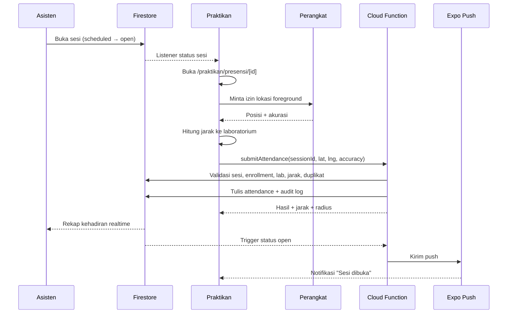
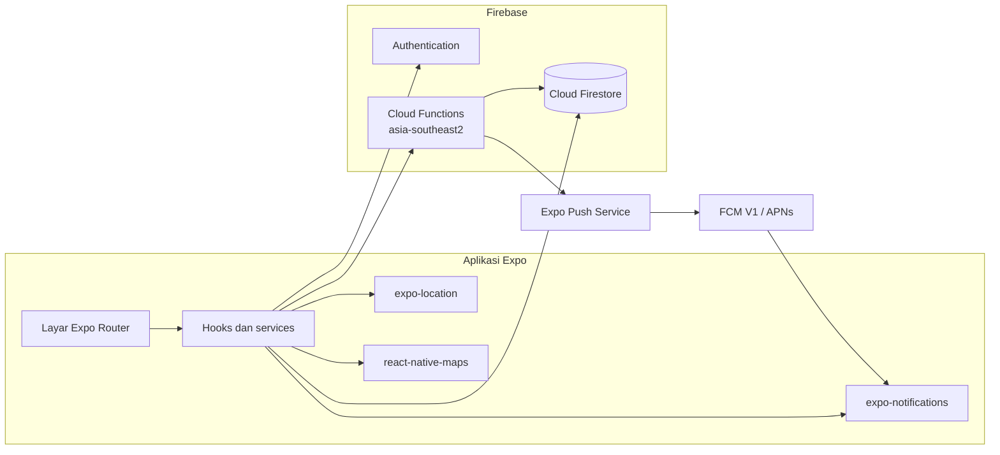
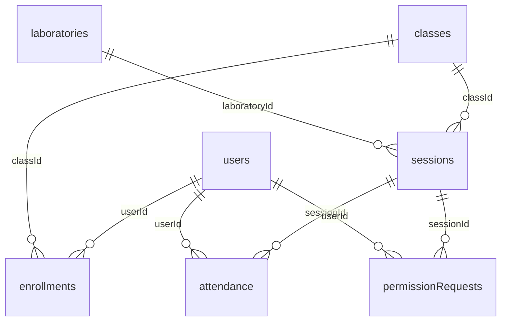
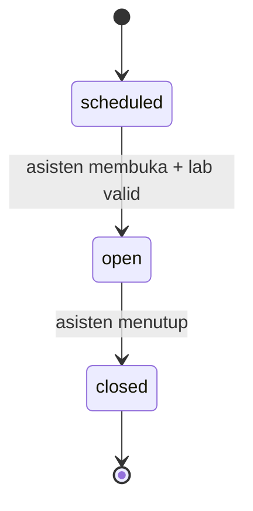
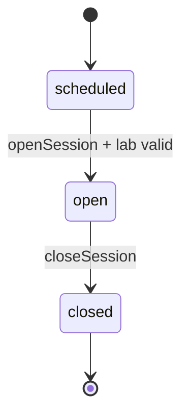
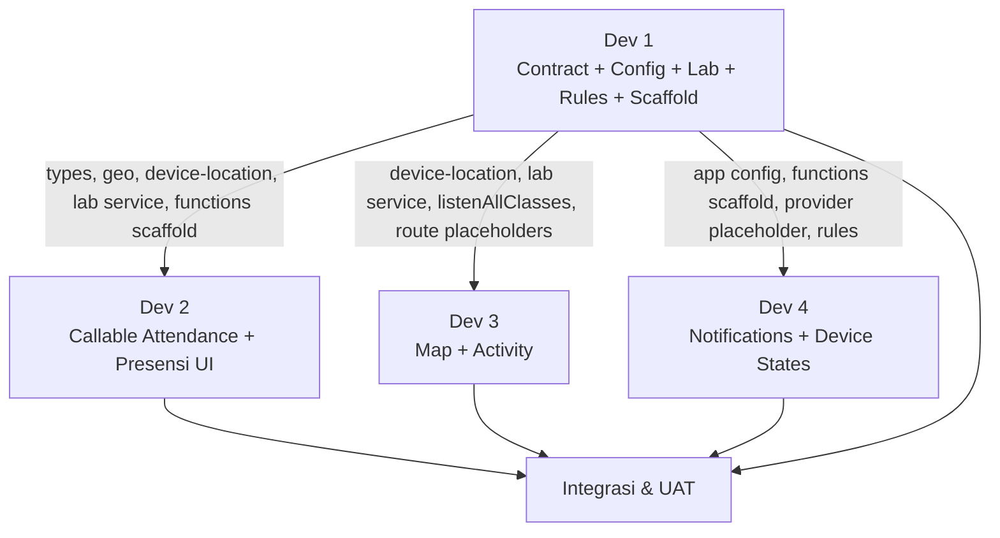

# PRD — Sprint 3: Presensi Berbasis Lokasi, Peta Laboratorium, dan Notifikasi

| Properti | Nilai |
|---|---|
| Produk | Presensi Praktikum (Expo SDK 58 + Firebase) |
| Sprint | 3 |
| Status | Rencana, belum diimplementasikan |
| Pemilik produk | Tim PPK |
| Jumlah developer | 4 |
| Durasi | 2 minggu / 10 hari kerja |
| Isi dokumen | PRD; SRS (Lampiran A); UAT (Lampiran B); pembagian tugas (Lampiran C) |

> Dokumen ini adalah satu-satunya dokumen Sprint 3. Bagian 1–20 adalah PRD; Lampiran A–C memuat SRS, UAT, dan pembagian tugas secara lengkap.

---

## Daftar isi

1. [Ringkasan](#1-ringkasan)
2. [Latar belakang dan masalah](#2-latar-belakang-dan-masalah)
3. [Tujuan dan metrik keberhasilan](#3-tujuan-dan-metrik-keberhasilan)
4. [Pengguna dan peran](#4-pengguna-dan-peran)
5. [Lingkup dan keputusan](#5-lingkup-dan-keputusan)
6. [Alur utama](#6-alur-utama)
7. [Kebutuhan produk](#7-kebutuhan-produk)
8. [Pengalaman pengguna per layar](#8-pengalaman-pengguna-per-layar)
9. [Arsitektur dan integrasi](#9-arsitektur-dan-integrasi)
10. [Model data dan kontrak](#10-model-data-dan-kontrak)
11. [Aturan bisnis](#11-aturan-bisnis)
12. [Kebutuhan non-fungsional ringkas](#12-kebutuhan-non-fungsional-ringkas)
13. [Dependensi dan prasyarat](#13-dependensi-dan-prasyarat)
14. [Risiko dan mitigasi](#14-risiko-dan-mitigasi)
15. [Rencana rilis dan demo](#15-rencana-rilis-dan-demo)
16. [Pembagian tugas ringkas](#16-pembagian-tugas-ringkas)
17. [UAT ringkas](#17-uat-ringkas)
18. [Definition of Done](#18-definition-of-done)
19. [Keputusan terbuka dan asumsi](#19-keputusan-terbuka-dan-asumsi)
20. [Referensi](#20-referensi)

### Lampiran

- [Lampiran A: SRS](#lampiran-a-srs)
- [Lampiran B: UAT](#lampiran-b-uat)
- [Lampiran C: Pembagian Tugas](#lampiran-c-pembagian-tugas)

---

## 1. Ringkasan

Sprint 2 sudah menyelesaikan autentikasi Firebase, pengelolaan kelas dan peserta, jadwal sesi, presensi realtime, rekap, serta pengajuan dan peninjauan izin. Namun presensi masih dapat dilakukan dari mana saja selama sesi dibuka, laboratorium belum memiliki data lokasi yang menjadi acuan, dan pengguna harus membuka aplikasi untuk mengetahui perubahan penting.

Sprint 3 menutup tiga celah itu:

1. **Presensi berbasis lokasi.** Presensi dipindahkan ke halaman khusus, diperiksa terhadap radius laboratorium, dan hanya dicatat bila sesi dibuka, pengguna terdaftar, lokasi valid, serta belum pernah presensi.
2. **Peta laboratorium.** Pengguna melihat sebaran laboratorium Informatika, posisi perangkatnya, serta praktikum yang sedang berlangsung dan berikutnya di setiap laboratorium.
3. **Notifikasi peristiwa.** Sesi dibuka, jadwal berubah, dan keputusan izin dikirim sebagai push notification kepada pengguna yang berkepentingan.

Hasil akhir adalah tiga alur demo yang dapat dijalankan di perangkat Android: presensi berbasis lokasi, peta dan informasi laboratorium, serta notifikasi kegiatan.

---

## 2. Latar belakang dan masalah

### 2.1 Kondisi saat ini

- Presensi di `src/lib/attendance-service.ts` hanya memeriksa status sesi dan duplikasi. Tidak ada pemeriksaan lokasi.
- Halaman detail sesi Praktikan memuat aksi presensi langsung di dalam layar detail, bukan halaman tersendiri.
- Belum ada koleksi `laboratories`, belum ada koordinat laboratorium, dan sesi belum terhubung ke laboratorium.
- Belum ada halaman peta, marker laboratorium, atau marker pengguna.
- Belum ada `expo-location`, `react-native-maps`, maupun `expo-notifications` di `package.json`.
- Belum ada Cloud Functions, sehingga belum ada pengirim notifikasi berbasis peristiwa.
- Pengguna hanya mengetahui perubahan jadwal, pembukaan sesi, atau keputusan izin setelah membuka aplikasi.

### 2.2 Masalah yang harus diselesaikan

| Masalah | Dampak | Kebutuhan Sprint 3 |
|---|---|---|
| Presensi bisa dilakukan dari luar laboratorium | Kehadiran tidak mencerminkan kehadiran fisik | Validasi radius lokasi |
| Tidak ada data lokasi laboratorium | Tidak ada acuan jarak yang konsisten | Koleksi `laboratories` dan pengelolaan oleh asisten |
| Sesi tidak terhubung ke laboratorium | Peta tidak tahu praktikum mana yang berlangsung di lab mana | `laboratoryId` pada sesi |
| Tidak ada peta | Pengguna tidak melihat sebaran lab dan aktivitasnya | Halaman Maps interaktif |
| Tidak ada notifikasi | Perubahan penting terlewat | Push notification berbasis peristiwa |
| Kondisi perangkat tidak tertangani | Pengguna bingung saat izin ditolak atau GPS mati | State dan pesan yang jelas |

---

## 3. Tujuan dan metrik keberhasilan

### 3.1 Tujuan

| Kode | Tujuan |
|---|---|
| G-01 | Presensi hanya tercatat bila pengguna berada dalam radius laboratorium dan sesi sedang dibuka. |
| G-02 | Asisten dapat menentukan lokasi dan radius laboratorium yang dipakai sebagai acuan presensi. |
| G-03 | Pengguna dapat melihat laboratorium, posisinya, dan aktivitas praktikum pada peta. |
| G-04 | Perubahan jadwal dan status sesi tercermin pada peta tanpa memuat ulang aplikasi. |
| G-05 | Pengguna yang berkepentingan menerima push notification atas pembukaan sesi, perubahan jadwal, dan keputusan izin. |
| G-06 | Setiap kondisi izin dan perangkat yang gagal memiliki pesan yang dapat ditindaklanjuti. |

### 3.2 Metrik keberhasilan sprint

| Metrik | Target | Cara ukur |
|---|---|---|
| Alur demo utama | 3 dari 3 lulus | UAT dan demo |
| Presensi ganda | 0 catatan ganda | UAT-ATT-10 |
| Presensi di luar radius | 0 catatan masuk | UAT-ATT-02 |
| Presensi tanpa laboratorium | 0 catatan masuk | UAT-ATT-15 |
| Waktu tampil perubahan jadwal di peta | ≤ 2 detik setelah Firestore berubah | UAT-MAP-07 |
| Notifikasi diterima penerima yang benar | 100% pada UAT | UAT-NOT-02 sampai UAT-NOT-06 |
| Notifikasi ke pengguna yang tidak berkepentingan | 0 | UAT-NOT-03 |
| Kesalahan TypeScript dan lint | 0 error | `npx tsc --noEmit`, `npx expo lint` |
| Waktu pencatatan setelah posisi tersedia | ≤ 5 detik p95 | UAT-ATT-01 |
| Crash saat demo | 0 | Demo |

### 3.3 Non-goals

- Presensi QR Code tidak diimplementasikan pada Sprint 3. Fitur ini opsional pada spesifikasi dan akan menambah izin kamera, generator QR, serta jalur validasi kedua. Keputusan ini dicatat pada bagian 5.
- Background location dan geofencing tidak dipakai. Lokasi hanya dibaca saat halaman presensi atau peta aktif.
- Presensi offline tidak diantrikan. Sesi dan lokasi harus segar, sehingga presensi yang gagal karena koneksi diminta mencoba lagi.
- Peta interaktif di web tidak menjadi target. Web memakai mode daftar laboratorium sebagai fallback.
- iOS push notification bersifat best-effort dan membutuhkan APNs; target UAT utama adalah Android.
- Koreksi presensi manual oleh asisten tidak mendapat UI baru. Aturan Firestore yang ada tetap mengizinkan asisten memperbaiki catatan.

---

## 4. Pengguna dan peran

| Peran | Kebutuhan utama | Hak akses baru |
|---|---|---|
| Praktikan | Melihat sesi, melakukan presensi dari lokasi lab, melihat peta, menerima notifikasi | Baca laboratorium, buat presensi lewat callable, kelola token push sendiri |
| Asisten | Mengelola laboratorium dan radius, menugaskan lab ke sesi, melihat rekap, melihat peta | CRUD laboratorium, menugaskan `laboratoryId`, membaca log notifikasi |
| Admin | Tidak berubah | Mewarisi hak asisten karena `isAdmin` juga `asisten` |

Asisten tidak menerima notifikasi pembukaan sesi karena dialah pelaku aksi. Notifikasi keputusan izin ditujukan kepada praktikan pemilik izin. Notifikasi pembukaan dan perubahan jadwal ditujukan kepada praktikan yang terdaftar di kelas sesi.

---

## 5. Lingkup dan keputusan

### 5.1 Masuk lingkup

Prioritas: **P0** wajib demo, **P1** wajib sebelum rilis, **P2** opsional.

| Kebutuhan spesifikasi | Wujud Sprint 3 | Prioritas |
|---|---|---|
| Halaman presensi terpisah | Rute `/praktikan/presensi/[id]` | P0 |
| Validasi lokasi presensi | Foreground location + Haversine + callable server | P0 |
| Pengelolaan lokasi laboratorium | Koleksi `laboratories`, layar asisten, `laboratoryId` pada sesi | P0 |
| Peta laboratorium interaktif | `react-native-maps`, marker lab, marker pengguna | P0 |
| Informasi aktivitas laboratorium | Praktikum sekarang dan berikutnya, realtime | P0 |
| Push notification | Expo Push Service dari Cloud Functions | P0 |
| Penanganan izin dan kondisi perangkat | State permission, services, GPS, koneksi, notifikasi | P0 |
| Presensi QR | Tidak dipilih | P2 |

### 5.2 Keputusan penting

| Kode | Keputusan | Alasan | Konsekuensi |
|---|---|---|---|
| D-01 | Validasi presensi dilakukan di Cloud Function callable, bukan hanya di UI | Satu jalur tulis, tidak bisa dilewati dengan menonaktifkan tombol | Butuh Firebase Blaze dan deployment Functions |
| D-02 | Klien tidak lagi menulis `attendance` langsung | Mencegah validasi ganda dan status sesi yang basi | Rules `attendance` create menjadi `false` |
| D-03 | Radius disimpan per laboratorium, bukan per sesi | Data lebih sederhana, konsisten untuk semua sesi di lab yang sama | Sesi yang pindah ruang harus diubah ke lab lain |
| D-04 | Sesi wajib memiliki `laboratoryId` sebelum dibuka | Presensi tidak mungkin divalidasi tanpa acuan lokasi | Sesi lama tanpa lab harus dilengkapi asisten |
| D-05 | Notifikasi dikirim oleh Firestore trigger di Cloud Functions | Tidak bergantung pada aplikasi asisten tetap terbuka | Butuh Functions dan kredensial push |
| D-06 | Expo Push Service dipakai, dengan FCM V1 di Android | Cross-platform, tidak menyimpan service account di aplikasi | Butuh EAS credentials dan `google-services.json` |
| D-07 | Lokasi hanya foreground | Menghindari izin background dan privasi berlebihan | Tidak ada pelacakan saat aplikasi ditutup |
| D-08 | Peta native; web memakai daftar | `react-native-maps` tidak mendukung web | Web bukan target demo peta |
| D-09 | Satu token push per pengguna | Cukup untuk demo, kode lebih sederhana | Perangkat terakhir yang login menggantikan token sebelumnya |
| D-10 | QR tidak diimplementasikan | Fokus pada validasi lokasi dan notifikasi | Tidak ada izin kamera baru |

---

## 6. Alur utama

### 6.1 Alur A — Presensi berbasis lokasi



Langkah demo:

1. Asisten membuat laboratorium dengan koordinat dan radius.
2. Asisten membuat kelas, menambah praktikan, lalu membuat sesi dan memilih laboratorium.
3. Asisten membuka sesi.
4. Praktikan membuka halaman presensi, memberikan izin lokasi, dan melihat status jarak.
5. Praktikan menekan **Presensi sekarang** dan mengonfirmasi.
6. Sistem mencatat kehadiran dengan waktu, koordinat, akurasi, jarak, dan radius.
7. Asisten melihat baris kehadiran baru tanpa memuat ulang.

### 6.2 Alur B — Peta dan informasi laboratorium

1. Pengguna membuka tab **Peta** (Praktikan) atau menu **Peta** (Asisten).
2. Aplikasi meminta izin lokasi foreground bila belum ada.
3. Peta menampilkan marker semua laboratorium aktif.
4. Marker pengguna muncul dan diperbarui selama halaman aktif.
5. Pengguna memilih marker laboratorium.
6. Panel bawah menampilkan nama lab, gedung/ruang, radius, praktikum sekarang, dan praktikum berikutnya.
7. Ketika asisten mengubah jadwal atau membuka/menutup sesi, panel berubah melalui listener Firestore.

### 6.3 Alur C — Notifikasi kegiatan

1. Praktikan mengaktifkan notifikasi dari halaman Profil.
2. Token Expo disimpan pada profil pengguna.
3. Asisten membuka sesi, mengubah jadwal, atau memutuskan izin.
4. Firestore trigger memilih penerima yang tepat.
5. Cloud Function mengirim push melalui Expo Push Service.
6. Perangkat penerima menampilkan notifikasi.
7. Ketukan notifikasi membuka layar terkait.

---

## 7. Kebutuhan produk

### 7.1 Halaman presensi terpisah

Halaman `/praktikan/presensi/[id]` adalah satu-satunya tempat Praktikan menekan tombol presensi. Halaman detail sesi tetap ada, tetapi aksinya berubah menjadi tautan menuju halaman presensi.

Isi halaman:

- Header dengan tombol kembali dan judul **Presensi**.
- Kartu sesi: nama praktikum, kelas, tanggal, waktu WIB, ruang, laboratorium, asisten, dan status sesi.
- Kartu pemeriksaan lokasi: status izin, status layanan lokasi, jarak ke lab, radius, akurasi, dan tombol **Periksa lokasi lagi**.
- Kartu status presensi: belum presensi, sudah presensi beserta waktu, atau sesi ditutup.
- Footer aksi: **Presensi sekarang** hanya aktif bila seluruh syarat terpenuhi.
- Bottom sheet konfirmasi berisi ringkasan sesi dan lokasi.
- State sukses menampilkan waktu tercatat, jarak, dan status baru.
- Notice inline untuk setiap kegagalan, bukan hanya toast.

Aturan tampilan tombol:

| Kondisi | Tombol | Alasan yang tampil |
|---|---|---|
| Sesi `scheduled` | Nonaktif | Sesi belum dibuka |
| Sesi `closed` | Nonaktif | Sesi sudah ditutup |
| Sudah presensi | Nonaktif | Sudah presensi pukul HH.mm WIB |
| Bukan peserta kelas | Nonaktif | Kamu tidak terdaftar di sesi ini |
| Lab belum diatur | Nonaktif | Laboratorium sesi belum diatur |
| Izin lokasi ditolak | Nonaktif | Izin lokasi diperlukan untuk presensi |
| Layanan lokasi mati | Nonaktif | Aktifkan layanan lokasi |
| Lokasi belum tersedia | Nonaktif | Lokasi belum tersedia, coba lagi |
| Akurasi rendah | Nonaktif | Akurasi lokasi terlalu rendah |
| Di luar radius | Nonaktif | Kamu berada X m dari lab, radius Y m |
| Semua syarat terpenuhi | Aktif | Presensi sekarang |

### 7.2 Validasi lokasi presensi

Validasi dilakukan dua lapis:

1. **Lapis tampilan** menghitung jarak agar pengguna melihat alasan sebelum menekan tombol.
2. **Lapis pencatatan** di Cloud Function menghitung ulang jarak dan menolak penulisan bila tidak valid. Klien tidak menulis `attendance` langsung.

Aturan validasi:

- Sesi harus berstatus `open`.
- Pengguna harus berperan `praktikan` dan terdaftar di kelas sesi melalui `enrollments/{classId}_{uid}`.
- Sesi harus memiliki `laboratoryId` yang merujuk laboratorium aktif.
- Koordinat laboratorium harus valid.
- Jarak dihitung dengan formula Haversine.
- Presensi valid bila `distanceMeters <= radiusMeters`.
- Akurasi lokasi harus `<= 100 m`. Bila lebih buruk, pengguna diminta mencoba lagi.
- Lokasi bertanda `mocked` ditolak sebagai upaya terbaik. Catatan: deteksi mock tidak sempurna.
- Satu pengguna hanya boleh memiliki satu dokumen `attendance/{sessionId}_{uid}`.
- Bila penulisan gagal, UI tidak boleh menampilkan status berhasil secara optimistis.

Rumus Haversine yang dipakai klien dan server harus identik:

```text
a = sin²(Δφ/2) + cos φ1 · cos φ2 · sin²(Δλ/2)
c = 2 · atan2(√a, √(1−a))
d = R · c, R = 6.371.000 m
```

Contoh perhitungan pada UAT: dua titik berjarak sekitar 111.195 m untuk selisih 1° lintang.

### 7.3 Pengelolaan lokasi laboratorium

Asisten dapat membuka menu **Lab** dan mengelola data laboratorium.

Field laboratorium:

| Field | Tipe | Aturan |
|---|---|---|
| `name` | string | Wajib, unik secara praktis, maksimum 80 karakter |
| `code` | string | Wajib, mis. `LAB-IF-01`, maksimum 20 karakter |
| `building` | string | Wajib, mis. `Gedung A` |
| `floor` | string | Opsional, mis. `Lantai 2` |
| `room` | string | Wajib, mis. `A201` |
| `latitude` | number | −90 sampai 90 |
| `longitude` | number | −180 sampai 180 |
| `radiusMeters` | number | 10 sampai 500, default 100 |
| `description` | string | Opsional, maksimum 200 karakter |
| `isActive` | boolean | Default `true` |
| `createdAt` | Timestamp | Server |
| `updatedAt` | Timestamp | Server |
| `updatedBy` | string | UID asisten |

Perilaku:

- Daftar lab menampilkan nama, gedung/ruang, radius, koordinat, dan status aktif.
- Form tambah/ubah memvalidasi semua field.
- Tombol **Gunakan lokasi saya** mengisi latitude/longitude dari posisi perangkat saat ini.
- Laboratorium tidak dihapus permanen. Asisten menonaktifkannya agar sesi lama tetap memiliki referensi.
- Setiap tambah/ubah dinonaktifkan dicatat ke `auditLogs`.
- Perubahan lab langsung terlihat di peta dan validasi presensi melalui listener.
- Sesi baru wajib memilih laboratorium. Sesi lama tanpa lab dapat diubah untuk menambahkan lab, tetapi tidak dapat dibuka sebelum lab diisi.
- Jika laboratorium dinonaktifkan, sesi yang memakainya tidak dapat menerima presensi sampai lab diaktifkan kembali atau sesi dipindahkan.

### 7.4 Peta laboratorium interaktif

Halaman peta tersedia untuk kedua peran:

- Praktikan: tab **Peta** di `/(praktikan)/peta`.
- Asisten: menu **Peta** di `/asisten/peta`.

Komponen:

- `MapView` native dengan marker laboratorium aktif.
- Marker pengguna berupa titik biru dengan lingkaran akurasi.
- Marker lab menampilkan nama dan status praktikum saat ini.
- Ketukan marker membuka panel bawah berisi detail lab dan aktivitas.
- Tombol **Pusatkan lokasi** untuk kembali ke posisi pengguna.
- Tombol **Daftar** untuk beralih ke mode daftar yang aksesibel.
- Peta awal diarahkan ke laboratorium pertama; bila tidak ada, ke pusat kampus.

State:

| Kondisi | Tampilan |
|---|---|
| Memuat data | Skeleton atau indikator |
| Tidak ada lab aktif | Empty state dan penjelasan |
| Izin lokasi ditolak | Banner, peta tetap menampilkan lab |
| Layanan lokasi mati | Banner dan tombol pengaturan |
| Lokasi belum tersedia | Banner, marker pengguna tidak tampil |
| Gagal memuat Firestore | Banner error dan tombol coba lagi |
| Web | Mode daftar, tanpa peta interaktif |

### 7.5 Informasi aktivitas laboratorium

Setiap lab menampilkan:

- **Sekarang**: sesi yang waktunya mencakup waktu sekarang, diprioritaskan yang berstatus `open`; bila tidak ada sesi dalam rentang waktu, sesi `open` tetap dianggap sedang berlangsung.
- **Berikutnya**: sesi terdekat setelah waktu sekarang dengan status bukan `closed`.

Informasi yang ditampilkan:

| Field | Sumber |
|---|---|
| Nama praktikum | `sessions.title` |
| Kelas | `classes.name` melalui `sessions.classId` |
| Waktu | `sessions.date`, `startTime`, `endTime` dalam WIB |
| Status | `sessions.status` dengan label teks |
| Ruang | `sessions.room` |

Aturan:

- Data dibaca realtime dari Firestore.
- Perubahan tanggal, jam, ruang, judul, status, atau laboratorium harus memperbarui panel tanpa memuat ulang.
- Bila tidak ada sesi sekarang/berikutnya, tampilkan **Belum ada praktikum terjadwal**.
- Semua perbandingan waktu memakai zona `Asia/Jakarta`.
- Data sesi dan kelas difilter di klien karena jumlahnya kecil; tidak perlu indeks komposit baru.

### 7.6 Push notification

#### Peristiwa dan penerima

| Peristiwa | Pemicu | Penerima | Isi |
|---|---|---|---|
| Sesi dibuka | `sessions.status` berubah menjadi `open` | Semua praktikan yang terdaftar di `classId` sesi | Judul sesi, kelas, waktu, ruang, ajakan presensi |
| Jadwal berubah | `date`, `startTime`, `endTime`, `room`, `title`, `laboratoryId`, atau `classId` berubah dan bukan perubahan ke `open` | Praktikan terdaftar di kelas sesi | Perubahan jadwal yang relevan |
| Izin disetujui | `permissionRequests.status` berubah `pending → approved` | `permissionRequests.userId` | Nama sesi dan waktu |
| Izin ditolak | `permissionRequests.status` berubah `pending → rejected` | `permissionRequests.userId` | Nama sesi, waktu, catatan asisten bila ada |

#### Kontrak payload

```json
{
  "title": "Sesi praktikum dibuka",
  "body": "Basis Data — IF-3A · 08.00–09.40 · Lab A201. Presensi sudah dibuka.",
  "data": {
    "type": "session-open",
    "sessionId": "abc123",
    "url": "/praktikan/presensi/abc123"
  }
}
```

`type` yang dipakai: `session-open`, `session-schedule-changed`, `permission-approved`, `permission-rejected`.

Untuk Android, pesan menyertakan `channelId: "praktikum"` agar memakai channel yang dibuat aplikasi.

`url` harus berupa rute Expo Router yang valid:

- Sesi dibuka: `/praktikan/presensi/{sessionId}`
- Jadwal berubah: `/praktikan/sesi/{sessionId}`
- Izin diputuskan: `/(praktikan)/izin`

#### Aturan pengiriman

- Notifikasi hanya dikirim kepada penerima yang terdaftar.
- Pengguna tanpa token dilewati dan dicatat.
- Token yang ditolak Expo dengan `DeviceNotRegistered` dibersihkan dari profil.
- Setiap peristiwa memiliki kunci deduplikasi. Trigger Firestore yang di-retry tidak boleh mengirim notifikasi ganda.
- Pengiriman dilakukan dalam batch maksimum 100 token per permintaan.
- Kegagalan dicatat di `notificationLogs` dengan status `failed` atau `partial`.
- Notifikasi foreground ditampilkan sebagai banner.
- Ketukan notifikasi membuka rute pada `data.url`.
- Bila perangkat tidak mendukung push (web, simulator tanpa layanan), aplikasi menampilkan status **Tidak didukung** di Profil, bukan error mentah.
- Bila dokumen sesi atau kelas sudah tidak ada, gunakan teks generik dan tetap kirim kepada penerima yang tercatat.

#### Token

- Token Expo disimpan di `users/{uid}`: `expoPushToken`, `pushPlatform`, `pushUpdatedAt`.
- Token didaftarkan saat pengguna sudah login dan memberi izin.
- Token diperbarui bila `addPushTokenListener` melaporkan perubahan.
- Token dihapus saat logout berikutnya atau saat perangkat mencabut izin.
- Satu pengguna memakai satu token aktif. Perangkat terakhir yang login menggantikan token sebelumnya.

### 7.7 Izin dan kondisi perangkat

| Kondisi | Pesan dan tindakan |
|---|---|
| Izin lokasi belum diminta | Kartu penjelasan + tombol **Izinkan lokasi** |
| Izin lokasi ditolak, masih bisa diminta | Tombol **Coba izinkan lagi** |
| Izin lokasi ditolak permanen | Tombol **Buka pengaturan** |
| Layanan lokasi mati | Tombol **Buka pengaturan lokasi** dan **Periksa lagi** |
| Lokasi belum tersedia / timeout | **Lokasi belum tersedia. Coba lagi di area terbuka.** |
| Akurasi > 100 m | **Akurasi lokasi rendah. Tunggu sebentar lalu coba lagi.** |
| Di luar radius | **Kamu berada X m dari lab. Radius Y m.** |
| Koneksi bermasalah saat presensi | **Koneksi bermasalah. Presensi tidak tercatat. Coba lagi.** |
| Sesi berubah menjadi tertutup saat halaman terbuka | Tombol nonaktif dan notice realtime |
| Izin notifikasi ditolak | Kartu status di Profil + **Buka pengaturan** |
| Push tidak didukung | **Notifikasi tidak tersedia di perangkat ini.** |
| Token gagal didaftarkan | **Notifikasi belum aktif. Perubahan tetap terlihat saat aplikasi dibuka.** |
| Peta gagal dimuat | Banner + mode daftar lab |

---

## 8. Pengalaman pengguna per layar

### 8.1 Rute baru dan perubahan

| Rute | Status | Isi | Pemilik |
|---|---|---|---|
| `/praktikan/presensi/[id]` | Baru | Halaman presensi berbasis lokasi | Dev 2 |
| `/praktikan/sesi/[id]` | Ubah | Detail sesi, tautan ke halaman presensi | Dev 2 |
| `/(praktikan)/peta` | Baru | Tab peta Praktikan | Dev 3 |
| `/asisten/peta` | Baru | Peta Asisten dari menu | Dev 3 |
| `/asisten/lab` | Baru | Daftar laboratorium | Dev 1 |
| `/asisten/lab/baru` | Baru | Form tambah laboratorium | Dev 1 |
| `/asisten/lab/[id]` | Baru | Form ubah laboratorium | Dev 1 |
| `/asisten/atur-sesi` | Ubah | Pilih laboratorium pada form sesi | Dev 1 |
| `/(praktikan)/profil`, `/asisten/profil` | Ubah | Kartu status notifikasi | Dev 4 |

### 8.2 Halaman presensi

Urutan bagian:

1. Header dan status sesi.
2. Kartu identitas sesi.
3. Kartu pemeriksaan lokasi.
4. Kartu status presensi.
5. Footer aksi.

Copy penting:

- Judul: **Presensi**
- Tombol utama: **Presensi sekarang**
- Tombol periksa: **Periksa lokasi lagi**
- Konfirmasi: **Ya, presensi sekarang**
- Sukses: **Presensi berhasil**
- Sukses detail: **Tercatat pukul 08.07 WIB · 23 m dari Lab A201**
- Di luar radius: **Kamu berada 140 m dari Lab A201. Radius yang diizinkan 100 m.**
- Izin ditolak: **Izin lokasi diperlukan untuk memastikan kamu berada di laboratorium.**
- Sesi tutup: **Sesi sudah ditutup. Presensi tidak dapat dilakukan.**

### 8.3 Detail sesi Praktikan

- Menampilkan informasi sesi seperti sekarang.
- Tombol presensi langsung dihapus.
- Bila sesi `open` dan pengguna belum presensi, tampilkan tombol **Buka halaman presensi**.
- Bila sudah presensi, tampilkan waktu dan status hadir.
- Bila sesi `scheduled` atau `closed`, tombol nonaktif dengan alasan.
- Tidak ada penulisan presensi dari layar ini.

### 8.4 Pengelolaan laboratorium

Daftar:

- Search bar nama/kode.
- Kartu lab: nama, kode, gedung/ruang, radius, status aktif.
- Tombol **Tambah laboratorium**.
- Empty state bila belum ada.

Form:

- Nama, kode, gedung, lantai, ruang.
- Latitude, longitude, tombol **Gunakan lokasi saya**.
- Radius dengan slider/input numerik 10–500 m.
- Deskripsi.
- Toggle aktif.
- Tombol **Simpan** dan **Batal**.
- Validasi inline dan pesan error yang jelas.

### 8.5 Peta

- Peta memenuhi area konten, dengan panel bawah yang dapat digeser.
- Marker lab memakai ikon lab; marker pengguna memakai titik biru.
- Panel lab: nama, gedung/ruang, radius, **Sekarang**, **Berikutnya**.
- Status sesi berupa teks, bukan hanya warna.
- Tombol **Daftar** membuka mode daftar.
- Banner izin/lokasi di atas peta, tidak menutupi marker.

### 8.6 Profil dan notifikasi

Tambahkan bagian **NOTIFIKASI** di atas **TAMPILAN**:

- Status: **Aktif**, **Belum diizinkan**, **Ditolak**, **Tidak didukung**, atau **Gagal**.
- Tombol **Aktifkan notifikasi** bila belum.
- Tombol **Buka pengaturan** bila ditolak permanen.
- Keterangan singkat tentang jenis notifikasi yang diterima.
- Tidak meminta izin saat aplikasi pertama kali dibuka; izin diminta saat pengguna menekan tombol atau setelah login dengan penjelasan.

### 8.7 Form sesi asisten

- Tambah field **Laboratorium** berupa picker lab aktif.
- Wajib dipilih untuk sesi baru.
- Sesi lama tanpa lab menampilkan peringatan **Laboratorium belum diatur**.
- Tombol **Buka sesi** ditolak dengan pesan **Lengkapi laboratorium sesi terlebih dahulu** bila lab kosong.
- Daftar sesi menampilkan nama lab.

---

## 9. Arsitektur dan integrasi

### 9.1 Gambaran arsitektur



### 9.2 Lapisan aplikasi

| Lapisan | Tanggung jawab | Contoh |
|---|---|---|
| Layar | Tampilan, navigasi, state UI | `presensi-screen.tsx`, `peta-screen.tsx` |
| Hook | Menggabungkan listener, izin, dan state | `usePresensi`, `useMapData`, `useNotifications` |
| Service | Akses Firebase, validasi, pemetaan error | `laboratory-service.ts`, `attendance-service.ts` |
| Fungsi murni | Perhitungan dan seleksi | `geo.ts`, `laboratory-activity.ts` |
| Cloud Functions | Validasi server dan trigger notifikasi | `attendance.ts`, `notifications.ts` |

Aturan: layar tidak mengimpor `firebase/firestore` langsung. Semua akses data lewat service atau hook yang sudah ada.

### 9.3 Mengapa callable untuk presensi

- Menghilangkan dua jalur validasi yang berbeda.
- Menjamin status sesi, enrollment, laboratorium, jarak, dan duplikasi diperiksa di satu tempat.
- Menulis `attendance` dan `auditLogs` dalam satu transaksi.
- Memungkinkan rules menolak semua create langsung dari klien.
- Memudahkan UAT: percobaan tulis langsung harus gagal.

Konsekuensi: Cloud Functions memerlukan paket Blaze. Bila proyek tidak dapat memakai Blaze, lihat risiko R-01. Jangan mengganti callable dengan penulisan langsung tanpa mencatat penurunan jaminan keamanan.

### 9.4 Realtime

| Data | Listener | Konsumen |
|---|---|---|
| Sesi satu | `listenSession(sessionId)` | Halaman presensi, detail |
| Semua sesi | `listenAllSessions()` | Peta |
| Laboratorium | `listenLaboratories()` | Peta, form sesi, validasi tampilan |
| Presensi sesi | `listenSessionAttendance(sessionId)` | Rekap asisten |
| Presensi saya | `listenMyAttendance(sessionId, uid)` | Halaman presensi |
| Kelas | `listenAllClasses()` | Peta, label kelas |

Listener harus dibersihkan saat layar blur/unmount.

### 9.5 Platform

| Platform | Presensi | Peta | Push |
|---|---|---|---|
| Android | Ya, target utama | Ya, Google Maps | Ya, FCM V1 |
| iOS | Ya, best-effort | Ya, Apple Maps default | Ya bila APNs dikonfigurasi |
| Web | Ya bila browser mengizinkan geolocation | Mode daftar | Tidak didukung |

### 9.6 Dependensi baru

| Paket | Fungsi | Cara pasang |
|---|---|---|
| `expo-location` | Izin dan posisi perangkat | `npx expo install expo-location` |
| `react-native-maps` | Peta native | `npx expo install react-native-maps` |
| `expo-notifications` | Izin, token, foreground, deep link | `npx expo install expo-notifications` |
| `firebase-functions` | Definisi Cloud Functions | `npm --prefix functions install` |
| `firebase-admin` | Admin SDK di Functions | `npm --prefix functions install` |

`expo-constants` dan `expo-device` sudah ada.

---

## 10. Model data dan kontrak

Hubungan utama antarkoleksi:



### 10.1 Koleksi baru

#### `laboratories/{labId}`

```ts
interface Laboratory {
  id: string;
  name: string;
  code: string;
  building: string;
  floor: string;
  room: string;
  latitude: number;
  longitude: number;
  radiusMeters: number;
  description: string;
  isActive: boolean;
  createdAt: Timestamp;
  updatedAt: Timestamp;
  updatedBy: string;
}
```

#### `notificationLogs/{dedupeKey}`

```ts
interface NotificationLog {
  eventType: 'session-open' | 'session-schedule-changed' | 'permission-approved' | 'permission-rejected';
  sourceCollection: 'sessions' | 'permissionRequests';
  sourceId: string;
  recipientIds: string[];
  successCount: number;
  failureCount: number;
  invalidTokens: string[];
  status: 'processing' | 'sent' | 'partial' | 'failed' | 'skipped';
  error: string | null;
  createdAt: Timestamp;
  completedAt: Timestamp | null;
}
```

### 10.2 Perubahan koleksi lama

| Koleksi | Field baru | Aturan |
|---|---|---|
| `sessions` | `laboratoryId: string` | Wajib sebelum sesi dibuka |
| `attendance` | `latitude`, `longitude`, `accuracyMeters`, `distanceMeters`, `radiusMeters`, `laboratoryId`, `locationVerifiedAt`, `mocked`, `source` | Ditulis oleh callable |
| `users` | `expoPushToken`, `pushPlatform`, `pushUpdatedAt` | Ditulis pemilik profil |
| `auditLogs` | Tidak berubah | Mencatat aksi lab dan presensi |

Dokumen `attendance` lama tanpa field lokasi tetap terbaca. UI menampilkan **Presensi lama** tanpa bukti lokasi.

### 10.3 Kontrak callable

```ts
type SubmitAttendanceRequest = {
  sessionId: string;
  latitude: number;
  longitude: number;
  accuracyMeters: number;
  mocked?: boolean;
};

type SubmitAttendanceResponse = {
  attendanceId: string;
  recordedAt: string; // ISO 8601
  distanceMeters: number;
  radiusMeters: number;
  laboratoryId: string;
  laboratoryName: string;
};
```

Kode error `failed-precondition`:

`SESSION_NOT_FOUND`, `SESSION_NOT_OPEN`, `NOT_ENROLLED`, `LAB_NOT_SET`, `LAB_INACTIVE`, `OUT_OF_RADIUS`, `LOCATION_INACCURATE`, `MOCK_LOCATION`, `ALREADY_PRESENT`.

Kode lain: `unauthenticated`, `permission-denied`, `not-found`, `unavailable`, `internal`.

### 10.4 Kontrak tipe klien

```ts
type AttendanceFailureCode =
  | 'SESSION_NOT_FOUND'
  | 'SESSION_NOT_OPEN'
  | 'NOT_ENROLLED'
  | 'LAB_NOT_SET'
  | 'LAB_INACTIVE'
  | 'OUT_OF_RADIUS'
  | 'LOCATION_INACCURATE'
  | 'MOCK_LOCATION'
  | 'ALREADY_PRESENT'
  | 'NETWORK'
  | 'UNKNOWN';

type AttendanceSubmitResult =
  | { ok: true; recordedAt: string; distanceMeters: number; radiusMeters: number }
  | { ok: false; code: AttendanceFailureCode; message: string; distanceMeters?: number; radiusMeters?: number };
```

### 10.5 Invarian data

- `attendance` ID selalu `{sessionId}_{uid}`.
- `attendance.sessionId` dan `attendance.userId` harus cocok dengan ID dokumen.
- `sessions.laboratoryId` harus merujuk dokumen `laboratories` yang ada.
- `sessions.classId` harus merujuk dokumen `classes` yang ada.
- Satu dokumen `enrollments/{classId}_{uid}` per praktikan per kelas.
- `notificationLogs` ID adalah kunci deduplikasi dan tidak boleh dipakai ulang.
- Semua tanggal sesi disimpan `YYYY-MM-DD`; waktu `HH:mm`; tampilan WIB.
- `radiusMeters` 10–500; koordinat valid.

---

## 11. Aturan bisnis

| Kode | Aturan | Ditegakkan di |
|---|---|---|
| BR-01 | Presensi hanya bila sesi `open` | Callable + rules |
| BR-02 | Hanya praktikan terdaftar yang boleh presensi | Callable |
| BR-03 | Satu presensi per sesi per praktikan | Callable + ID dokumen |
| BR-04 | Sesi harus punya laboratorium aktif | Callable + `openSession` |
| BR-05 | Jarak ≤ radius laboratorium | Callable |
| BR-06 | Akurasi ≤ 100 m | Callable |
| BR-07 | Lokasi `mocked` ditolak | Callable |
| BR-08 | Radius 10–500 m | Form + rules |
| BR-09 | Lab tidak dihapus permanen bila dipakai sesi | Service |
| BR-10 | Sesi tanpa lab tidak dapat dibuka | `openSession` + rules |
| BR-11 | Klien tidak menulis `attendance` langsung | Rules |
| BR-12 | Tidak ada status sukses optimistis | UI |
| BR-13 | Peta menampilkan sesi sekarang/berikutnya sesuai algoritma | Selector |
| BR-14 | Notifikasi hanya ke penerima dan unik per peristiwa | Functions + log |
| BR-15 | Semua waktu WIB | Formatter |
| BR-16 | Presensi offline tidak diantrikan | Service |
| BR-17 | QR tidak dipakai | Lingkup |

### 11.1 State sesi



Tidak ada transisi lain. `openSession` menolak `scheduled` tanpa lab.

### 11.2 Keputusan presensi

| Sesi | Terdaftar | Sudah presensi | Izin | Layanan | Akurasi | Jarak | Hasil |
|---|---|---|---|---|---|---|---|
| `scheduled` | ya | tidak | ya | ya | baik | dalam | Ditolak: sesi belum dibuka |
| `open` | tidak | tidak | ya | ya | baik | dalam | Ditolak: bukan peserta |
| `open` | ya | ya | ya | ya | baik | dalam | Ditolak: duplikat |
| `open` | ya | tidak | tidak | ya | baik | dalam | Ditolak: izin lokasi |
| `open` | ya | tidak | ya | tidak | — | — | Ditolak: layanan lokasi |
| `open` | ya | tidak | ya | ya | buruk | dalam | Ditolak: akurasi |
| `open` | ya | tidak | ya | ya | baik | luar | Ditolak: luar radius |
| `open` | ya | tidak | ya | ya | baik | dalam | Diterima |
| `closed` | ya | tidak | ya | ya | baik | dalam | Ditolak: sesi ditutup |

### 11.3 Algoritma aktivitas lab

```text
today = tanggal WIB sekarang
now   = jam WIB sekarang

current =
  sesi lab dengan status open, pilih yang paling dekat waktunya
  jika tidak ada:
    sesi lab dengan date == today dan startTime <= now < endTime,
    prioritaskan open, lalu scheduled, pilih startTime terbaru

next =
  sesi lab dengan status != closed dan
  (date > today atau (date == today dan startTime > now)),
  kecuali current, pilih tanggal/jam paling awal
```

Bila `current` dan `next` kosong, tampilkan empty state. Bila `current` ada dan `next` ada, tampilkan keduanya.

---

## 12. Kebutuhan non-fungsional ringkas

| Kode | Kebutuhan | Target |
|---|---|---|
| NFR-PERF-01 | Peta tampil setelah data dimuat | ≤ 3 detik pada Android mid-range |
| NFR-PERF-02 | Perubahan Firestore terlihat | ≤ 2 detik |
| NFR-PERF-03 | Presensi tanpa GPS | ≤ 5 detik p95 |
| NFR-PERF-04 | GPS fix timeout | 15 detik, lalu state error |
| NFR-SEC-01 | Semua akses butuh autentikasi | Rules |
| NFR-SEC-02 | Hanya asisten yang menulis lab/sesi | Rules |
| NFR-SEC-03 | Presensi hanya lewat callable | Rules `create: false` |
| NFR-SEC-04 | Callable memeriksa auth, role, enrollment, sesi, lab, jarak, duplikat | Functions |
| NFR-PRIV-01 | Lokasi foreground saja | Tidak ada izin background |
| NFR-PRIV-02 | Koordinat hanya disimpan saat presensi | Attendance |
| NFR-PRIV-03 | Tidak ada pelacakan berkelanjutan | watch hanya saat peta aktif |
| NFR-REL-01 | Trigger notifikasi idempoten | Dedupe log |
| NFR-REL-02 | Kegagalan kirim dicatat | notificationLogs |
| NFR-REL-03 | Token tidak valid dibersihkan | Functions |
| NFR-A11Y-01 | Status selalu teks | Semua badge |
| NFR-A11Y-02 | Target sentuh ≥ 44 px | Semua tombol |
| NFR-A11Y-03 | Peta punya mode daftar | Peta |
| NFR-COMP-01 | Android 8+ (API 26+) | Expo SDK 58 |
| NFR-COMP-02 | iOS best-effort | Expo |
| NFR-COMP-03 | Web fallback peta dan notifikasi | Mode daftar/status |
| NFR-MAINT-01 | Layar tidak akses Firestore langsung | Code review |
| NFR-MAINT-02 | Tipe kontrak di `src/types` | TypeScript |
| NFR-OBS-01 | Audit log untuk lab dan presensi | `auditLogs` |
| NFR-OBS-02 | Log notifikasi | `notificationLogs` |
| NFR-COST-01 | Functions hanya untuk operasi perlu | Budget alert |

Detail ID dan kriteria ada di [SRS](#lampiran-a-srs).

---

## 13. Dependensi dan prasyarat

### 13.1 Prasyarat teknis

| Prasyarat | Dipakai untuk | Pemilik |
|---|---|---|
| Firebase project dengan paket **Blaze** | Cloud Functions callable + trigger | Dev 1 |
| Cloud Functions region `asia-southeast2` | Callable dan trigger | Dev 1 |
| `google-services.json` di root | FCM Android | Dev 1 |
| EAS FCM V1 service account | Push Android | Dev 4 |
| APNs key (opsional) | Push iOS | Dev 4 |
| Google Maps API key, Maps SDK Android aktif | Peta Android | Dev 1 |
| API key dibatasi package `com.ppk.presensipraktikum` + SHA-1 | Keamanan peta | Dev 1 |
| Expo project ID `973698af-d649-4bb7-a583-4fbf399f00a2` | Token push | Dev 4 |
| Development build EAS | Maps + notifications | Semua |
| Perangkat/emulator Android dengan Google Play Services | Peta + push | QA |
| Koordinat laboratorium Informatika | Seed data | Asisten/tim |

### 13.2 Konfigurasi yang berubah

- `app.json`: plugin `expo-location`, `expo-notifications`, `react-native-maps`; `android.googleServicesFile`.
- `.env.example`: tidak perlu variabel baru untuk Maps bila API key dimasukkan ke `app.json`. Bila tim memilih `app.config.ts`, tambahkan `GOOGLE_MAPS_API_KEY` dan jangan commit nilai rahasia.
- `firebase.json`: tambah konfigurasi `functions`.
- `firestore.rules`: aturan laboratorium, attendance, notificationLogs, dan validasi sesi.
- `package.json` dan `package-lock.json`: hanya Dev 1 yang mengubah.

| Plugin | Konfigurasi wajib |
|---|---|
| `expo-location` | `locationWhenInUsePermission`: "Izinkan Presensi Praktikum mengakses lokasi untuk memvalidasi presensi." Tidak ada background permission. |
| `expo-notifications` | `icon`, `color`, `defaultChannel`: `praktikum`; remote notifications aktif. |
| `react-native-maps` | `androidGoogleMapsApiKey`; iOS memakai Apple Maps default. |
| `android` | `googleServicesFile: "./google-services.json"`. |

### 13.3 Perintah deployment

```bash
npx expo install expo-location react-native-maps expo-notifications
npm --prefix functions install
npm --prefix functions run build
npx firebase-tools deploy --only functions --project <PROJECT_ID>
npx firebase-tools deploy --only firestore:rules --project <PROJECT_ID>
npx expo run:android
npx expo start --dev-client
```

Urutan deploy yang aman: deploy callable `submitAttendance` lebih dulu, lalu rules yang menolak create `attendance` langsung, lalu build klien. Membalik urutan membuat presensi gagal selama jendela deploy.

---

## 14. Risiko dan mitigasi

| Kode | Risiko | Dampak | Mitigasi | Pemilik |
|---|---|---|---|---|
| R-01 | Proyek tidak dapat memakai Blaze | Callable dan trigger tidak dapat deploy | Konfirmasi hari 0; bila tidak memungkinkan, gunakan fallback yang didokumentasikan dan turunkan klaim keamanan | Dev 1 |
| R-02 | Google Maps key salah atau SHA-1 tidak cocok | Peta kosong | Batasi key dengan package + SHA-1; uji build dev sebelum hari 5 | Dev 1 |
| R-03 | GPS dalam ruangan tidak akurat | Presensi valid ditolak | Radius default 100 m; tampilkan akurasi; minta pengguna mendekat/jendela; uji dengan emulator | Dev 2 |
| R-04 | Push tidak muncul di emulator | Demo notifikasi gagal | Gunakan perangkat fisik atau emulator dengan Play Services; uji token dan Expo push tool | Dev 4 |
| R-05 | Trigger Firestore retry | Notifikasi ganda | Kunci dedupe `notificationLogs` | Dev 4 |
| R-06 | Token berubah / logout | Notifikasi tidak sampai | `addPushTokenListener`; hapus token saat logout; uji dua perangkat | Dev 4 |
| R-07 | Sesi lama tanpa lab | Tidak bisa dibuka | Tampilkan peringatan; form edit untuk menambahkan lab; dokumentasikan migrasi | Dev 1 |
| R-08 | Data lab dan kelas tidak konsisten | Peta salah menampilkan | Join `classId`; validasi referensi; listener realtime | Dev 3 |
| R-09 | Konflik file antar-dev | Merge lambat | Matriks kepemilikan file dan aturan satu pemilik | Dev 1 |
| R-10 | Web tidak mendukung peta/push | Demo web terbatas | Mode daftar dan status tidak didukung; demo utama Android | Dev 3/4 |
| R-11 | Lokasi dipalsukan | Presensi curang | Catat `mocked`; tolak bila terdeteksi; validasi jarak di server; sebutkan batasan | Dev 2 |
| R-12 | Koneksi putus saat presensi | Data tidak tercatat | Tidak ada antrean offline; pesan jelas dan tombol coba lagi | Dev 2 |

### 14.1 Rencana fallback bila Blaze tidak tersedia

Ini bukan jalur utama dan hanya dipakai bila R-01 terbukti. Fallback harus disetujui sebelum Dev 2/4 mulai:

- Validasi presensi dipindah ke service klien dengan transaksi Firestore; rules tetap menolak create langsung kecuali dengan field bukti lengkap. Klaim keamanan diturunkan menjadi **client-enforced**.
- Notifikasi dikirim dari aplikasi asisten setelah aksi sukses, memakai token penerima dan Expo Push API. Keandalan hanya selama aplikasi asisten aktif.
- Semua dokumen PRD/SRS/UAT harus mencatat penurunan ini. Jangan mencampur fallback dengan jalur utama dalam satu demo.

---

## 15. Rencana rilis dan demo

### 15.1 Ringkasan 10 hari

| Hari | Fokus | Keluaran |
|---|---|---|
| 0 | Kontrak, akses Firebase Blaze, Maps key, koordinat lab | Kontrak disetujui |
| 1–2 | Fondasi Dev 1: config, tipe, koleksi, geo, device-location, lab service skeleton, functions scaffold, placeholder | PR fondasi |
| 3–5 | Lab CRUD, integrasi sesi, rules awal; callable attendance; map data; notification service | CP1 |
| 5–7 | Presensi UI, peta marker/aktivitas, trigger notifikasi | CP2 |
| 7–8 | Edge case, dedupe, deep link, mode daftar | CP3 |
| 8 | Integrasi, rules final, review silang | Kandidat rilis |
| 9 | UAT penuh, perbaikan, bukti | UAT lulus |
| 10 | Demo rehearsal dan dokumentasi | Siap demo |

### 15.2 Urutan merge

1. `sprint3/dev1-foundation`
2. `sprint3/dev2-presensi`
3. `sprint3/dev3-peta`
4. `sprint3/dev4-notifikasi`
5. `sprint3/integration` (Dev 1)

Dev 2, 3, dan 4 boleh bekerja paralel setelah fondasi. Hanya Dev 1 yang mengubah file shell, rules, config, dan lockfile.

### 15.3 Skenario demo

#### Demo 1 — Presensi berbasis lokasi

1. Asisten membuka Lab A201 di menu **Lab**; koordinat dan radius 100 m terlihat.
2. Asisten membuka sesi Basis Data di Lab A201.
3. Praktikan membuka halaman presensi; aplikasi menunjukkan **23 m dari Lab A201**, akurasi ±12 m.
4. Praktikan menekan **Presensi sekarang**, konfirmasi, dan melihat **Presensi berhasil pukul 08.07 WIB**.
5. Asisten membuka rekap; baris praktikan muncul dengan waktu presensi.
6. Emulator dipindah ke luar radius; praktikan lain mencoba presensi dan ditolak dengan jarak 140 m.
7. Praktikan pertama mencoba lagi; sistem menolak karena sudah presensi.

#### Demo 2 — Peta dan informasi laboratorium

1. Pengguna membuka tab **Peta**.
2. Marker tiga lab muncul; marker pengguna muncul di posisi saat ini.
3. Pengguna memilih Lab A201; panel menampilkan **Sekarang: Basis Data — IF-3A, 08.00–09.40, Dibuka** dan **Berikutnya: Struktur Data — IF-3B, 10.00–11.40, Belum dibuka**.
4. Asisten mengubah jam sesi berikutnya; panel peta berubah tanpa reload.
5. Asisten menutup sesi; status panel berubah menjadi **Ditutup**.

#### Demo 3 — Notifikasi kegiatan

1. Praktikan mengaktifkan notifikasi di Profil; status menjadi **Aktif**.
2. Aplikasi praktikan masuk background.
3. Asisten membuka sesi; praktikan menerima **Sesi praktikum dibuka**.
4. Asisten mengubah jadwal; praktikan menerima **Jadwal praktikum berubah**.
5. Asisten menyetujui izin; praktikan menerima **Izin disetujui**.
6. Asisten menolak izin praktikan lain; hanya praktikan itu yang menerima **Izin ditolak**.
7. Ketukan notifikasi membuka halaman presensi atau riwayat izin yang sesuai.

---

## 16. Pembagian tugas ringkas

| Developer | Tema | Kepemilikan utama | Dependensi |
|---|---|---|---|
| Dev 1 | Platform, data lab, integrasi sesi | Config, tipe, koleksi, `geo`, `device-location`, `laboratory-service`, lab UI, session lab, rules, functions scaffold, navigation shell | Tidak ada; butuh Maps key dan koordinat lab |
| Dev 2 | Presensi berbasis lokasi | Callable attendance, `attendance-service`, halaman presensi, detail sesi, hook presensi | Dev 1: tipe, geo, device-location, functions scaffold, rules |
| Dev 3 | Peta dan aktivitas lab | `src/screens/peta/**`, `laboratory-activity`, route peta | Dev 1: lab service, device-location, `listenAllClasses`; Dev 2 tidak perlu |
| Dev 4 | Notifikasi dan kondisi perangkat | Notification service/context, kartu profil, functions notifications, dedupe | Dev 1: config, functions scaffold, provider placeholder, rules |

Detail task, estimasi, dan aturan konflik ada di [Pembagian tugas](#lampiran-c-pembagian-tugas).

---

## 17. UAT ringkas

| Grup | Jumlah kasus | Fokus |
|---|---|---|
| UAT-LAB | 8 | CRUD lab, validasi, akses, sesi tanpa lab |
| UAT-ATT | 15 | Presensi dalam/luar radius, izin, kondisi perangkat, duplikat, direct write |
| UAT-MAP | 12 | Marker, user marker, aktivitas, realtime, fallback |
| UAT-NOT | 14 | Token, penerima, trigger, dedupe, deep link, kegagalan |
| UAT-DEV | 8 | Kondisi perangkat dan data lama |
| UAT-REG | 8 | Regresi Sprint 2 |
| **Total** | **65** | |

Kriteria keluar:

- Semua kasus P0 lulus.
- Tidak ada defect kritis atau tinggi terbuka.
- Bukti screenshot/rekaman untuk setiap alur demo.
- `npx tsc --noEmit` dan `npx expo lint` lulus.
- Rules dan Functions ter-deploy di project uji.

Detail ada di [UAT](#lampiran-b-uat).

---

## 18. Definition of Done

### 18.1 Per fitur

- Perilaku sesuai FR dan BR terkait.
- State kosong, loading, error, dan izin ditolak tertangani.
- Tidak ada warna sebagai satu-satunya penanda status.
- Tidak ada akses Firestore langsung dari layar.
- TypeScript strict dan lint lulus.
- UAT terkait lulus dengan bukti.
- Dokumentasi diperbarui bila perilaku berubah.

### 18.2 Sprint

- Tiga alur demo berjalan di Android.
- Presensi hanya tercatat lewat callable.
- Tidak ada catatan ganda.
- Peta menampilkan lab, pengguna, sekarang, dan berikutnya.
- Notifikasi sampai ke penerima yang benar dan tidak ke yang salah.
- Rules menolak tulis langsung yang tidak sah.
- Semua route baru terdaftar dan dijaga peran.
- `npx tsc --noEmit`, `npx expo lint`, dan `npx expo-doctor` lulus.
- README diperbarui dengan dokumen Sprint 3.

---

## 19. Keputusan terbuka dan asumsi

| Kode | Asumsi/Keputusan | Perlu konfirmasi |
|---|---|---|
| A-01 | Proyek Firebase dapat memakai Blaze | Hari 0 |
| A-02 | Koordinat laboratorium diisi dari survei, bukan geocoding | Hari 0 |
| A-03 | Demo utama memakai Android | Hari 0 |
| A-04 | Radius default 100 m cukup untuk lab indoor | Hari 5 |
| A-05 | Satu token push per pengguna cukup | Hari 0 |
| A-06 | QR tidak diimplementasikan | Disetujui |
| A-07 | Peta web memakai mode daftar | Disetujui |
| A-08 | Kelas pada peta memakai `classes.name` | Hari 3 |

---

## 20. Referensi

- [Lampiran A: SRS](#lampiran-a-srs)
- [Lampiran B: UAT](#lampiran-b-uat)
- [Lampiran C: Pembagian Tugas](#lampiran-c-pembagian-tugas)
- [DESIGN.md](DESIGN.md)
- [README.md](README.md)
- [SPRINT-2-PLAN.md](SPRINT-2-PLAN.md)
- Expo Location: <https://docs.expo.dev/versions/v58.0.0/sdk/location/>
- Expo Notifications: <https://docs.expo.dev/versions/v58.0.0/sdk/notifications/>
- Expo Push setup: <https://docs.expo.dev/push-notifications/push-notifications-setup/>
- react-native-maps: <https://docs.expo.dev/versions/v58.0.0/sdk/map-view/>
- Firebase Functions v2: <https://firebase.google.com/docs/functions>

---

# Lampiran A: SRS

> Spesifikasi kebutuhan perangkat lunak formal. Rujukan ke PRD mengarah ke bagian utama dokumen ini.

## 1. Pendahuluan

### 1.1 Tujuan

Dokumen ini menetapkan kebutuhan perangkat lunak Sprint 3 secara terukur: perilaku fungsional, kualitas non-fungsional, model data, aturan keamanan, state, penanganan galat, dan ketertelusuran ke pengujian.

### 1.2 Ruang lingkup

Sistem adalah aplikasi Expo/React Native dengan Firebase Authentication, Cloud Firestore, dan Cloud Functions. Sprint 3 menambahkan:

- Presensi berbasis lokasi dengan halaman terpisah.
- Data dan pengelolaan laboratorium.
- Peta laboratorium dan informasi aktivitas.
- Push notification untuk pembukaan sesi, perubahan jadwal, dan keputusan izin.
- Penanganan izin dan kondisi perangkat.

### 1.3 Definisi dan singkatan

| Istilah | Makna |
|---|---|
| Praktikan | Pengguna berperan `praktikan` yang mengikuti sesi praktikum |
| Asisten | Pengguna berperan `asisten` yang mengelola kelas, sesi, lab, dan izin |
| Sesi | Dokumen `sessions/{sessionId}` |
| Lab | Dokumen `laboratories/{labId}` |
| Presensi | Dokumen `attendance/{sessionId}_{uid}` |
| Callable | Firebase Cloud Function tipe HTTPS callable |
| WIB | Waktu Indonesia Barat, `Asia/Jakarta` |
| Radius | `radiusMeters` laboratorium |
| Eligibility | Kelayakan presensi berdasarkan sesi, peserta, lokasi, dan duplikasi |

### 1.4 Referensi

- [PRD Sprint 3](#1-ringkasan)
- [UAT Sprint 3](#lampiran-b-uat)
- [DESIGN.md](DESIGN.md)
- [README.md](README.md)
- Expo SDK 58 Location, Notifications, MapView
- Firebase Cloud Functions v2 dan Cloud Firestore Security Rules

---

## 2. Deskripsi umum

### 2.1 Perspektif produk

Aplikasi sudah memiliki autentikasi, kelas, enrollment, sesi, attendance, permission request, dan audit log. Sprint 3 memperluas model data dan menambah satu lapisan backend untuk operasi yang membutuhkan kepercayaan server.

```text
Expo App
├── Layar (Expo Router)
├── Hook (realtime, izin, state)
├── Service (Firestore, callable, notifikasi)
└── Library (geo, format, validasi)

Firebase
├── Authentication
├── Cloud Firestore
└── Cloud Functions
    ├── submitAttendance (callable)
    ├── onSessionUpdated (trigger)
    └── onPermissionReviewed (trigger)

Expo Push Service
└── FCM V1 (Android) / APNs (iOS)
```

### 2.2 Fungsi utama

| Kode | Fungsi |
|---|---|
| F-01 | Menampilkan halaman presensi khusus |
| F-02 | Memeriksa izin dan layanan lokasi |
| F-03 | Menghitung jarak dan kelayakan presensi |
| F-04 | Mencatat presensi secara server-authoritative |
| F-05 | Mengelola laboratorium dan radius |
| F-06 | Menugaskan laboratorium ke sesi |
| F-07 | Menampilkan peta dan marker |
| F-08 | Menampilkan aktivitas lab sekarang dan berikutnya |
| F-09 | Mendaftarkan token push |
| F-10 | Mengirim notifikasi peristiwa |
| F-11 | Menangani kegagalan perangkat dan koneksi |
| F-12 | Menjaga konsistensi dan keamanan data |

### 2.3 Kelas pengguna

| Kelas | Hak |
|---|---|
| Praktikan | Baca sesi/kelas/lab, presensi lewat callable, baca presensi sendiri, kelola token push |
| Asisten | Semua hak praktikan yang relevan, CRUD lab, CRUD sesi, buka/tutup sesi, baca semua presensi, baca notificationLogs |
| Admin | Asisten dengan `isAdmin=true`; tidak ada fitur baru |

### 2.4 Lingkungan operasi

| Aspek | Ketentuan |
|---|---|
| Framework | Expo SDK 58, React Native 0.88, React 19.3 |
| Bahasa | TypeScript strict |
| Routing | Expo Router, rute di `src/app/` |
| Backend | Firebase Auth, Firestore, Functions v2 region `asia-southeast2` |
| Peta | `react-native-maps`; Google Maps di Android, Apple Maps di iOS |
| Lokasi | `expo-location`, foreground only |
| Notifikasi | `expo-notifications` + Expo Push Service |
| Build | Development build EAS; Expo Go tidak cukup untuk push |
| Zona waktu | WIB |

### 2.5 Batasan desain

- Tidak ada background location.
- Tidak ada presensi offline yang diantrikan.
- Tidak ada QR.
- Tidak ada peta interaktif web.
- Tidak ada multi-token per pengguna.
- Tidak ada perubahan model kelas/enrollment di luar `laboratoryId` pada sesi.
- Tidak ada UI koreksi presensi manual.

### 2.6 Asumsi

- Firebase project memakai Blaze.
- Google Maps API key tersedia dan dibatasi.
- Koordinat lab diisi manual hasil survei.
- Perangkat uji Android memiliki Google Play Services.
- Pengguna memberi izin lokasi dan notifikasi saat diminta.
- Jumlah lab dan sesi kecil sehingga filter klien memadai.

---

## 3. Kebutuhan antarmuka eksternal

### 3.1 Antarmuka pengguna

| Layar | Kebutuhan |
|---|---|
| Presensi | Kartu sesi, kartu lokasi, status presensi, footer aksi, sheet konfirmasi, notice |
| Detail sesi | Tautan ke halaman presensi, tanpa aksi tulis |
| Lab list | Daftar, pencarian, status aktif, tombol tambah |
| Lab form | Field identitas, koordinat, radius, tombol gunakan lokasi, validasi |
| Peta | Map, marker lab, marker pengguna, panel aktivitas, banner izin, mode daftar |
| Profil | Kartu status notifikasi dan tombol aktifkan/pengaturan |
| Form sesi | Picker laboratorium dan peringatan lab kosong |

### 3.2 Antarmuka perangkat keras

| Perangkat | Penggunaan | Izin |
|---|---|---|
| GPS/lokasi | Presensi dan marker pengguna | Foreground location |
| Kamera | Tidak dipakai | Tidak diminta |
| Jaringan | Firestore, callable, push | Tidak ada izin khusus |

### 3.3 Antarmuka perangkat lunak

| Layanan | Protokol | Penggunaan |
|---|---|---|
| Firebase Auth | HTTPS | Identitas pengguna |
| Cloud Firestore | WebChannel/HTTPS | Data realtime |
| Cloud Functions callable | HTTPS | Presensi |
| Firestore triggers | Internal | Notifikasi |
| Expo Push Service | HTTPS | Pengiriman push |
| Google Maps | Native SDK | Peta Android |

### 3.4 Antarmuka komunikasi

- Semua komunikasi memakai HTTPS.
- Firestore listener memakai `onSnapshot` dan dibersihkan saat tidak dipakai.
- Callable mengembalikan data atau `HttpsError` dengan `details.code`.
- Push payload berupa JSON dengan `title`, `body`, dan `data`.

---

## 4. Kebutuhan fungsional

Prioritas: **P0** wajib demo, **P1** wajib sebelum rilis, **P2** opsional.

### 4.1 Presensi

| ID | Kebutuhan | Prioritas | Kriteria penerimaan | Pemilik |
|---|---|---|---|---|
| FR-ATT-01 | Aplikasi menyediakan halaman presensi terpisah di `/praktikan/presensi/[id]`. | P0 | Rute dapat dibuka Praktikan; halaman memuat sesi berdasarkan `id`. | Dev 2 |
| FR-ATT-02 | Halaman menampilkan nama praktikum, kelas, tanggal, waktu WIB, ruang, laboratorium, asisten, dan status sesi. | P0 | Semua field tampil; status berupa teks. | Dev 2 |
| FR-ATT-03 | Tombol presensi hanya aktif bila sesi `open`, pengguna terdaftar, belum presensi, izin/layanan/lokasi valid, dan jarak ≤ radius. | P0 | Tabel keputusan PRD 11.2 terpenuhi. | Dev 2 |
| FR-ATT-04 | Menekan tombol membuka konfirmasi berisi sesi dan lokasi. | P0 | Tidak ada penulisan sebelum konfirmasi. | Dev 2 |
| FR-ATT-05 | Presensi dikirim ke callable `submitAttendance` dan divalidasi di server. | P0 | Server memeriksa auth, role, sesi, enrollment, lab, jarak, akurasi, mock, duplikat. | Dev 2 |
| FR-ATT-06 | Keberhasilan menampilkan waktu, jarak, radius, dan status hadir. | P0 | Data berasal dari respons callable; listener memperbarui status. | Dev 2 |
| FR-ATT-07 | Presensi ganda ditolak dan catatan lama ditampilkan. | P0 | Tidak ada dokumen kedua; pesan menyebut waktu presensi. | Dev 2 |
| FR-ATT-08 | Perubahan status sesi terlihat realtime; sesi ditutup menonaktifkan aksi. | P0 | Listener `listenSession` aktif; tombol berubah tanpa reload. | Dev 2 |
| FR-ATT-09 | Rekap asisten dapat menampilkan bukti lokasi (jarak dan akurasi) bila field tersedia. | P2 | Baris lama tetap tampil; bukti lokasi bukan syarat demo. | Dev 2 |
| FR-ATT-10 | Klien tidak menulis `attendance` langsung. | P0 | Rules `create: false`; percobaan tulis langsung gagal. | Dev 1 |
| FR-ATT-11 | Kegagalan presensi menampilkan notice inline dan tombol coba lagi. | P0 | Tidak ada status sukses optimistis. | Dev 2 |
| FR-ATT-12 | QR Code tidak disediakan. | P2 | Tidak ada izin kamera atau UI QR. | Dev 2 |

### 4.2 Lokasi

| ID | Kebutuhan | Prioritas | Kriteria penerimaan | Pemilik |
|---|---|---|---|---|
| FR-LOC-01 | Aplikasi meminta izin lokasi foreground saat pengguna membuka presensi/peta atau menekan tombol. | P0 | Tidak ada permintaan otomatis saat aplikasi pertama dibuka. | Dev 1/2/3 |
| FR-LOC-02 | Aplikasi memeriksa `hasServicesEnabledAsync`. | P0 | Bila mati, tampil panduan dan tombol pengaturan. | Dev 1 |
| FR-LOC-03 | Aplikasi mengambil posisi segar dengan timeout 15 detik. | P0 | Timeout menghasilkan state `LOCATION_UNAVAILABLE`. | Dev 1 |
| FR-LOC-04 | Aplikasi menghitung jarak Haversine dan menampilkan jarak, radius, akurasi. | P0 | Nilai jarak sama dengan server untuk input yang sama. | Dev 1/2 |
| FR-LOC-05 | Aplikasi membedakan izin ditolak, ditolak permanen, layanan mati, timeout, tidak tersedia, akurasi rendah, luar radius, dan valid. | P0 | Setiap state punya pesan dan aksi. | Dev 1/2 |
| FR-LOC-06 | Tombol presensi nonaktif bila lokasi tidak valid. | P0 | Tidak ada panggilan callable saat state tidak valid. | Dev 2 |
| FR-LOC-07 | Aplikasi tidak meminta izin background atau melacak lokasi di latar belakang. | P0 | Tidak ada `requestBackgroundPermissionsAsync`. | Dev 1 |
| FR-LOC-08 | Lokasi presensi dicatat sebagai bukti: lat, lng, akurasi, jarak, radius, lab, waktu, `mocked`. | P0 | Field tersimpan di `attendance`. | Dev 2 |
| FR-LOC-09 | Pengguna dapat membuka pengaturan perangkat dan memeriksa ulang. | P0 | Tombol **Buka pengaturan** dan **Periksa lagi** berfungsi. | Dev 2/3 |
| FR-LOC-10 | Peta memperbarui marker pengguna selama halaman aktif. | P0 | `watchPositionAsync` berjalan; berhenti saat blur/unmount. | Dev 3 |

### 4.3 Laboratorium

| ID | Kebutuhan | Prioritas | Kriteria penerimaan | Pemilik |
|---|---|---|---|---|
| FR-LAB-01 | Sistem menyimpan laboratorium di `laboratories` dengan field PRD 10.1. | P0 | Dokumen dapat dibaca semua pengguna login. | Dev 1 |
| FR-LAB-02 | Asisten dapat melihat daftar laboratorium dan mencari berdasarkan nama/kode. | P0 | Daftar menampilkan status aktif dan radius. | Dev 1 |
| FR-LAB-03 | Asisten dapat menambah dan mengubah laboratorium. | P0 | Form menyimpan semua field; audit log tercatat. | Dev 1 |
| FR-LAB-04 | Validasi nama, kode, gedung, ruang, lat, lng, radius, dan panjang teks. | P0 | Nilai tidak valid ditolak dengan pesan field. | Dev 1 |
| FR-LAB-05 | Tombol **Gunakan lokasi saya** mengisi koordinat dari posisi saat ini. | P1 | Izin diminta saat tombol ditekan; error ditampilkan bila gagal. | Dev 1 |
| FR-LAB-06 | Laboratorium dinonaktifkan, bukan dihapus permanen. | P0 | Tidak ada delete; `isActive=false` menyembunyikan dari peta/picker. | Dev 1 |
| FR-LAB-07 | Sesi baru wajib memilih laboratorium. | P0 | Form menolak simpan tanpa `laboratoryId`. | Dev 1 |
| FR-LAB-08 | Sesi tanpa lab tidak dapat dibuka. | P0 | `openSession` mengembalikan gagal dengan pesan jelas. | Dev 1 |
| FR-LAB-09 | Perubahan lab langsung tersedia untuk peta dan validasi. | P0 | Listener `listenLaboratories` memperbarui konsumen. | Dev 1 |
| FR-LAB-10 | Perubahan lab dicatat di `auditLogs`. | P1 | Aksi create/update/deactivate tercatat. | Dev 1 |

### 4.4 Peta

| ID | Kebutuhan | Prioritas | Kriteria penerimaan | Pemilik |
|---|---|---|---|---|
| FR-MAP-01 | Peta tersedia untuk Praktikan dan Asisten. | P0 | Praktikan punya tab Peta; Asisten punya menu Peta. | Dev 3 |
| FR-MAP-02 | Peta menampilkan marker semua lab aktif. | P0 | Jumlah marker sama dengan lab aktif. | Dev 3 |
| FR-MAP-03 | Peta menampilkan marker pengguna yang diperbarui. | P0 | Marker bergerak saat posisi berubah. | Dev 3 |
| FR-MAP-04 | Memilih marker membuka panel detail lab. | P0 | Panel menampilkan nama, gedung/ruang, radius. | Dev 3 |
| FR-MAP-05 | Panel menampilkan praktikum sekarang dan berikutnya. | P0 | Algoritma PRD 11.3; status dan waktu benar. | Dev 3 |
| FR-MAP-06 | Informasi memuat nama praktikum, kelas, waktu, status. | P0 | Semua field tampil; kelas dari `classes.name`. | Dev 3 |
| FR-MAP-07 | Perubahan jadwal/status sesi memperbarui panel realtime. | P0 | Tanpa reload; ≤ 2 detik. | Dev 3 |
| FR-MAP-08 | Peta menangani loading, kosong, error, izin ditolak, layanan mati. | P0 | Setiap state punya tampilan dan aksi. | Dev 3 |
| FR-MAP-09 | Web memakai mode daftar lab. | P1 | Tidak ada crash; daftar menampilkan aktivitas. | Dev 3 |
| FR-MAP-10 | Tersedia mode daftar aksesibel di native. | P1 | Tombol **Daftar** menampilkan daftar setara. | Dev 3 |
| FR-MAP-11 | Peta memusatkan tampilan ke lab pertama atau kampus. | P1 | Initial region benar; tombol pusatkan lokasi bekerja. | Dev 3 |

### 4.5 Notifikasi

| ID | Kebutuhan | Prioritas | Kriteria penerimaan | Pemilik |
|---|---|---|---|---|
| FR-NOT-01 | Aplikasi meminta izin notifikasi secara kontekstual. | P0 | Tidak meminta saat app pertama dibuka; ada penjelasan. | Dev 4 |
| FR-NOT-02 | Token Expo disimpan di `users/{uid}` dan diperbarui saat berubah. | P0 | Field `expoPushToken`, `pushPlatform`, `pushUpdatedAt` terisi. | Dev 4 |
| FR-NOT-03 | Sesi dibuka mengirim notifikasi ke praktikan terdaftar. | P0 | Penerima benar; non-peserta tidak menerima. | Dev 4 |
| FR-NOT-04 | Perubahan jadwal mengirim notifikasi ke praktikan terdaftar. | P0 | Perubahan `date`, `startTime`, `endTime`, `room`, `title`, `laboratoryId`, atau `classId` terdeteksi. | Dev 4 |
| FR-NOT-05 | Keputusan izin mengirim notifikasi ke pemilik izin. | P0 | `approved` dan `rejected` masing-masing. | Dev 4 |
| FR-NOT-06 | Penerima dihitung dari `enrollments` atau `permissionRequests.userId`. | P0 | Tidak ada broadcast. | Dev 4 |
| FR-NOT-07 | Payload memuat `type`, `sessionId`/`permissionId`, dan `url`. | P0 | Deep link sesuai PRD 7.6. | Dev 4 |
| FR-NOT-08 | Setiap peristiwa memiliki kunci dedupe di `notificationLogs`. | P0 | Retry trigger tidak menggandakan push. | Dev 4 |
| FR-NOT-09 | Token `DeviceNotRegistered` dibersihkan. | P1 | Field token menjadi `null`. | Dev 4 |
| FR-NOT-10 | Notifikasi foreground tampil sebagai banner. | P1 | `setNotificationHandler` aktif. | Dev 4 |
| FR-NOT-11 | Ketukan notifikasi membuka rute terkait. | P0 | Halaman presensi/detail/izin terbuka. | Dev 4 |
| FR-NOT-12 | Profil menampilkan status notifikasi dan aksi. | P0 | Aktif/ditolak/tidak didukung/gagal. | Dev 4 |
| FR-NOT-13 | Pengguna tanpa token dilewati dan dicatat. | P1 | `notificationLogs.status='skipped'` atau hitungan recipient sesuai. | Dev 4 |
| FR-NOT-14 | Notifikasi tidak dikirim ke pengguna yang tidak berkepentingan. | P0 | UAT-NOT-03 dan UAT-NOT-06 lulus. | Dev 4 |

### 4.6 Perangkat dan kondisi tepi

| ID | Kebutuhan | Prioritas | Kriteria penerimaan | Pemilik |
|---|---|---|---|---|
| FR-DEV-01 | Izin lokasi ditolak ditangani dengan pesan dan aksi. | P0 | Bisa minta lagi atau buka pengaturan. | Dev 2/3 |
| FR-DEV-02 | Layanan lokasi mati ditangani. | P0 | Banner + tombol pengaturan + periksa lagi. | Dev 1/2/3 |
| FR-DEV-03 | Lokasi tidak tersedia/timeout ditangani. | P0 | Pesan dan tombol coba lagi. | Dev 2/3 |
| FR-DEV-04 | Koneksi bermasalah saat presensi ditangani tanpa antrean offline. | P0 | Pesan jelas, tidak ada catatan. | Dev 2 |
| FR-DEV-05 | Izin notifikasi ditolak ditangani. | P0 | Status di Profil + pengaturan. | Dev 4 |
| FR-DEV-06 | Platform tanpa push ditangani. | P0 | Status **Tidak didukung**, bukan crash. | Dev 4 |
| FR-DEV-07 | Peta gagal dimuat ditangani. | P1 | Banner + mode daftar. | Dev 3 |
| FR-DEV-08 | Sesi/lab lama tanpa data baru ditangani. | P1 | Peringatan; presensi ditolak dengan pesan. | Dev 1/2 |
| FR-DEV-09 | Error listener Firestore ditangani. | P1 | Banner dan tombol coba lagi. | Dev 1/2/3 |
| FR-DEV-10 | Aplikasi kembali dari background memperbarui status izin/lokasi. | P1 | Cek ulang saat fokus. | Dev 2/3/4 |

---

## 5. Kebutuhan non-fungsional

### 5.1 Performa

| ID | Kebutuhan | Target | Verifikasi |
|---|---|---|---|
| NFR-PERF-01 | Peta tampil setelah data tersedia | ≤ 3 s Android mid-range | UAT-MAP-01 |
| NFR-PERF-02 | Perubahan Firestore terlihat | ≤ 2 s | UAT-MAP-07 |
| NFR-PERF-03 | Pencatatan presensi setelah posisi tersedia | ≤ 5 s p95 | UAT-ATT-01 |
| NFR-PERF-04 | GPS timeout | 15 s | UAT-ATT-06 |
| NFR-PERF-05 | Listener dibersihkan | Tidak ada kebocoran | Code review |

### 5.2 Keamanan

| ID | Kebutuhan | Verifikasi |
|---|---|---|
| NFR-SEC-01 | Semua koleksi butuh autentikasi, kecuali yang memang publik | Rules review |
| NFR-SEC-02 | Hanya asisten yang menulis lab, sesi, dan keputusan izin | Rules review |
| NFR-SEC-03 | `attendance` create hanya lewat Admin SDK/callable | UAT-ATT-13 |
| NFR-SEC-04 | Callable memeriksa auth, role, sesi, enrollment, lab, jarak, akurasi, mock, duplikat | UAT-ATT |
| NFR-SEC-05 | `notificationLogs` tidak dapat ditulis klien | Rules review |
| NFR-SEC-06 | Tidak ada service account atau secret di aplikasi | Repo scan |
| NFR-SEC-07 | Deep link tidak membuka data di luar peran | UAT-NOT-08 |

### 5.3 Privasi

| ID | Kebutuhan | Verifikasi |
|---|---|---|
| NFR-PRIV-01 | Lokasi hanya foreground | Code review |
| NFR-PRIV-02 | Tidak ada background location permission | `app.json` review |
| NFR-PRIV-03 | Koordinat hanya disimpan saat presensi | Data review |
| NFR-PRIV-04 | Peta berhenti watch saat blur | Code review |
| NFR-PRIV-05 | Token push hanya untuk notifikasi | Data review |

### 5.4 Keandalan

| ID | Kebutuhan | Verifikasi |
|---|---|---|
| NFR-REL-01 | Trigger notifikasi idempoten | UAT-NOT-12 |
| NFR-REL-02 | Kegagalan kirim dicatat | UAT-NOT-13 |
| NFR-REL-03 | Token tidak valid dibersihkan | UAT-NOT-14 |
| NFR-REL-04 | Presensi tidak ditulis saat gagal | UAT-ATT-12 |
| NFR-REL-05 | Listener error tidak membuat layar crash | UAT-DEV-04 |

### 5.5 Aksesibilitas

| ID | Kebutuhan | Verifikasi |
|---|---|---|
| NFR-A11Y-01 | Status selalu teks, bukan warna saja | UAT-MAP-05 |
| NFR-A11Y-02 | Target sentuh ≥ 44 px | Code review |
| NFR-A11Y-03 | Peta punya mode daftar | UAT-MAP-12 |
| NFR-A11Y-04 | Banner error memakai `accessibilityRole="alert"` | Code review |
| NFR-A11Y-05 | Marker punya label aksesibel | Code review |

### 5.6 Kompatibilitas

| ID | Kebutuhan | Verifikasi |
|---|---|---|
| NFR-COMP-01 | Android 8+ | Build |
| NFR-COMP-02 | iOS best-effort | Build |
| NFR-COMP-03 | Web fallback peta/notifikasi | UAT-MAP-11, UAT-DEV-05 |
| NFR-COMP-04 | Tidak ada perubahan native manual | CNG review |

### 5.7 Maintainability

| ID | Kebutuhan | Verifikasi |
|---|---|---|
| NFR-MAINT-01 | Layar tidak mengimpor Firestore langsung | Code review |
| NFR-MAINT-02 | Tipe kontrak di `src/types` | `tsc` |
| NFR-MAINT-03 | Service mengembalikan pesan Indonesia | Code review |
| NFR-MAINT-04 | File ownership dipatuhi | PR review |

### 5.8 Observability

| ID | Kebutuhan | Verifikasi |
|---|---|---|
| NFR-OBS-01 | Aksi lab/presensi masuk `auditLogs` | Console |
| NFR-OBS-02 | Pengiriman push masuk `notificationLogs` | Console |
| NFR-OBS-03 | Error callable memakai kode yang terdokumentasi | Logs |

### 5.9 Biaya

| ID | Kebutuhan | Verifikasi |
|---|---|---|
| NFR-COST-01 | Functions hanya dipakai untuk operasi yang membutuhkan kepercayaan server | Code review |
| NFR-COST-02 | `maxInstances` dibatasi dan budget alert aktif | Console |

---

## 6. Kebutuhan data

### 6.1 `laboratories/{labId}`

| Field | Tipe | Wajib | Aturan |
|---|---|---|---|
| `name` | string | ya | 1–80 karakter |
| `code` | string | ya | 1–20 karakter |
| `building` | string | ya | 1–80 karakter |
| `floor` | string | tidak | maks 20 |
| `room` | string | ya | 1–40 karakter |
| `latitude` | number | ya | −90..90 |
| `longitude` | number | ya | −180..180 |
| `radiusMeters` | number | ya | 10..500 |
| `description` | string | tidak | maks 200 |
| `isActive` | boolean | ya | default true |
| `createdAt` | timestamp | ya | server |
| `updatedAt` | timestamp | ya | server |
| `updatedBy` | string | ya | UID asisten |

### 6.2 `sessions/{sessionId}`

Field lama tetap. Tambahan:

| Field | Tipe | Wajib | Aturan |
|---|---|---|---|
| `laboratoryId` | string | ya sebelum `open` | merujuk lab |

### 6.3 `attendance/{sessionId}_{uid}`

| Field | Tipe | Wajib | Aturan |
|---|---|---|---|
| `sessionId` | string | ya | sama dengan prefix ID |
| `userId` | string | ya | sama dengan auth UID |
| `userName` | string | ya | dari profil |
| `userNim` | string | ya | dari profil |
| `recordedAt` | timestamp | ya | waktu server |
| `latitude` | number | ya | posisi pengguna |
| `longitude` | number | ya | posisi pengguna |
| `accuracyMeters` | number | ya | ≥ 0 |
| `distanceMeters` | number | ya | hasil Haversine |
| `radiusMeters` | number | ya | dari lab |
| `laboratoryId` | string | ya | dari sesi |
| `locationVerifiedAt` | timestamp | ya | waktu server |
| `mocked` | boolean | ya | dari perangkat |
| `source` | string | ya | `location` |

### 6.4 `users/{uid}`

Tambahan:

| Field | Tipe | Wajib | Aturan |
|---|---|---|---|
| `expoPushToken` | string atau null | tidak | token Expo |
| `pushPlatform` | `'android'` / `'ios'` / null | tidak | platform |
| `pushUpdatedAt` | timestamp atau null | tidak | waktu update |

### 6.5 `notificationLogs/{dedupeKey}`

Field sesuai PRD 10.1. Hanya Functions (Admin SDK) yang menulis. Asisten boleh membaca.

### 6.6 Indeks

- `enrollments` query `classId ==` memakai indeks otomatis.
- `attendance` query `sessionId ==` memakai indeks otomatis.
- `permissionRequests` query `userId ==` memakai indeks otomatis.
- Peta memakai `listenAllSessions()` lalu filter `laboratoryId` di klien, sehingga tidak perlu indeks komposit baru.
- Bila kelak query `sessions where laboratoryId == ... orderBy date` ditambahkan, buat indeks komposit.

### 6.7 Siklus hidup data

- Lab dibuat asisten; dinonaktifkan, tidak dihapus.
- Sesi dibuat asisten; lab wajib sebelum dibuka.
- Attendance dibuat callable; tidak dihapus pengguna.
- Notification log dibuat Functions; retensi minimal satu sprint.
- Token push dihapus saat logout atau izin dicabut.

### 6.8 Migrasi

- Sesi lama tanpa `laboratoryId` tetap dapat dibaca.
- Sesi lama tidak dapat dibuka sampai lab diisi.
- Attendance lama tanpa field lokasi tetap tampil; UI menandai **Presensi lama**.
- Tidak ada penghapusan data.

---

## 7. Aturan dan state

### 7.1 State sesi



Aturan:

- `openSession` hanya dari `scheduled`.
- `closeSession` hanya dari `open`.
- `openSession` menolak bila `laboratoryId` kosong, lab tidak ada, atau lab tidak aktif.
- `closeSession` tidak menghapus attendance.

### 7.2 State presensi

| State | Kondisi | Aksi UI |
|---|---|---|
| `idle` | Halaman baru dibuka | Minta izin/lokasi |
| `checking-permission` | Memeriksa izin | Spinner |
| `permission-denied` | Izin ditolak | Pesan + minta lagi |
| `permission-blocked` | Tidak bisa diminta lagi | Buka pengaturan |
| `services-disabled` | Layanan lokasi mati | Buka pengaturan |
| `locating` | Menunggu GPS | Spinner + timeout |
| `location-unavailable` | Timeout/tidak ada fix | Coba lagi |
| `low-accuracy` | Akurasi > 100 m | Coba lagi |
| `out-of-radius` | Jarak > radius | Tampilkan jarak/radius |
| `eligible` | Semua syarat | Aktifkan tombol |
| `submitting` | Menunggu callable | Tombol spinner |
| `success` | Callable sukses | Waktu + jarak |
| `already-present` | Duplikat | Waktu presensi lama |
| `session-closed` | Sesi tutup | Nonaktif |
| `not-enrolled` | Bukan peserta | Nonaktif |
| `lab-missing` | Lab tidak diatur | Nonaktif |
| `network-error` | Callable gagal | Coba lagi |

### 7.3 State lab

| State | Arti |
|---|---|
| `active` | Tampil di peta dan picker; validasi boleh |
| `inactive` | Tidak tampil di peta/picker; validasi ditolak |

### 7.4 Event notifikasi

| Event | Kondisi | Penerima | Dedupe key |
|---|---|---|---|
| `session-open` | `before.status != open && after.status == open` | Enrollment kelas | `session-open:{id}:{updateTime}` |
| `session-schedule-changed` | Field jadwal berubah dan bukan transisi ke open | Enrollment kelas | `session-schedule:{id}:{updateTime}` |
| `permission-approved` | `before.status == pending && after.status == approved` | `request.userId` | `permission-approved:{id}:{updateTime}` |
| `permission-rejected` | `before.status == pending && after.status == rejected` | `request.userId` | `permission-rejected:{id}:{updateTime}` |

---

## 8. Keamanan dan privasi

### 8.1 Matriks rules

| Koleksi | Baca | Tulis |
|---|---|---|
| `laboratories` | semua login | asisten |
| `sessions` | semua login | asisten; status `open` wajib lab |
| `attendance` | pemilik atau asisten | create: false; update/delete: asisten |
| `notificationLogs` | asisten | false |
| `users` | pemilik atau asisten | pemilik (token) atau admin (role) |
| `enrollments` | pemilik atau asisten | asisten |
| `permissionRequests` | pemilik atau asisten | pemilik create pending; asisten review |
| `auditLogs` | asisten | create oleh authenticated actor; update/delete false |

### 8.2 Callable

- `request.auth` wajib.
- Profil `users/{uid}` wajib ada dan role `praktikan`.
- Input divalidasi tipe dan rentang.
- Semua operasi dalam transaksi.
- Error tidak membocorkan detail internal.
- Tidak menulis attendance bila gagal.

### 8.3 Privasi lokasi

- Tidak ada background permission.
- Lokasi hanya dibaca saat halaman presensi/peta aktif.
- Koordinat hanya dikirim saat presensi.
- Tidak ada histori lokasi berkelanjutan.
- Pengguna dapat menolak izin; aplikasi tetap bisa dipakai untuk fitur lain.

### 8.4 Ancaman dan batasan

| Ancaman | Mitigasi | Batasan |
|---|---|---|
| Mock location | Tolak `mocked=true` | Deteksi tidak sempurna |
| Client memalsukan koordinat | Server menghitung jarak dari koordinat yang dikirim | Server tidak dapat membuktikan koordinat asli tanpa attestation |
| Direct Firestore write | Rules create false | Admin SDK tetap bisa |
| Push spam | Hanya Functions yang mengirim | Kredensial Functions harus aman |
| Token dicuri | Rules pemilik | Token perangkat |

---

## 9. Penanganan galat

### 9.1 Kode lokasi klien

| Kode | Penyebab | Pesan | Aksi |
|---|---|---|---|
| `PERMISSION_DENIED` | Izin ditolak | Izin lokasi diperlukan | Coba lagi |
| `PERMISSION_BLOCKED` | Tidak bisa diminta | Izin lokasi diblokir | Buka pengaturan |
| `SERVICES_DISABLED` | GPS mati | Layanan lokasi nonaktif | Buka pengaturan |
| `TIMEOUT` | Tidak ada fix | Lokasi belum tersedia | Coba lagi |
| `UNAVAILABLE` | Provider gagal | Lokasi tidak tersedia | Coba lagi |
| `LOW_ACCURACY` | Akurasi > 100 m | Akurasi rendah | Coba lagi |

### 9.2 Kode callable

| Kode | HTTP | Pesan klien |
|---|---|---|
| `SESSION_NOT_FOUND` | not-found | Sesi tidak ditemukan |
| `SESSION_NOT_OPEN` | failed-precondition | Sesi belum dibuka atau sudah ditutup |
| `NOT_ENROLLED` | permission-denied | Kamu tidak terdaftar di sesi ini |
| `LAB_NOT_SET` | failed-precondition | Laboratorium sesi belum diatur |
| `LAB_INACTIVE` | failed-precondition | Laboratorium sedang tidak aktif |
| `OUT_OF_RADIUS` | failed-precondition | Kamu berada di luar radius |
| `LOCATION_INACCURATE` | failed-precondition | Akurasi lokasi terlalu rendah |
| `MOCK_LOCATION` | failed-precondition | Lokasi palsu terdeteksi |
| `ALREADY_PRESENT` | already-exists | Kamu sudah presensi |
| `unauthenticated` | unauthenticated | Silakan masuk kembali |
| `unavailable` | unavailable | Koneksi bermasalah |
| `internal` | internal | Terjadi kesalahan |

### 9.3 Status notifikasi

| Status | Arti |
|---|---|
| `processing` | Log dibuat, pengiriman berjalan |
| `sent` | Semua token berhasil |
| `partial` | Sebagian gagal |
| `failed` | Semua gagal |
| `skipped` | Tidak ada penerima/token |

### 9.4 Aturan retry

- Presensi: pengguna menekan coba lagi; tidak ada retry otomatis yang menulis.
- Push: trigger Firestore dapat retry; dedupe mencegah ganda.
- Token: didaftarkan ulang saat app aktif/token berubah.
- Firestore listener: tampilkan banner; listener tetap aktif.

---

## 10. Ketertelusuran

| Kebutuhan spesifikasi | FR | Layar | UAT | Pemilik |
|---|---|---|---|---|
| 1. Halaman presensi | FR-ATT-01..04, 06, 08, 11 | Presensi | UAT-ATT-01..04 | Dev 2 |
| 2. Validasi lokasi | FR-LOC-01..10, FR-ATT-03, 05, 07, 10 | Presensi | UAT-ATT-01..15 | Dev 1/2 |
| 3. Pengelolaan lab | FR-LAB-01..10 | Lab, form sesi | UAT-LAB-01..08 | Dev 1 |
| 4. Peta interaktif | FR-MAP-01..04, 08..11 | Peta | UAT-MAP-01..04, 08..12 | Dev 3 |
| 5. Informasi aktivitas | FR-MAP-05..07 | Peta | UAT-MAP-05..07 | Dev 3 |
| 6. Push notification | FR-NOT-01..14 | Profil, sistem | UAT-NOT-01..14 | Dev 4 |
| 7. Izin dan kondisi perangkat | FR-DEV-01..10, FR-LOC-05, 09 | Semua | UAT-DEV-01..08 | Dev 1/2/3/4 |

---

## 11. Asumsi, dependensi, dan batasan

### 11.1 Asumsi

- Blaze aktif.
- Maps key valid.
- Lab coordinates tersedia.
- Android device/emulator with Play Services.
- EAS development build.
- Firebase rules dan functions dapat dideploy.

### 11.2 Dependensi

- Dev 1 menyediakan tipe, koleksi, `geo`, `device-location`, `laboratory-service`, `listenAllClasses`, functions scaffold, rules, navigation placeholder.
- Dev 2 menyediakan callable attendance dan service klien.
- Dev 3 menyediakan peta dan selector aktivitas.
- Dev 4 menyediakan notification service/context dan functions trigger.

### 11.3 Batasan

- Tidak ada QR.
- Tidak ada background location.
- Tidak ada offline attendance.
- Tidak ada multi-token.
- Tidak ada peta web interaktif.
- Tidak ada jaminan deteksi mock location.
- Tidak ada test suite otomatis; verifikasi lewat UAT.

---

## 12. Definisi selesai

- Semua FR P0 dan P1 terimplementasi.
- Semua NFR target terverifikasi kecuali yang ditandai best-effort.
- Semua UAT P0 lulus.
- Rules dan Functions ter-deploy.
- Tidak ada akses tulis langsung ke attendance.
- Dokumentasi diperbarui.
- `npx tsc --noEmit`, `npx expo lint`, `npx expo-doctor` lulus.

---

# Lampiran B: UAT

> Skenario penerimaan dan bukti kelulusan. Rujukan ke PRD/SRS mengarah ke bagian utama dan Lampiran A.

## 1. Tujuan

Memastikan tiga alur utama Sprint 3 berjalan pada build yang akan didemokan:

1. Presensi berbasis lokasi hanya tercatat bila sesi, peserta, dan radius terpenuhi.
2. Peta menampilkan laboratorium, posisi pengguna, dan aktivitas praktikum secara realtime.
3. Notifikasi diterima oleh pengguna yang berkepentingan dan tidak diterima oleh yang tidak berkepentingan.

UAT ini juga memverifikasi regresi Sprint 2 dan penanganan kondisi perangkat.

---

## 2. Lingkungan pengujian

### 2.1 Perangkat

| Perangkat | Peran | Catatan |
|---|---|---|
| Android emulator dengan Google Play Services | Perangkat utama | Dapat mengatur lokasi; mendukung Google Maps |
| Perangkat Android fisik | Push notification | Disarankan untuk demo notifikasi |
| Browser (Chrome) | Fallback | Peta mode daftar; push tidak didukung |
| iOS simulator/perangkat | Best-effort | Hanya bila APNs tersedia |

### 2.2 Build

```bash
npx expo install
npm --prefix functions install
npm --prefix functions run build
npx firebase-tools deploy --only functions --project <PROJECT_ID>
npx firebase-tools deploy --only firestore:rules --project <PROJECT_ID>
npx expo run:android
npx expo start --dev-client
```

Build harus development build. Expo Go tidak cukup untuk push notification.

### 2.3 Akun

| Akun | Peran | Keperluan |
|---|---|---|
| `asisten@test.local` | Asisten | Lab, sesi, rekap, izin |
| `praktikan1@test.local` | Praktikan | Terdaftar di IF-3A, menerima notifikasi |
| `praktikan2@test.local` | Praktikan | Terdaftar di IF-3B, uji non-penerima |
| `praktikan3@test.local` | Praktikan | Tidak terdaftar di kelas mana pun |

### 2.4 Prasyarat

- Firebase project Blaze aktif.
- Cloud Functions dan rules ter-deploy.
- `google-services.json` terpasang di `app.json`.
- Google Maps API key valid untuk package + SHA-1.
- EAS FCM V1 credentials terpasang.
- Izin lokasi dan notifikasi dapat diubah di pengaturan perangkat.
- Emulator memiliki Google Play Services.

---

## 3. Data uji

### 3.1 Laboratorium

Ganti koordinat dengan hasil survei. Nilai berikut hanya contoh untuk menyiapkan skenario.

| Kode | Nama | Gedung/Ruang | Latitude | Longitude | Radius |
|---|---|---|---|---|---|
| LAB-A | Lab A201 | Gedung A / A201 | -7.05190 | 110.43830 | 100 m |
| LAB-B | Lab B102 | Gedung B / B102 | -7.05080 | 110.43900 | 80 m |
| LAB-C | Lab C301 | Gedung C / C301 | -7.05250 | 110.43750 | 120 m |

### 3.2 Kelas dan enrollment

| Kelas | Praktikan |
|---|---|
| IF-3A | `praktikan1` |
| IF-3B | `praktikan2` |

`praktikan3` tidak terdaftar di kelas mana pun.

### 3.3 Sesi

| ID | Kelas | Lab | Tanggal | Waktu | Status awal |
|---|---|---|---|---|---|
| S1 | IF-3A | LAB-A | Hari ini | 08.00–09.40 | `open` |
| S2 | IF-3B | LAB-B | Hari ini | 10.00–11.40 | `scheduled` |
| S3 | IF-3A | LAB-A | Besok | 08.00–09.40 | `scheduled` |
| S4 | IF-3A | LAB-A | Hari ini | 13.00–14.40 | `closed` |
| S5 | IF-3A | LAB-A | Hari ini | 15.00–16.40 | `scheduled` |

### 3.4 Titik lokasi emulator

| Nama | Latitude | Longitude | Perkiraan jarak ke LAB-A |
|---|---|---|---|
| Dalam radius A | -7.05190 | 110.43830 | 0 m |
| Luar radius A | -7.05400 | 110.43830 | ±233 m |
| Dekat LAB-B | -7.05080 | 110.43900 | ±160 m dari A |

### 3.5 Izin

Buat dua `permissionRequests` berstatus `pending`: satu milik `praktikan1` untuk S1, dan satu milik `praktikan2` untuk S2. Asisten akan menyetujui atau menolak pada UAT-NOT-05/06.

---

## 4. Persiapan pengujian

1. Deploy rules dan functions.
2. Buat akun dan atur peran asisten lewat layar Admin.
3. Buat tiga laboratorium sesuai tabel.
4. Buat kelas IF-3A dan IF-3B.
5. Tambahkan `praktikan1` ke IF-3A dan `praktikan2` ke IF-3B.
6. Buat S1–S4 dan pilih laboratorium pada setiap sesi.
7. Buka S1 dari asisten.
8. Pastikan `praktikan1` sudah login dan token push terdaftar.
9. Atur lokasi emulator ke titik dalam radius A.
10. Siapkan dua perangkat/emulator: satu asisten, satu praktikan, untuk uji realtime.

Urutan eksekusi yang disarankan: **LAB → ATT → MAP → NOT → DEV → REG**. Beberapa kasus mengubah status sesi. Jika kasus berikutnya membutuhkan status awal yang berbeda, reset data uji atau gunakan sesi baru; jangan mengandalkan state dari kasus lain kecuali precondition menyebutkannya.

---

## 5. Kasus uji

Legenda prioritas: **P0** wajib, **P1** wajib sebelum rilis, **P2** opsional.

### 5.1 Pengelolaan laboratorium (UAT-LAB)

| ID | Prasyarat | Langkah | Hasil yang diharapkan | FR | Prioritas |
|---|---|---|---|---|---|
| UAT-LAB-01 | Login asisten | Buka **Lab** → **Tambah laboratorium**; isi LAB-A lengkap; simpan | Lab muncul di daftar; status aktif; data tersimpan di Firestore; audit log tercatat | FR-LAB-01..03 | P0 |
| UAT-LAB-02 | Form lab terbuka | Isi latitude `-120`, longitude `200`, radius `5`; simpan | Validasi menolak ketiga field dengan pesan jelas; tidak ada dokumen baru | FR-LAB-04 | P0 |
| UAT-LAB-03 | Form lab terbuka; izin lokasi tersedia | Tekan **Gunakan lokasi saya** | Latitude/longitude terisi posisi perangkat; pengguna dapat mengubahnya | FR-LAB-05 | P1 |
| UAT-LAB-04 | LAB-A ada | Ubah radius menjadi 120 m dan nama menjadi **Lab A201 Revisi**; simpan | Daftar dan peta menampilkan nilai baru; audit log mencatat perubahan | FR-LAB-03, FR-LAB-09, FR-LAB-10 | P0 |
| UAT-LAB-05 | LAB-C ada | Nonaktifkan LAB-C | Lab hilang dari peta dan picker sesi; sesi yang memakainya tidak dapat presensi | FR-LAB-06, FR-LAB-09 | P0 |
| UAT-LAB-06 | Login praktikan | Buka `/asisten/lab` langsung | Akses ditolak atau diarahkan keluar; tidak ada tombol tambah/ubah | FR-LAB-01, NFR-SEC-02 | P0 |
| UAT-LAB-07 | Lab tersedia; kelas tersedia | Buka **Atur Sesi** → tambah sesi; kosongkan laboratorium | Form menolak simpan dengan pesan **Pilih laboratorium** | FR-LAB-07 | P0 |
| UAT-LAB-08 | Sesi `scheduled` tanpa `laboratoryId` | Sebagai asisten, tekan **Buka sesi** | Aksi gagal dengan pesan **Lengkapi laboratorium sesi terlebih dahulu**; status tetap `scheduled` | FR-LAB-08, BR-10 | P0 |

### 5.2 Presensi berbasis lokasi (UAT-ATT)

| ID | Prasyarat | Langkah | Hasil yang diharapkan | FR | Prioritas |
|---|---|---|---|---|---|
| UAT-ATT-01 | S1 `open`; `praktikan1` terdaftar; lokasi dalam radius A | Buka `/praktikan/presensi/S1`; izinkan lokasi; tekan **Presensi sekarang**; konfirmasi | Muncul jarak ±0 m, radius 100 m, akurasi; presensi berhasil; waktu WIB tampil; status hadir | FR-ATT-01..06, FR-LOC-03..06 | P0 |
| UAT-ATT-02 | S1 `open`; `praktikan1` terdaftar dan belum presensi di sesi uji; lokasi luar radius | Buka halaman presensi sesi uji; periksa lokasi | Tombol nonaktif; pesan menampilkan jarak ±233 m dan radius 100 m; tidak ada catatan | FR-ATT-03, FR-LOC-04..06 | P0 |
| UAT-ATT-03 | Izin lokasi belum diberikan | Buka halaman presensi; tekan **Izinkan lokasi**; pilih **Tolak** | Pesan izin ditolak; tombol presensi nonaktif; tombol coba lagi tersedia | FR-LOC-01, FR-LOC-05, FR-DEV-01 | P0 |
| UAT-ATT-04 | Izin lokasi ditolak permanen | Buka halaman presensi | Pesan **Izin lokasi diblokir**; tombol **Buka pengaturan** membuka settings | FR-LOC-05, FR-LOC-09 | P0 |
| UAT-ATT-05 | Izin diberikan; layanan lokasi mati | Matikan lokasi perangkat; buka halaman presensi | Pesan **Layanan lokasi nonaktif**; tombol pengaturan; tidak ada panggilan presensi | FR-LOC-02, FR-DEV-02 | P0 |
| UAT-ATT-06 | Izin diberikan; GPS tidak memberi fix | Buka halaman presensi; tunggu 15 detik | State **Lokasi belum tersedia**; tombol coba lagi; tidak ada catatan | FR-LOC-03, FR-DEV-03 | P0 |
| UAT-ATT-07 | Izin diberikan | Simulasikan/verifikasi akurasi > 100 m | Pesan **Akurasi lokasi rendah**; tombol presensi nonaktif | FR-LOC-05, BR-06 | P1 |
| UAT-ATT-08 | S2 `scheduled`; S4 `closed` | Buka halaman presensi S2 lalu S4 | Tombol nonaktif dengan alasan **Sesi belum dibuka** dan **Sesi sudah ditutup**; tidak ada catatan | FR-ATT-03, FR-ATT-08 | P0 |
| UAT-ATT-09 | S1 dibuka; halaman presensi praktikan terbuka | Asisten menutup S1; kembali ke halaman praktikan | Status berubah menjadi **Ditutup** tanpa reload; tombol presensi nonaktif | FR-ATT-08 | P0 |
| UAT-ATT-10 | `praktikan1` sudah presensi S1 | Buka halaman presensi S1 lagi; tekan tombol bila ada | Tombol nonaktif; pesan **Sudah presensi pukul HH.mm WIB**; tidak ada dokumen kedua | FR-ATT-07, BR-03 | P0 |
| UAT-ATT-11 | `praktikan2` tidak terdaftar di S1 | Buka halaman presensi S1 | Pesan **Kamu tidak terdaftar di sesi ini**; tombol nonaktif | FR-ATT-03, BR-02 | P0 |
| UAT-ATT-12 | S1 `open`; perangkat online | Matikan koneksi; tekan presensi | Pesan **Koneksi bermasalah. Presensi tidak tercatat.**; tidak ada dokumen; tombol coba lagi | FR-ATT-11, FR-DEV-04 | P0 |
| UAT-ATT-13 | S1 `open`; lokasi valid | Coba tulis dokumen `attendance/S1_<uid>` langsung dari klien/Firestore SDK | Penulisan ditolak oleh rules; tidak ada dokumen | FR-ATT-10, NFR-SEC-03 | P0 |
| UAT-ATT-14 | UAT-ATT-01 berhasil | Buka rekap asisten S1 | Baris praktikan menampilkan nama, NIM, dan waktu; jumlah hadir bertambah; field lokasi tersimpan di Firestore (tampilan jarak opsional) | — (regresi Sprint 2) | P0 |
| UAT-ATT-15 | Sesi `open` tanpa lab atau lab nonaktif | Buka halaman presensi; tekan presensi | Pesan **Laboratorium sesi belum diatur** atau **Laboratorium tidak aktif**; tidak ada catatan | FR-LAB-08, FR-DEV-08 | P0 |

### 5.3 Peta dan aktivitas laboratorium (UAT-MAP)

| ID | Prasyarat | Langkah | Hasil yang diharapkan | FR | Prioritas |
|---|---|---|---|---|---|
| UAT-MAP-01 | Tiga lab aktif; login praktikan | Buka tab **Peta** | Peta tampil ≤ 3 detik; tiga marker lab muncul; marker pengguna muncul | FR-MAP-01..03, NFR-PERF-01 | P0 |
| UAT-MAP-02 | Peta terbuka; lokasi aktif | Ubah lokasi emulator 20 m | Marker pengguna bergerak mengikuti posisi; tidak perlu reload | FR-MAP-03, FR-LOC-10 | P0 |
| UAT-MAP-03 | Peta terbuka | Ketuk marker LAB-A | Panel bawah menampilkan nama, gedung/ruang, radius | FR-MAP-04 | P0 |
| UAT-MAP-04 | S1 `open` di LAB-A (buka kembali bila UAT-ATT-09 sudah menutupnya) | Pilih LAB-A | Bagian **Sekarang** menampilkan S1: judul, kelas IF-3A, 08.00–09.40, **Dibuka** | FR-MAP-05, FR-MAP-06 | P0 |
| UAT-MAP-05 | S3 `scheduled` besok di LAB-A | Pilih LAB-A | Bagian **Berikutnya** menampilkan S3 dengan status **Belum dibuka** | FR-MAP-05, FR-MAP-06 | P0 |
| UAT-MAP-06 | Ada lab aktif tanpa sesi (mis. LAB-C setelah diaktifkan kembali) | Pilih lab tersebut | **Belum ada praktikum terjadwal**; tidak ada error | FR-MAP-05, FR-MAP-08 | P0 |
| UAT-MAP-07 | Peta LAB-A terbuka; asisten login di perangkat lain | Ubah jam S3 dari 08.00 menjadi 10.00; simpan | Panel **Berikutnya** berubah ≤ 2 detik tanpa reload | FR-MAP-07, NFR-PERF-02 | P0 |
| UAT-MAP-08 | Peta LAB-B terbuka | Asisten membuka S2, lalu menutupnya | Status panel LAB-B berubah **Dibuka** lalu **Ditutup** secara realtime | FR-MAP-07 | P0 |
| UAT-MAP-09 | Izin lokasi ditolak | Buka peta | Peta tetap menampilkan lab; banner izin; marker pengguna tidak tampil; tidak crash | FR-MAP-08, FR-DEV-01 | P0 |
| UAT-MAP-10 | Tidak ada lab aktif | Buka peta | Empty state **Belum ada laboratorium**; tidak ada marker | FR-MAP-08 | P0 |
| UAT-MAP-11 | Browser web | Buka halaman peta | Mode daftar tampil; setiap lab menampilkan aktivitas; tidak ada crash | FR-MAP-09, NFR-COMP-03 | P1 |
| UAT-MAP-12 | Peta native terbuka | Tekan **Daftar** | Daftar lab setara peta; setiap item dapat dibuka; tombol kembali ke peta | FR-MAP-10, NFR-A11Y-03 | P1 |

### 5.4 Notifikasi (UAT-NOT)

| ID | Prasyarat | Langkah | Hasil yang diharapkan | FR | Prioritas |
|---|---|---|---|---|---|
| UAT-NOT-01 | Login praktikan; izin notifikasi belum | Buka Profil → **Aktifkan notifikasi** → izinkan | Status berubah **Aktif**; `users/{uid}.expoPushToken` terisi; tidak ada error | FR-NOT-01, FR-NOT-02 | P0 |
| UAT-NOT-02 | `praktikan1` terdaftar IF-3A; S5 `scheduled`; notifikasi aktif; app background | Asisten membuka S5 | `praktikan1` menerima **Sesi praktikum dibuka** berisi judul, kelas, waktu, ruang | FR-NOT-03, FR-NOT-06 | P0 |
| UAT-NOT-03 | `praktikan2` terdaftar IF-3B; notifikasi aktif | Asisten membuka S5 (IF-3A) | `praktikan2` tidak menerima notifikasi S5 | FR-NOT-06, FR-NOT-14 | P0 |
| UAT-NOT-04 | S3 `scheduled`; `praktikan1` aktif | Asisten mengubah jam S3 | `praktikan1` menerima **Jadwal praktikum berubah** dengan jam baru | FR-NOT-04 | P0 |
| UAT-NOT-05 | Izin `praktikan1` pending | Asisten menyetujui izin | `praktikan1` menerima **Izin disetujui**; praktikan lain tidak menerima | FR-NOT-05, FR-NOT-06 | P0 |
| UAT-NOT-06 | Izin `praktikan2` pending | Asisten menolak izin | `praktikan2` menerima **Izin ditolak** dengan catatan; `praktikan1` tidak menerima | FR-NOT-05, FR-NOT-06 | P0 |
| UAT-NOT-07 | App praktikan di foreground | Asisten membuka sesi | Banner notifikasi tampil di dalam aplikasi | FR-NOT-10 | P1 |
| UAT-NOT-08 | App praktikan background/tertutup | Asisten membuka S5; ketuk notifikasi | App terbuka ke `/praktikan/presensi/S5` | FR-NOT-11 | P0 |
| UAT-NOT-09 | Izin notifikasi ditolak | Buka Profil | Status **Ditolak**; tombol **Buka pengaturan**; tidak ada crash | FR-NOT-12, FR-DEV-05 | P0 |
| UAT-NOT-10 | Web atau emulator tanpa push | Buka Profil | Status **Tidak didukung**; penjelasan; tidak ada crash | FR-NOT-12, FR-DEV-06 | P0 |
| UAT-NOT-11 | Token gagal didaftarkan (simulasi offline saat enable) | Tekan **Aktifkan notifikasi** saat offline | Status **Gagal**; pesan agar mencoba lagi; tidak ada token palsu | FR-NOT-02, FR-NOT-12 | P1 |
| UAT-NOT-12 | S5 dibuka; trigger berjalan | Picu update S5 berulang/retry trigger | Hanya satu notifikasi per peristiwa; `notificationLogs` hanya satu dokumen dedupe | FR-NOT-08, NFR-REL-01 | P0 |
| UAT-NOT-13 | S5 dibuka | Periksa `notificationLogs` | Ada log dengan `eventType`, `recipientIds`, `status`, `successCount`; kegagalan tercatat | FR-NOT-08, NFR-OBS-02 | P1 |
| UAT-NOT-14 | Token perangkat dicabut/tidak valid | Kirim notifikasi ke token tersebut | Expo mengembalikan error; token dibersihkan dari `users/{uid}` | FR-NOT-09, NFR-REL-03 | P1 |

### 5.5 Kondisi perangkat dan data lama (UAT-DEV)

| ID | Prasyarat | Langkah | Hasil yang diharapkan | FR | Prioritas |
|---|---|---|---|---|---|
| UAT-DEV-01 | Izin lokasi ditolak | Buka peta | Banner izin; lab tetap tampil; tombol pengaturan | FR-DEV-01, FR-MAP-08 | P0 |
| UAT-DEV-02 | Layanan lokasi mati | Buka peta | Banner layanan; lab tetap tampil; tombol pengaturan | FR-DEV-02, FR-MAP-08 | P0 |
| UAT-DEV-03 | GPS tidak tersedia | Buka presensi | State lokasi belum tersedia; tombol coba lagi | FR-DEV-03 | P0 |
| UAT-DEV-04 | Koneksi mati | Buka peta | Data cache/empty state + banner koneksi; tidak crash | FR-DEV-09 | P1 |
| UAT-DEV-05 | Web | Buka Profil | Notifikasi **Tidak didukung**; tidak ada error mentah | FR-DEV-06 | P0 |
| UAT-DEV-06 | Maps key salah/kosong | Build dan buka peta | Peta gagal dimuat; banner + mode daftar; tidak crash | FR-DEV-07 | P1 |
| UAT-DEV-07 | Sesi lama tanpa lab | Buka detail sesi sebagai asisten | Peringatan **Laboratorium belum diatur**; tombol buka sesi ditolak | FR-DEV-08, FR-LAB-08 | P1 |
| UAT-DEV-08 | Login sebagai praktikan; token aktif | Tutup dan buka kembali aplikasi | Sesi login bertahan; status notifikasi dan data sesi dimuat ulang | FR-DEV-10 | P1 |

### 5.6 Regresi Sprint 2 (UAT-REG)

| ID | Prasyarat | Langkah | Hasil yang diharapkan | FR | Prioritas |
|---|---|---|---|---|---|
| UAT-REG-01 | Akun terdaftar | Login, logout, login lagi | Alur auth berjalan; guard peran benar | — | P0 |
| UAT-REG-02 | Login asisten | Tambah, ubah, hapus kelas | CRUD kelas dan audit log berjalan | — | P0 |
| UAT-REG-03 | Kelas ada | Tambah/hapus peserta | Enrollment dan pencegahan duplikat berjalan | — | P0 |
| UAT-REG-04 | Kelas ada | Tambah, ubah, hapus sesi; pilih lab | CRUD sesi berjalan; `laboratoryId` tersimpan | — | P0 |
| UAT-REG-05 | Sesi `scheduled` | Buka sesi, presensi lewat halaman baru, tutup sesi, lihat rekap | Alur buka/presensi/tutup/rekap berjalan | — | P0 |
| UAT-REG-06 | Sesi ada | Ajukan izin, tinjau izin | Izin tersimpan; status berubah; notifikasi terkirim | — | P0 |
| UAT-REG-07 | Login | Ganti tema terang/gelap; periksa kontras dan label status | Tema berjalan; status tetap terbaca | NFR-A11Y-01 | P1 |
| UAT-REG-08 | Repo bersih | Jalankan `npx tsc --noEmit`, `npx expo lint`, `npx expo-doctor` | Tidak ada error | — | P0 |

---

## 6. Matriks keterkaitan dengan alur demo

| Alur demo | Kasus wajib |
|---|---|
| Presensi berbasis lokasi | UAT-LAB-01, 07; UAT-ATT-01, 02, 08, 09, 10, 13, 14 |
| Peta dan informasi lab | UAT-MAP-01..10 |
| Notifikasi kegiatan | UAT-NOT-01..06, 08, 12, 13 |
| Regresi | UAT-REG-01..06, 08 |

---

## 7. Kriteria keluar

- Semua kasus **P0** lulus.
- Semua kasus **P1** lulus atau memiliki waiver tertulis dari pemilik produk.
- Tidak ada defect kritis atau tinggi yang terbuka.
- Tidak ada penulisan `attendance` langsung dari klien.
- Tidak ada notifikasi ke pengguna yang tidak berkepentingan.
- Tiga alur demo berjalan dua kali berturut-turut tanpa intervensi manual di luar skenario.
- `npx tsc --noEmit`, `npx expo lint`, dan `npx expo-doctor` lulus.
- Bukti tersimpan.

---

## 8. Bukti pengujian

Setiap kasus P0 harus memiliki:

- Screenshot atau rekaman layar.
- Nama build/commit.
- Waktu dan perangkat.
- Hasil `notificationLogs` untuk kasus notifikasi.
- Catatan defect bila gagal.

Simpan bukti di folder tim (bukan di repo bila berisi data pribadi).

---

## 9. Sign-off

| Peran | Nama | Tanggal | Hasil | Catatan |
|---|---|---|---|---|
| Product owner | | | | |
| QA lead | | | | |
| Dev 1 | | | | |
| Dev 2 | | | | |
| Dev 3 | | | | |
| Dev 4 | | | | |

Status: **PASS / PASS WITH WAIVER / FAIL**

---

## 10. Batasan pengujian

- Deteksi mock location tidak dapat diuji sepenuhnya pada semua perangkat.
- Akurasi GPS indoor bergantung perangkat dan lokasi.
- Push iOS tidak menjadi target utama.
- Peta web hanya mode daftar.
- Pengujian beban tidak dilakukan; data uji kecil.
- Tidak ada test suite otomatis; UAT manual adalah bukti utama.

---

# Lampiran C: Pembagian Tugas

> Rincian empat paket kerja, kepemilikan file, urutan merge, dan aturan anti-konflik. Rujukan ke PRD/SRS/UAT mengarah ke bagian utama dan lampiran terkait.

## 1. Tujuan dan prinsip pembagian

Sprint 3 menyentuh empat area yang berbeda: data laboratorium, presensi, peta, dan notifikasi. Agar empat developer dapat bekerja paralel tanpa saling menimpa, pembagian dilakukan dengan aturan berikut:

1. **Contract-first.** Tipe, nama koleksi, signature service, route, dan payload notifikasi dibekukan di Hari 1 sebelum fitur dibangun.
2. **Satu file, satu pemilik.** Setiap file hanya diedit oleh satu developer. File bersama hanya diedit Dev 1.
3. **Vertical slice.** Setiap developer memiliki layar, hook/service, dan pengujiannya sendiri, bukan potongan horizontal yang saling bergantung.
4. **Placeholder handoff.** Dev 1 membuat file rute/context/fungsi kosong dengan signature final. Pemilik berikutnya mengganti isi tanpa mengubah file shell.
5. **Shared files are read-only.** `src/types/index.ts`, `src/lib/firebase/firestore.ts`, `firestore.rules`, `app.json`, `firebase.json`, `package.json`, root layout, dan navigasi hanya Dev 1.
6. **No cross-folder fixes.** Bila menemukan bug di file developer lain, buka issue/PR comment; pemilik file yang memperbaiki.
7. **Small PRs.** Satu PR untuk satu tujuan, idealnya < 400 baris perubahan.
8. **Integration is a feature.** Hari 8–10 bukan buffer bebas; ada checkpoint dan UAT.

---

## 2. Ringkasan pembagian

| Developer | Tema | Hasil utama | Branch |
|---|---|---|---|
| **Dev 1** | Platform, data lab, integrasi sesi | Config, tipe, geo, device-location, lab CRUD, `laboratoryId` pada sesi, rules, functions scaffold, navigation shell | `sprint3/dev1-foundation` |
| **Dev 2** | Presensi berbasis lokasi | Callable attendance, service klien, halaman presensi, detail sesi, hook presensi | `sprint3/dev2-presensi` |
| **Dev 3** | Peta dan aktivitas lab | Map screen, marker, user marker, panel sekarang/berikutnya, mode daftar/web | `sprint3/dev3-peta` |
| **Dev 4** | Notifikasi dan kondisi perangkat | Token, context, kartu profil, trigger notifikasi, dedupe, deep link | `sprint3/dev4-notifikasi` |

### 2.1 Peta ketergantungan



Dev 2, 3, dan 4 tidak saling mengimpor kode. Mereka hanya berbagi kontrak dari Dev 1 dan koleksi Firestore.

---

## 3. Kontrak yang dibekukan di Hari 1

### 3.1 Tipe bersama (`src/types/index.ts`)

Dev 1 menambahkan:

```ts
export interface Laboratory {
  id: string;
  name: string;
  code: string;
  building: string;
  floor: string;
  room: string;
  latitude: number;
  longitude: number;
  radiusMeters: number;
  description: string;
  isActive: boolean;
  createdAt: TimestampValue;
  updatedAt: TimestampValue;
  updatedBy: string;
}

export interface CreateLaboratoryInput {
  name: string;
  code: string;
  building: string;
  floor: string;
  room: string;
  latitude: number;
  longitude: number;
  radiusMeters: number;
  description: string;
}

export interface UpdateLaboratoryInput extends Partial<CreateLaboratoryInput> {
  isActive?: boolean;
}
```

`PraktikumSession` dan `Session` mendapat `laboratoryId: string`; string kosong berarti laboratorium belum diatur (data lama). `CreateSessionInput` mewajibkan `laboratoryId`; `UpdateSessionInput` menerima `laboratoryId?`.

Tipe presensi:

```ts
export type AttendanceFailureCode =
  | 'SESSION_NOT_FOUND'
  | 'SESSION_NOT_OPEN'
  | 'NOT_ENROLLED'
  | 'LAB_NOT_SET'
  | 'LAB_INACTIVE'
  | 'OUT_OF_RADIUS'
  | 'LOCATION_INACCURATE'
  | 'MOCK_LOCATION'
  | 'ALREADY_PRESENT'
  | 'NETWORK'
  | 'UNKNOWN';

export type AttendanceSubmitResult =
  | {
      ok: true;
      recordedAt: string;
      distanceMeters: number;
      radiusMeters: number;
    }
  | {
      ok: false;
      code: AttendanceFailureCode;
      message: string;
      distanceMeters?: number;
      radiusMeters?: number;
    };
```

### 3.2 Koleksi (`src/lib/firebase/firestore.ts`)

Dev 1 menambahkan:

```ts
export const COLLECTIONS = {
  // ...
  laboratories: 'laboratories',
  notificationLogs: 'notificationLogs',
} as const;
```

### 3.3 Geo (`src/lib/geo.ts`)

Dev 1 membuat fungsi murni yang dipakai klien:

```ts
export const EARTH_RADIUS_M = 6_371_000;
export const MAX_ACCURACY_METERS = 100;
export const MIN_RADIUS_METERS = 10;
export const MAX_RADIUS_METERS = 500;

export function haversineMeters(
  a: { latitude: number; longitude: number },
  b: { latitude: number; longitude: number }
): number;

export function isWithinRadius(distanceMeters: number, radiusMeters: number): boolean;
export function isValidLatitude(value: number): boolean;
export function isValidLongitude(value: number): boolean;
export function isValidRadius(value: number): boolean;
export function formatDistanceMeters(value: number): string;
```

Dev 2 menyalin algoritma yang sama ke `functions/src/geo.ts` untuk callable, dengan test vector yang sama:

- Titik sama → 0 m.
- Selisih 1° lintang → ±111.195 m.
- LAB-A ke LAB-B → nilai acuan yang disepakati.

### 3.4 Device location (`src/lib/device-location.ts`)

Dev 1 membuat API berikut. Dev 2 dan Dev 3 hanya memakai, tidak mengubah.

```ts
export type DeviceLocationFailureCode =
  | 'PERMISSION_DENIED'
  | 'PERMISSION_BLOCKED'
  | 'SERVICES_DISABLED'
  | 'TIMEOUT'
  | 'UNAVAILABLE';

export interface DevicePosition {
  latitude: number;
  longitude: number;
  accuracyMeters: number;
  mocked: boolean;
  timestamp: number;
}

export type DeviceLocationResult =
  | { ok: true; position: DevicePosition }
  | { ok: false; code: DeviceLocationFailureCode; message: string };

export function getForegroundPermission(): Promise<'granted' | 'denied' | 'undetermined'>;
export function requestForegroundPermission(): Promise<'granted' | 'denied' | 'blocked'>;
export function hasLocationServicesEnabled(): Promise<boolean>;
export function getFreshPosition(options?: {
  timeoutMs?: number;
  maxAccuracyMeters?: number;
}): Promise<DeviceLocationResult>;
export function watchPosition(
  onPosition: (position: DevicePosition) => void,
  onError: (code: DeviceLocationFailureCode, message: string) => void
): { remove(): void };
```

Aturan implementasi:

- Hanya foreground permission.
- Timeout default 15.000 ms.
- `canAskAgain === false` → `blocked`.
- `watchPosition` berhenti saat `remove()` dipanggil.
- Tidak ada import dari layar.

### 3.5 Laboratory service (`src/lib/laboratory-service.ts`)

```ts
export function listenLaboratories(
  onData: (items: Laboratory[]) => void,
  onError?: (message: string) => void
): () => void;

export function getLaboratoryById(id: string): Promise<Laboratory | null>;
export function getActiveLaboratories(): Promise<Laboratory[]>;
export function createLaboratory(input: CreateLaboratoryInput): Promise<Laboratory>;
export function updateLaboratory(id: string, input: UpdateLaboratoryInput): Promise<Laboratory>;
export function setLaboratoryActive(id: string, isActive: boolean): Promise<void>;
```

Service memakai `logActionInBatch` untuk audit. `setLaboratoryActive` adalah soft delete; tidak ada `deleteLaboratory`.

### 3.6 Class service tambahan

Dev 1 menambahkan ke `src/lib/class-service.ts`:

```ts
export function listenAllClasses(
  onData: (items: PracticumClass[]) => void,
  onError?: (message: string) => void
): () => void;
```

Dev 3 memakai untuk label kelas di peta.

### 3.7 Callable attendance

Dev 2 memiliki `functions/src/attendance.ts` setelah handoff. Kontrak:

```ts
submitAttendance({
  sessionId,
  latitude,
  longitude,
  accuracyMeters,
  mocked,
}) => {
  attendanceId,
  recordedAt,
  distanceMeters,
  radiusMeters,
  laboratoryId,
  laboratoryName,
}
```

Kode error: lihat PRD 10.3 dan SRS 9.2.

### 3.8 Notification context

Dev 1 membuat placeholder final di `src/context/notification-context.tsx`:

```ts
export type NotificationStatus =
  | 'idle'
  | 'requesting'
  | 'granted'
  | 'denied'
  | 'blocked'
  | 'unsupported'
  | 'error';

export interface NotificationContextValue {
  status: NotificationStatus;
  token: string | null;
  lastError: string | null;
  enableNotifications(): Promise<void>;
  openSettings(): Promise<void>;
  refresh(): Promise<void>;
}

export function NotificationProvider(props: { children: React.ReactNode }): JSX.Element;
export function useNotifications(): NotificationContextValue;
export function useNotificationObserver(): void;
```

Dev 4 mengganti isi, bukan signature. `NotificationProvider` memanggil `useNotificationObserver` sendiri; Dev 1 cukup membungkus root dengan provider, tanpa menambah hook di `_layout.tsx`.

### 3.9 Route dan placeholder

Dev 1 membuat file berikut pada Hari 1, lalu menyerahkan kepemilikannya:

| File | Isi awal | Pemilik akhir |
|---|---|---|
| `src/app/praktikan/presensi/[id].tsx` | Placeholder inline | Dev 2 |
| `src/app/(praktikan)/peta.tsx` | Placeholder inline | Dev 3 |
| `src/app/asisten/peta.tsx` | Placeholder inline | Dev 3 |
| `src/context/notification-context.tsx` | Provider no-op + hook | Dev 4 |
| `functions/src/attendance.ts` | Stub `submitAttendance` yang melempar `unimplemented` | Dev 2 |
| `functions/src/notifications.ts` | Stub trigger kosong | Dev 4 |

Dev 1 juga mendaftarkan route di `src/app/_layout.tsx` dan menambahkan tab/menu:

- `src/app/(praktikan)/_layout.tsx`: tab `peta`.
- `src/screens/praktikan/components/navigasi.tsx`: entri `peta`.
- `src/screens/asisten/home-menu.ts`: menu `Lab` dan `Peta`.

### 3.10 Payload notifikasi

Dev 4 mengikuti kontrak PRD 7.6:

```json
{
  "title": "…",
  "body": "…",
  "data": {
    "type": "session-open",
    "sessionId": "…",
    "url": "/praktikan/presensi/…"
  }
}
```

---

## 4. Matriks kepemilikan file

### 4.1 Dev 1 — Platform dan data lab

| File/Folder | Peran | Konsumen |
|---|---|---|
| `package.json`, `package-lock.json` | Dependensi | Semua |
| `app.json` | Plugin, `googleServicesFile` | Semua |
| `.env.example` | Contoh env | Semua |
| `firebase.json` | Konfigurasi functions | Semua |
| `firestore.rules` | Rules semua koleksi | Semua |
| `functions/package.json`, `functions/tsconfig.json` | Scaffold functions | Dev 2/4 |
| `functions/src/index.ts` | Export functions | Dev 2/4 |
| `src/types/index.ts` | Kontrak tipe | Semua |
| `src/lib/firebase/firestore.ts` | Nama koleksi | Semua |
| `src/lib/geo.ts` | Haversine dan validasi | Dev 2/3 |
| `src/lib/device-location.ts` | Izin dan posisi | Dev 2/3 |
| `src/lib/laboratory-service.ts` | CRUD lab | Dev 2/3 |
| `src/lib/class-service.ts` | Tambah `listenAllClasses` | Dev 3 |
| `src/lib/session-service.ts` | `laboratoryId` | Semua |
| `src/lib/session-actions.ts` | Guard buka sesi | Dev 2 tidak |
| `src/screens/asisten/lab/**` | Lab list/form | — |
| `src/app/asisten/lab/**` | Route lab | — |
| `src/screens/asisten/sesi/**` | Picker lab di form sesi | — |
| `src/screens/asisten/home-menu.ts` | Menu Lab/Peta | — |
| `src/app/_layout.tsx` | Route + provider | Semua |
| `src/app/(praktikan)/_layout.tsx` | Tab Peta | Dev 3 |
| `src/screens/praktikan/components/navigasi.tsx` | Tab Peta | Dev 3 |
| `src/app/praktikan/presensi/[id].tsx` | Placeholder | Dev 2 |
| `src/app/(praktikan)/peta.tsx` | Placeholder | Dev 3 |
| `src/app/asisten/peta.tsx` | Placeholder | Dev 3 |
| `src/context/notification-context.tsx` | Placeholder | Dev 4 |
| `functions/src/attendance.ts` | Stub | Dev 2 |
| `functions/src/notifications.ts` | Stub | Dev 4 |
| `README.md` | Link dokumen Sprint 3 | — |

### 4.2 Dev 2 — Presensi

| File/Folder | Peran | Konsumen |
|---|---|---|
| `src/lib/attendance-service.ts` | Callable + listener | Hook/UI |
| `src/lib/useSessionFirestore.ts` | Hook presensi | Detail/presensi |
| `src/lib/attendance-errors.ts` | Pemetaan kode error | UI |
| `src/screens/praktikan/presensi-screen.tsx` | Halaman presensi | Route |
| `src/screens/praktikan/components/presensi-*` | Komponen lokasi/status | Halaman |
| `src/screens/praktikan/detail-screen.tsx` | Tautan ke presensi | Route detail |
| `src/app/praktikan/presensi/[id].tsx` | Route final | — |
| `functions/src/attendance.ts` | Callable | Klien |
| `functions/src/geo.ts` | Haversine server | Callable |

### 4.3 Dev 3 — Peta

| File/Folder | Peran | Konsumen |
|---|---|---|
| `src/screens/peta/peta-screen.tsx` | Layar peta | Route |
| `src/screens/peta/components/**` | Map, marker, panel, banner | Layar |
| `src/screens/peta/use-map-data.ts` | Listener lab/sesi/kelas | Layar |
| `src/screens/peta/selectors.ts` | Filter dan format | Layar |
| `src/lib/laboratory-activity.ts` | Algoritma sekarang/berikutnya | Layar/UAT |
| `src/app/(praktikan)/peta.tsx` | Route final | — |
| `src/app/asisten/peta.tsx` | Route final | — |

### 4.4 Dev 4 — Notifikasi

| File/Folder | Peran | Konsumen |
|---|---|---|
| `src/lib/notification-service.ts` | Izin, token, kirim/daftar | Context |
| `src/context/notification-context.tsx` | Provider final | Root |
| `src/hooks/use-notification-observer.ts` | Deep link | Root |
| `src/screens/shared/notification-settings.tsx` | Kartu status | Profil |
| `src/screens/shared/profil-screen.tsx` | Integrasi kartu | Kedua role |
| `functions/src/notifications.ts` | Trigger | Firestore |
| `functions/src/notification-helpers.ts` | Penerima, payload, dedupe | Functions |

### 4.5 File bersama yang read-only

File berikut tidak boleh diedit Dev 2/3/4 tanpa persetujuan Dev 1:

- `src/theme/**`
- `src/components/**`
- `src/context/auth-context.tsx`
- `src/context/session-context.tsx`
- `src/data/dummy.ts`
- `src/screens/shared/components/**`
- `src/app/(auth)/**`
- `src/app/asisten/(tabs)/**` (tidak berubah pada Sprint 3)
- `src/app/(praktikan)/_layout.tsx` (Dev 1)
- `src/app/_layout.tsx` (Dev 1)
- `src/screens/asisten/home-menu.ts` (Dev 1)
- `src/screens/asisten/schedule-screen.tsx`, `session-screen.tsx`, `home-screen.tsx` (tidak berubah)
- `src/screens/asisten/izin/**` (tidak berubah; notifikasi lewat Functions)
- `android/`, `ios/`, `.expo/types/**` (generated)

---

## 5. Detail tugas per developer

### 5.1 Dev 1 — Platform, data lab, integrasi sesi

**Misi:** menyediakan fondasi yang membuat Dev 2/3/4 dapat bekerja tanpa mengedit file shell, serta menyelesaikan pengelolaan laboratorium dan integrasi sesi.

| ID | Task | File utama | Depends | Estimasi | Acceptance |
|---|---|---|---|---|---|
| D1-01 | Kickoff kontrak, review PRD/SRS/UAT, konfirmasi Blaze, Maps key, kredensial FCM/APNs, koordinat lab | docs | — | 0,5 hari | Kontrak disetujui; akses tersedia |
| D1-02 | Pasang `expo-location`, `react-native-maps`, `expo-notifications`; konfigurasi plugin, `googleServicesFile`, Maps key | `package.json`, `app.json` | D1-01 | 1 hari | `npx expo-doctor` lulus; build dev dapat memuat modul |
| D1-03 | Tambah tipe, koleksi, `geo.ts`, `device-location.ts`, dan `listenAllClasses` | `src/types`, `src/lib` | D1-02 | 1,5 hari | `tsc` lulus; fungsi geo punya test vector |
| D1-04 | Buat `laboratory-service` + rules lab | `src/lib/laboratory-service.ts`, `firestore.rules` | D1-03 | 1 hari | CRUD lab dan audit berjalan; rules menolak non-asisten |
| D1-05 | Buat layar lab list/form + route (`index`, `baru`, `[id]`) | `src/screens/asisten/lab/**`, `src/app/asisten/lab/**` | D1-04 | 1,5 hari | UAT-LAB-01..06 lulus |
| D1-06 | Tambah `laboratoryId` ke session service, form sesi, dan guard buka sesi | `session-service.ts`, `session-actions.ts`, `screens/asisten/sesi/**` | D1-04 | 1 hari | Sesi baru wajib lab; sesi tanpa lab tidak bisa dibuka |
| D1-07 | Buat placeholder route/context/functions dan daftarkan navigasi. Tab Peta memakai ikon `lokasi` yang sudah ada; menu Lab dan Peta memakai ikon `pin`. | `src/app/_layout.tsx`, layout/tab, `home-menu`, placeholder | D1-03 | 1 hari | `tsc` lulus; route placeholder dapat dibuka |
| D1-08 | Scaffold `functions/`, `firebase.json`, index export, stub | `functions/**`, `firebase.json` | D1-02 | 0,5 hari | `npm --prefix functions run build` lulus; stub terdeploy |
| D1-09 | Integrasi CP1/CP2, review rules, bantu merge | semua shell | D1-05..08 | 1 hari | CP1/CP2 lulus |

**Total:** ±9 hari.

**Antarmuka yang disediakan:**

- Tipe dan koleksi.
- `geo.ts`, `device-location.ts`.
- `laboratory-service.ts`.
- `listenAllClasses`.
- `laboratoryId` pada sesi.
- Placeholder route/context/functions.
- Rules.

**Yang tidak boleh dilakukan Dev 1:**

- Mengedit `attendance-service.ts`, `useSessionFirestore.ts`, `detail-screen.tsx` (milik Dev 2).
- Mengedit `src/screens/peta/**` (milik Dev 3).
- Mengedit `notification-service.ts`, `notification-context.tsx` setelah handoff, `profil-screen.tsx` (milik Dev 4).

**Definition of Done Dev 1:**

- Lab CRUD dan form sesi berjalan di Android.
- Sesi tanpa lab tidak dapat dibuka.
- Rules ter-deploy di project uji.
- Placeholder route/context/functions memiliki signature final.
- `npx tsc --noEmit` dan `npx expo lint` lulus.
- UAT-LAB dan UAT-DEV-07 lulus.
- README menautkan dokumen Sprint 3.

---

### 5.2 Dev 2 — Presensi berbasis lokasi

**Misi:** membuat jalur presensi yang valid, aman, dan jelas, dari halaman sampai callable.

| ID | Task | File utama | Depends | Estimasi | Acceptance |
|---|---|---|---|---|---|
| D2-01 | Implementasi callable `submitAttendance` + transaksi + audit | `functions/src/attendance.ts`, `functions/src/geo.ts` | D1-03, D1-08 | 2 hari | Menolak sesi tutup, non-peserta, lab kosong/nonaktif, luar radius, akurasi buruk, mock, duplikat; sukses menulis |
| D2-02 | Ganti `attendance-service` klien menjadi callable + error mapping; panggil `getFunctions(app, 'asia-southeast2')` | `src/lib/attendance-service.ts`, `attendance-errors.ts` | D2-01 | 1 hari | Tidak ada `setDoc(attendance)` di klien |
| D2-03 | Buat halaman presensi + state lokasi + konfirmasi + sukses | `src/screens/praktikan/presensi-screen.tsx`, components | D2-02, D1-03 | 3 hari | UAT-ATT-01..15 lulus |
| D2-04 | Ubah detail sesi menjadi tautan ke halaman presensi | `detail-screen.tsx` | D2-03 | 0,5 hari | Tidak ada penulisan dari detail |
| D2-05 | Perbarui hook realtime dan eligibility | `useSessionFirestore.ts` | D2-02 | 1 hari | Status sesi/presensi berubah realtime |
| D2-06 | UAT presensi, perbaikan, bukti | docs | D2-03..05 | 1,5 hari | Semua P0 ATT lulus |
| D2-07 | Dukungan integrasi | — | — | 0,5 hari | CP2/CP4 lulus |

**Total:** ±9,5 hari.

**Antarmuka yang disediakan:**

- Callable `submitAttendance`.
- `submitAttendanceWithLocation`.
- Hook presensi.
- Halaman presensi.

**Yang tidak boleh dilakukan Dev 2:**

- Mengedit `firestore.rules` (Dev 1).
- Mengedit `laboratory-service.ts`, `device-location.ts`, `geo.ts` klien (Dev 1).
- Mengedit `session-actions.ts`, `session-service.ts` (Dev 1).
- Mengedit `src/screens/peta/**` (Dev 3).
- Mengedit `notification-*` atau `profil-screen.tsx` (Dev 4).

**Definition of Done Dev 2:**

- Halaman presensi terpisah dan dapat dibuka dari detail.
- Semua state lokasi/izin/koneksi tampil.
- Callable menolak semua kasus tidak valid.
- Tidak ada penulisan langsung.
- UAT-ATT P0 lulus.
- `functions` build dan deploy.
- `npx tsc --noEmit` dan `npx expo lint` lulus.

---

### 5.3 Dev 3 — Peta dan aktivitas laboratorium

**Misi:** menampilkan sebaran lab, posisi pengguna, dan aktivitas sekarang/berikutnya secara realtime, dengan fallback yang jelas.

| ID | Task | File utama | Depends | Estimasi | Acceptance |
|---|---|---|---|---|---|
| D3-01 | Buat hook data peta: lab, sesi, kelas | `use-map-data.ts` | D1-04, D1-06 | 1,5 hari | Data gabungan benar; listener dibersihkan |
| D3-02 | Buat map native, marker lab, marker pengguna, pusatkan lokasi; pisahkan `map-view.native.tsx` dan `map-view.web.tsx` | `screens/peta/**` | D3-01, D1-03 | 2 hari | UAT-MAP-01..04 |
| D3-03 | Buat panel aktivitas sekarang/berikutnya + formatter | `laboratory-activity.ts`, components | D3-01 | 1,5 hari | UAT-MAP-05..08 |
| D3-04 | Buat state permission/error/empty, mode daftar, fallback web | `screens/peta/**` | D3-02 | 1,5 hari | UAT-MAP-09..12, UAT-DEV-01/02/06 |
| D3-05 | Finalisasi route peta | `(praktikan)/peta.tsx`, `asisten/peta.tsx` | D1-07 | 0,5 hari | Route dapat dibuka kedua peran |
| D3-06 | UAT peta, perbaikan, bukti | docs | D3-02..05 | 1,5 hari | Semua P0 MAP lulus |
| D3-07 | Dukungan integrasi | — | — | 0,5 hari | CP2/CP4 lulus |

**Total:** ±9 hari.

**Antarmuka yang disediakan:**

- `PetaScreen` untuk kedua route.
- Selector aktivitas lab.
- Mode daftar.

**Yang tidak boleh dilakukan Dev 3:**

- Mengedit `laboratory-service.ts`, `device-location.ts` (Dev 1).
- Mengedit `_layout.tsx`, tab layout, `navigasi.tsx`, `home-menu.ts` (Dev 1).
- Mengedit `attendance-service.ts` (Dev 2).
- Mengedit `notification-*` (Dev 4).

**Definition of Done Dev 3:**

- Peta menampilkan lab aktif dan marker pengguna.
- Panel sekarang/berikutnya benar dan realtime.
- Permission/error/empty/web fallback bekerja.
- Mode daftar aksesibel.
- UAT-MAP P0 lulus.
- `npx tsc --noEmit` dan `npx expo lint` lulus.

---

### 5.4 Dev 4 — Notifikasi dan kondisi perangkat

**Misi:** mendaftarkan token, menampilkan status izin, dan mengirim notifikasi peristiwa yang tepat sasaran dan idempoten.

| ID | Task | File utama | Depends | Estimasi | Acceptance |
|---|---|---|---|---|---|
| D4-01 | Pastikan EAS FCM V1 credentials; buat notification service: izin, channel Android, token, simpan ke profil; guard web dan fallback `unsupported` | `notification-service.ts` | D1-01, D1-02, D1-03 | 1,5 hari | Token tersimpan; error terpetakan |
| D4-02 | Buat context/provider + kartu status di Profil | `notification-context.tsx`, `notification-settings.tsx`, `profil-screen.tsx` | D4-01 | 1,5 hari | UAT-NOT-01, 09..11 |
| D4-03 | Buat trigger `onSessionUpdated` dan `onPermissionReviewed`; batasi `maxInstances` dan timeout | `functions/src/notifications.ts`, helpers | D1-08 | 2,5 hari | UAT-NOT-02..06 |
| D4-04 | Dedupe, log, batch, invalid token cleanup | helpers | D4-03 | 1 hari | UAT-NOT-12..14 |
| D4-05 | Foreground banner + deep link observer | `use-notification-observer.ts` | D4-01 | 1 hari | UAT-NOT-07/08 |
| D4-06 | UAT notifikasi, perbaikan, bukti | docs | D4-02..05 | 1,5 hari | Semua P0 NOT lulus |
| D4-07 | Dukungan integrasi | — | — | 0,5 hari | CP3/CP4 lulus |

**Total:** ±9,5 hari.

**Antarmuka yang disediakan:**

- `NotificationProvider`, `useNotifications`.
- `useNotificationObserver`.
- Kartu status notifikasi.
- Functions trigger dan log.

**Yang tidak boleh dilakukan Dev 4:**

- Mengedit `src/app/_layout.tsx` (Dev 1).
- Mengedit `app.json`, `firebase.json`, `functions/src/index.ts` (Dev 1).
- Mengedit `firestore.rules` (Dev 1).
- Mengedit `session-screen.tsx`, `screens/asisten/izin/**` (tidak perlu; trigger Firestore).
- Mengedit `attendance-service.ts` (Dev 2).
- Mengedit `src/screens/peta/**` (Dev 3).

**Definition of Done Dev 4:**

- Token terdaftar dan diperbarui.
- Tiga peristiwa mengirim ke penerima yang benar.
- Dedupe dan log berjalan.
- Deep link membuka layar yang benar.
- Status izin/notifikasi tampil di Profil.
- UAT-NOT P0 lulus.
- `functions` build dan deploy.
- `npx tsc --noEmit` dan `npx expo lint` lulus.

---

## 6. Urutan kerja

### 6.1 Hari 0 — Kickoff

- Review PRD, SRS, UAT, dan dokumen ini.
- Konfirmasi Blaze, Maps key, FCM credentials, APNs (opsional).
- Kumpulkan koordinat tiga laboratorium.
- Bekukan kontrak.
- Buat branch masing-masing.

### 6.2 Hari 1–2 — Fondasi

Dev 1:

- Hari 1: D1-02 (config/dependensi), D1-07 (placeholder route/nav), D1-08 (functions scaffold), mulai D1-03.
- Hari 2: selesaikan D1-03 (tipe, koleksi, geo, device-location, `listenAllClasses`).
- Push PR fondasi paling lambat akhir Hari 2. Kontrak tipe dan placeholder harus sudah tersedia di Hari 1 agar Dev 2/3/4 dapat mulai.

Dev 2/3/4:

- Pull kontrak dan placeholder.
- Siapkan environment, baca kontrak.
- Mulai task yang tidak bergantung pada implementasi (UI skeleton, test data).

### 6.3 Hari 3–5 — Lab dan fitur awal

- Dev 1: D1-04, D1-05, D1-06.
- Dev 2: D2-01; callable dapat diuji dengan data manual.
- Dev 3: D3-01, D3-02 mulai.
- Dev 4: D4-01, D4-02 mulai.
- Checkpoint CP1 akhir Hari 5.

### 6.4 Hari 5–7 — Fitur inti

- Dev 2: D2-02, D2-03.
- Dev 3: D3-02, D3-03.
- Dev 4: D4-03, D4-04.
- Dev 1: review rules, bantu integrasi, D1-09.
- Checkpoint CP2 akhir Hari 7: presensi dalam/luar radius dan peta marker/aktivitas.

### 6.5 Hari 7–8 — Notifikasi dan edge case

- Dev 4: D4-05, D4-06.
- Dev 2: D2-04, D2-05, D2-06.
- Dev 3: D3-04, D3-05, D3-06.
- Dev 1: finalisasi rules dan route.
- Checkpoint CP3 akhir Hari 8: notifikasi tiga peristiwa, deep link.

### 6.6 Hari 8 — Integrasi

- Semua PR masuk.
- Dev 1 memimpin review silang.
- Perbaiki konflik kontrak dan rules.
- Jalankan `npx tsc --noEmit`, `npx expo lint`, `npx expo-doctor`.
- Deploy functions/rules ke project uji.
- Urutan deploy: callable `submitAttendance` → rules `attendance create:false` → build klien. Jangan memasang rules yang menolak create sebelum callable tersedia.

### 6.7 Hari 9 — UAT penuh

- Jalankan seluruh UAT P0.
- Perbaiki defect.
- Kumpulkan bukti.
- Checkpoint CP4.

### 6.8 Hari 10 — Demo

- Rehearsal tiga alur dua kali.
- Siapkan akun, data, lokasi emulator, perangkat push.
- Perbarui README dan dokumen.
- Checkpoint CP5.

---

## 7. Urutan merge dan branch

| Urutan | Branch | Isi | Prasyarat |
|---|---|---|---|
| 1 | `sprint3/dev1-foundation` | Config, tipe, geo, device-location, lab, session, rules, scaffold, placeholder | — |
| 2 | `sprint3/dev2-presensi` | Callable + presensi UI + detail | Branch 1 |
| 2 | `sprint3/dev3-peta` | Peta + aktivitas | Branch 1 |
| 2 | `sprint3/dev4-notifikasi` | Notifikasi + Profil | Branch 1 |
| 3 | `sprint3/integration` | Perbaikan integrasi, rules final, docs | Branch 2 |

Aturan merge:

- Dev 2/3/4 rebase ke `main` setelah PR fondasi masuk.
- Jangan merge branch sendiri sebelum PR fondasi masuk.
- Konflik lockfile diselesaikan Dev 1.
- PR harus mendapat review minimal satu developer lain; PR yang menyentuh shared files direview Dev 1.
- Jangan force-push branch yang sedang direview.

---

## 8. Aturan menghindari konflik

### 8.1 Wajib

1. **Satu file, satu pemilik.** Lihat matriks bagian 4.
2. **Shared files hanya Dev 1.** Termasuk `src/types`, `firestore.rules`, `app.json`, `firebase.json`, `package.json`, root layout, tab layout, `home-menu`, dan `session-service`.
3. **Placeholder handoff.** Dev 1 membuat file kosong; pemilik akhir mengganti isi. Jangan membuat file route baru sendiri tanpa mendaftarkannya.
4. **Jangan memperbaiki file orang lain.** Buka issue atau komentar PR.
5. **Jangan mengubah dependensi.** Ajukan ke Dev 1; hanya Dev 1 yang menjalankan `npx expo install` dan commit lockfile.
6. **Jangan mengubah generated files.** `.expo/types`, `android/`, `ios/`.
7. **Jangan melakukan reformat massal.** Perubahan formatting di file orang lain akan ditolak.
8. **Beri tahu perubahan kontrak.** Setiap perubahan tipe/signature harus lewat PR Dev 1 dan diumumkan.
9. **PR kecil.** Satu tujuan, < 400 baris bila memungkinkan.
10. **Sinkron harian.** `git pull --rebase origin main` di branch sendiri.

### 8.2 Titik rawan dan pemiliknya

| Titik rawan | Risiko | Pemilik | Aturan |
|---|---|---|---|
| `src/app/_layout.tsx` | Semua dev ingin menambah route/provider | Dev 1 | Hanya Dev 1; placeholder disiapkan Hari 1 |
| `src/app/(praktikan)/_layout.tsx` | Tab Peta | Dev 1 | Hanya Dev 1 |
| `src/screens/praktikan/components/navigasi.tsx` | Entri tab Peta | Dev 1 | Hanya Dev 1 |
| `src/screens/asisten/home-menu.ts` | Menu Lab/Peta | Dev 1 | Hanya Dev 1 |
| `firestore.rules` | Rules lab/attendance/notifikasi | Dev 1 | Hanya Dev 1; Dev 2/4 memberi requirement |
| `app.json` | Plugin lokasi/maps/notifications | Dev 1 | Hanya Dev 1 |
| `package.json` / lockfile | Dependency | Dev 1 | Hanya Dev 1 |
| `functions/src/index.ts` | Export functions | Dev 1 | Hanya Dev 1; Dev 2/4 mengisi modul |
| `src/screens/shared/profil-screen.tsx` | Kartu notifikasi | Dev 4 | Hanya Dev 4 |
| `src/lib/attendance-service.ts` | Jalur presensi | Dev 2 | Hanya Dev 2 |
| `src/lib/session-actions.ts` | Guard buka sesi | Dev 1 | Hanya Dev 1 |
| `src/screens/asisten/session-screen.tsx` | Buka/tutup sesi | Tidak berubah | Jangan edit; guard di service/trigger |
| `src/screens/asisten/izin/**` | Review izin | Tidak berubah | Jangan edit; notifikasi lewat Functions |

### 8.3 Bila membutuhkan perubahan di file orang lain

1. Buat issue/komentar dengan file, baris, alasan, dan usulan diff.
2. Pemilik file mengeksekusi.
3. Bila mendesak, minta izin tertulis di chat tim; tetap pemilik yang commit.
4. Jangan menyalin file ke folder sendiri untuk menghindari konflik; itu membuat duplikasi.

---

## 9. Checkpoint integrasi

| Checkpoint | Waktu | Kriteria | Penanggung jawab |
|---|---|---|---|
| CP0 | Akhir Hari 2 | Kontrak beku; `tsc` lulus; placeholder route/context/functions ada; app build | Dev 1 |
| CP1 | Akhir Hari 5 | Lab CRUD; form sesi lab; rules draft; callable attendance; map data; notification service | Dev 1 |
| CP2 | Akhir Hari 7 | Presensi dalam/luar radius; peta marker + aktivitas; assignment lab | Dev 1/2/3 |
| CP3 | Akhir Hari 8 | Notifikasi tiga peristiwa; token; deep link; dedupe | Dev 4 |
| CP4 | Akhir Hari 9 | Semua UAT P0; rules final; tidak ada direct write; docs | Dev 1 |
| CP5 | Hari 10 | Demo rehearsal 2x; data siap; bukti lengkap | Semua |

Setiap checkpoint menghasilkan catatan singkat: apa yang lulus, apa yang gagal, siapa yang memperbaiki, kapan.

---

## 10. Definition of Done per developer

### 10.1 Umum

- Kode mengikuti konvensi proyek: TypeScript strict, Expo Router, `@/` alias, theme token, Bahasa Indonesia, WIB.
- Tidak ada akses Firestore langsung dari layar.
- State loading, empty, error, dan permission ditangani.
- Status selalu teks, bukan warna saja.
- Target sentuh ≥ 44 px.
- Tidak ada secret di repo.
- `npx tsc --noEmit` dan `npx expo lint` lulus.
- PR memiliki deskripsi, screenshot, dan bukti UAT.
- Dokumentasi diperbarui bila perilaku berubah.

### 10.2 Tambahan per dev

| Dev | Tambahan |
|---|---|
| Dev 1 | Rules ter-deploy; lab CRUD; sesi tanpa lab ditolak; placeholder final |
| Dev 2 | Callable ter-deploy; tidak ada direct write; UAT-ATT P0 |
| Dev 3 | Peta + mode daftar; realtime; UAT-MAP P0 |
| Dev 4 | Token + trigger + dedupe + deep link; UAT-NOT P0 |

---

## 11. Handoff checklist

Sebelum menutup task/PR:

- [ ] Branch dan commit hash dicatat.
- [ ] PR link dan deskripsi.
- [ ] File yang diubah sesuai matriks kepemilikan.
- [ ] Kontrak baru/berubah diumumkan.
- [ ] Perubahan config/env didokumentasikan.
- [ ] Screenshot/rekaman untuk UI.
- [ ] Hasil UAT terkait.
- [ ] Log functions/rules bila relevan.
- [ ] Known limitations.
- [ ] Next step untuk integrator.

---

## 12. Kontinjensi

| Situasi | Tindakan | Pemilik |
|---|---|---|
| Blaze tidak tersedia | Aktifkan rencana fallback PRD 14.1; turunkan klaim keamanan; catat di docs | Dev 1 |
| Maps key terlambat | Peta memakai mode daftar; marker ditunda; demo peta ditunda | Dev 3 |
| FCM credentials terlambat | Uji token di perangkat fisik; gunakan Expo push tool; demo notifikasi ditunda | Dev 4 |
| Koordinat lab belum siap | Isi koordinat sementara; tandai di UAT; ganti sebelum demo | Dev 1 |
| GPS indoor tidak akurat | Naikkan radius lab sementara (mis. 150 m); uji ulang; catat | Dev 2 |
| Developer berhalangan | File diambil alih sesuai matriks; kontrak tidak berubah; Dev 1 mengoordinasikan | Dev 1 |
| Konflik merge | Pemilik file menyelesaikan; Dev 1 mereview | Dev 1 |

---

## 13. Ringkasan beban

| Dev | Estimasi | Buffer | Total |
|---|---|---|---|
| Dev 1 | 9 hari | 1 | 10 |
| Dev 2 | 9,5 hari | 0,5 | 10 |
| Dev 3 | 9 hari | 1 | 10 |
| Dev 4 | 9,5 hari | 0,5 | 10 |

Buffer dipakai untuk integrasi, review, dan perbaikan UAT. Jangan menambah fitur baru setelah Hari 8.
