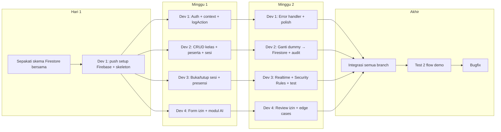
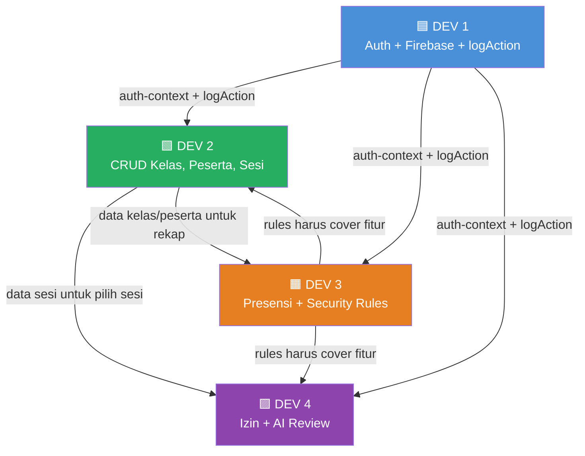

# 📋 Sprint 2 — Plan Lengkap (4 Developer)

> **Aplikasi:** Presensi Praktikum (Expo Router SDK 58 + Firebase)
> **Basis:** Kode Sprint 1 yang sudah di-merge ke `main`
> **Durasi:** 2 minggu

---

## 🔥 Perubahan Besar dari Sprint 1

| Aspek | Sprint 1 | Sprint 2 |
|---|---|---|
| **Auth** | Pilih user dari daftar dummy | Register/login Firebase Auth |
| **Data** | `useReducer` + dummy in-memory | Firestore realtime |
| **Role** | Bebas pilih praktikan/asisten | Asisten pakai kode undangan |
| **Presensi** | State lokal | Firestore + security rules |
| **Fitur baru** | — | Izin + AI review, audit log |

---

## 🏗️ Skema Firestore (Disepakati Bersama Hari 1)

```
users/{uid}
├── email: string
├── name: string
├── nim: string
├── role: "praktikan" | "asisten"
└── createdAt: Timestamp

classes/{classId}
├── name: string               // "Basis Data"
├── description: string
├── assistantId: string         // uid asisten yang buat
└── createdAt: Timestamp

enrollments/{enrollmentId}
├── classId: string
├── userId: string              // uid praktikan
├── userName: string
└── enrolledAt: Timestamp

sessions/{sessionId}
├── classId: string
├── title: string               // "Pertemuan 3"
├── date: Timestamp
├── startTime: string           // "08:00"
├── endTime: string             // "10:00"
├── room: string
├── assistantId: string
├── status: "scheduled" | "open" | "closed"
└── createdAt: Timestamp

attendance/{sessionId}_{uid}    ← ID = gabungan, cegah duplikat
├── sessionId: string
├── userId: string
├── userName: string
└── timestamp: Timestamp

permissionRequests/{requestId}
├── sessionId: string
├── userId: string
├── userName: string
├── reason: string
├── aiLabel: string | null      // "valid" | "invalid" | null
├── aiConfidence: number | null
├── status: "pending" | "approved" | "rejected"
├── reviewedBy: string | null   // uid asisten
├── reviewedAt: Timestamp | null
├── reviewNote: string | null
└── createdAt: Timestamp

auditLogs/{logId}
├── action: string              // "CREATE" | "UPDATE" | "DELETE"
├── collection: string          // "sessions", "attendance", dll.
├── docId: string
├── before: object | null
├── after: object | null
├── performedBy: string         // uid
└── timestamp: Timestamp

invitationCodes/{code}
├── role: "asisten"
├── used: boolean
├── usedBy: string | null
└── createdAt: Timestamp
```

---

## 👥 Pembagian per Developer

---

### 🟦 DEV 1 — Foundation & Auth

**Branch:** `sprint2/dev1-auth`

**Tanggung Jawab:**
Setup Firebase, autentikasi, navigasi per role, helper audit log, error handler, dan komponen UI bersama.

#### Daftar Task

| # | Task | File/Folder | Prioritas |
|---|---|---|---|
| 1.1 | Setup Firebase project (Auth + Firestore), file `.env`, konfigurasi `app.json` | `src/lib/firebase.ts`, `.env`, `app.json` | 🔴 Hari 1 |
| 1.2 | Layar Register + Login + Logout, validasi (email format, password min 6 karakter, field kosong) | `src/app/(auth)/register.tsx`, `src/app/(auth)/login.tsx` | 🔴 Minggu 1 |
| 1.3 | Saat register, buat dokumen `users/{uid}`, role asisten hanya jika punya **kode undangan** valid (cek koleksi `invitationCodes`), role praktikan default | `src/lib/auth-service.ts` | 🔴 Minggu 1 |
| 1.4 | Auth context: `onAuthStateChanged`, session persist, auto-redirect ke tab sesuai role | `src/context/auth-context.tsx`, update `src/app/_layout.tsx` | 🔴 Minggu 1 |
| 1.5 | Helper `logAction(action, collection, docId, before, after)` — tulis ke `auditLogs` | `src/lib/audit.ts` | 🟡 Minggu 1 |
| 1.6 | Error handler global + mapper error Firebase (auth/wrong-password → "Password salah", dll.) | `src/lib/error-handler.ts` | 🟡 Minggu 1 |
| 1.7 | Komponen UI bersama: `<LoadingScreen>`, `<ErrorScreen>`, update `<EmptyState>` | `src/components/LoadingScreen.tsx`, `src/components/ErrorScreen.tsx` | 🟡 Minggu 1 |

#### Folder yang Dimiliki

```
src/
├── lib/
│   ├── firebase.ts          ← BARU (config + init)
│   ├── auth-service.ts      ← BARU (register, login, logout, cek kode undangan)
│   ├── audit.ts             ← BARU (logAction helper)
│   └── error-handler.ts     ← BARU (mapper error Firebase)
├── context/
│   └── auth-context.tsx     ← BARU (mengganti session-context untuk auth)
├── app/
│   ├── (auth)/
│   │   ├── _layout.tsx      ← BARU
│   │   ├── login.tsx        ← BARU
│   │   └── register.tsx     ← BARU
│   └── _layout.tsx          ← UBAH (tambah AuthProvider, conditional routing)
└── components/
    ├── LoadingScreen.tsx     ← BARU
    └── ErrorScreen.tsx       ← BARU
```

#### Cara Running & Testing

```bash
# 1. Install dependensi Firebase
npx expo install firebase

# 2. Copy .env.example ke .env, isi konfigurasi Firebase
cp .env.example .env

# 3. Jalankan aplikasi
npx expo start

# 4. Test alur:
#    - Buka app → harus redirect ke Login
#    - Register tanpa kode → jadi Praktikan
#    - Register dengan kode undangan → jadi Asisten
#    - Login → masuk ke tab sesuai role
#    - Logout → kembali ke Login
#    - Input salah → pesan error yang jelas (bukan kode Firebase mentah)
```

#### ⚠️ PUSH PERTAMA (Hari 1)
Dev 1 wajib push **paling awal** agar Dev 2, 3, 4 bisa mulai:
- `src/lib/firebase.ts` (config)
- `src/context/auth-context.tsx` (skeleton, boleh kasar)
- `src/lib/audit.ts` (skeleton `logAction`)
- `.env.example`
- Struktur folder baru

---

### 🟩 DEV 2 — Data Praktikum (CRUD Firestore)

**Branch:** `sprint2/dev2-data`

**Tanggung Jawab:**
Semua operasi CRUD (kelas, peserta, jadwal/sesi) di Firestore. Mengganti data dummy Sprint 1 ke data real.

#### Daftar Task

| # | Task | File/Folder | Prioritas |
|---|---|---|---|
| 2.1 | Asisten: CRUD kelas (tambah, edit, hapus, list) | `src/lib/class-service.ts`, `src/screens/asisten/kelas/` | 🔴 Minggu 1 |
| 2.2 | Asisten: CRUD peserta/enrollments (tambah praktikan ke kelas, hapus, list) | `src/lib/enrollment-service.ts`, `src/screens/asisten/peserta/` | 🔴 Minggu 1 |
| 2.3 | Asisten: CRUD jadwal dan sesi (tambah sesi, edit, hapus, list per kelas) | `src/lib/session-service.ts`, update layar jadwal asisten | 🔴 Minggu 1 |
| 2.4 | Praktikan: lihat kelas/jadwal/sesi **miliknya** (filter via enrollment) | Update layar jadwal & riwayat praktikan | 🟡 Minggu 2 |
| 2.5 | Ganti **semua** import data dummy Sprint 1 ke query Firestore | Semua file yang import dari `@/data/dummy` | 🟡 Minggu 2 |
| 2.6 | Panggil `logAction()` di setiap operasi tambah/ubah/hapus | Semua service file | 🟢 Minggu 2 |

#### Folder yang Dimiliki

```
src/
├── lib/
│   ├── class-service.ts       ← BARU (CRUD kelas)
│   ├── enrollment-service.ts  ← BARU (CRUD peserta)
│   └── session-service.ts     ← BARU (CRUD sesi)
├── screens/
│   ├── asisten/
│   │   ├── kelas/             ← BARU (list, form tambah/edit kelas)
│   │   └── peserta/           ← BARU (list, form tambah peserta ke kelas)
│   └── praktikan/
│       ├── jadwal-screen.tsx   ← UBAH (query Firestore, filter enrollment)
│       └── riwayat-screen.tsx  ← UBAH (query Firestore)
└── app/
    └── asisten/
        ├── kelas/              ← BARU (route file)
        └── peserta/            ← BARU (route file)
```

#### Cara Running & Testing

```bash
# 1. Pastikan Dev 1 sudah push setup Firebase + auth context
git pull origin sprint2/dev1-auth

# 2. Jalankan aplikasi
npx expo start

# 3. Test alur:
#    - Login sebagai Asisten
#    - Buat kelas baru → cek di Firebase Console, data masuk
#    - Tambah peserta ke kelas
#    - Buat sesi baru untuk kelas tersebut
#    - Edit & hapus sesi → cek Firestore berubah
#    - Login sebagai Praktikan → hanya lihat kelas yang di-enroll
#    - Cek audit log di Firebase Console (koleksi auditLogs)
```

#### Ketergantungan
- ✅ Butuh `firebase.ts` + `auth-context.tsx` + `logAction()` dari **Dev 1**
- ⚠️ Jika Dev 1 belum selesai: gunakan `firebase.ts` skeleton yang sudah di-push Hari 1

---

### 🟧 DEV 3 — Sesi, Presensi & Security Rules

**Branch:** `sprint2/dev3-presensi`

**Tanggung Jawab:**
Logika buka/tutup sesi, presensi real-time, cegah duplikat, dan **seluruh Firestore Security Rules**.

#### Daftar Task

| # | Task | File/Folder | Prioritas |
|---|---|---|---|
| 3.1 | Buka/tutup sesi (`scheduled` → `open` → `closed`) + audit log | `src/lib/session-actions.ts` | 🔴 Minggu 1 |
| 3.2 | Tombol presensi (hanya aktif saat sesi `open`, disabled jika `scheduled`/`closed`) | Update layar detail sesi praktikan | 🔴 Minggu 1 |
| 3.3 | Cegah presensi ganda: doc ID = `{sessionId}_{uid}`, pakai `setDoc` (bukan `addDoc`) | `src/lib/attendance-service.ts` | 🔴 Minggu 1 |
| 3.4 | Rekap kehadiran realtime untuk asisten (`onSnapshot` pada `attendance` filtered by `sessionId`) | Update layar rekap asisten | 🟡 Minggu 2 |
| 3.5 | Praktikan lihat status presensinya realtime (sudah/belum hadir di sesi tertentu) | Update detail sesi praktikan | 🟡 Minggu 2 |
| 3.6 | Tulis **Firestore Security Rules** untuk SEMUA koleksi | `firestore.rules` | 🔴 Minggu 2 |
| 3.7 | Test rules: praktikan ❌ buka/tutup sesi, ❌ edit kelas, ❌ presensi 2x | Manual test / emulator | 🟡 Minggu 2 |

#### Folder yang Dimiliki

```
src/
├── lib/
│   ├── session-actions.ts     ← BARU (openSession, closeSession dengan Firestore)
│   └── attendance-service.ts  ← BARU (submitAttendance, getAttendance, onSnapshot)
├── screens/
│   ├── praktikan/
│   │   └── detail-screen.tsx  ← UBAH (presensi realtime)
│   └── asisten/
│       └── rekap/             ← UBAH (onSnapshot realtime)
firestore.rules                ← BARU (di root project)
```

#### Contoh Security Rules

```javascript
rules_version = '2';
service cloud.firestore {
  match /databases/{database}/documents {

    // Users: hanya bisa baca profil sendiri, write saat register
    match /users/{uid} {
      allow read: if request.auth != null && request.auth.uid == uid;
      allow create: if request.auth != null && request.auth.uid == uid;
    }

    // Classes: asisten bisa CRUD, praktikan hanya read
    match /classes/{classId} {
      allow read: if request.auth != null;
      allow write: if request.auth != null
        && get(/databases/$(database)/documents/users/$(request.auth.uid)).data.role == "asisten";
    }

    // Attendance: praktikan hanya bisa create miliknya, 1x per sesi
    match /attendance/{attendanceId} {
      allow read: if request.auth != null;
      allow create: if request.auth != null
        && request.auth.uid == request.resource.data.userId
        && !exists(/databases/$(database)/documents/attendance/$(attendanceId));
    }

    // ... (rules lengkap untuk semua koleksi)
  }
}
```

#### Cara Running & Testing

```bash
# 1. Pastikan Dev 1 (auth) + Dev 2 (data kelas/sesi) sudah tersedia
git pull origin sprint2/dev1-auth
git pull origin sprint2/dev2-data

# 2. Jalankan aplikasi
npx expo start

# 3. Test alur presensi:
#    - Login Asisten → buka sesi (status berubah scheduled → open)
#    - Login Praktikan → tombol presensi aktif → klik → sukses
#    - Klik lagi → "Sudah presensi" (duplikat dicegah)
#    - Asisten tutup sesi → status closed
#    - Praktikan coba presensi → ditolak (sesi sudah ditutup)
#
# 4. Test security rules:
#    - Praktikan coba buka sesi → DENIED
#    - Praktikan coba edit kelas → DENIED
#    - Cek di Firebase Console: audit log tercatat
```

#### Ketergantungan
- ✅ Butuh `firebase.ts` + `auth-context.tsx` dari **Dev 1**
- ✅ Butuh data kelas/sesi/peserta dari **Dev 2**
- ⚠️ Jika Dev 2 belum selesai: tambah data manual di Firebase Console untuk testing

---

### 🟪 DEV 4 — Izin, AI Review & Edge Cases

**Branch:** `sprint2/dev4-izin`

**Tanggung Jawab:**
Fitur pengajuan izin dari praktikan, integrasi modul AI untuk analisis alasan, dan flow review oleh asisten.

#### Daftar Task

| # | Task | File/Folder | Prioritas |
|---|---|---|---|
| 4.1 | Form izin: pilih sesi + tulis alasan, validasi (sesi wajib dipilih, alasan min 10 karakter) | `src/screens/praktikan/izin/form-izin.tsx` | 🔴 Minggu 1 |
| 4.2 | Modul AI: kirim alasan ke API → terima `{label, confidence}`, ada **timeout 10 detik** + fallback jika gagal (label = null) | `src/lib/ai-service.ts` | 🟡 Minggu 1 |
| 4.3 | Simpan ke `permissionRequests` (status: `pending`, sertakan hasil AI) | `src/lib/permission-service.ts` | 🔴 Minggu 1 |
| 4.4 | Cegah izin ganda di sesi yang sama (query: `where userId == X AND sessionId == Y`) | `src/lib/permission-service.ts` | 🔴 Minggu 1 |
| 4.5 | Riwayat izin praktikan + status realtime (`onSnapshot`) | `src/screens/praktikan/izin/riwayat-izin.tsx` | 🟡 Minggu 2 |
| 4.6 | Asisten: daftar izin masuk (filter: pending/approved/rejected) + tampilkan alasan + hasil AI | `src/screens/asisten/izin/daftar-izin.tsx` | 🟡 Minggu 2 |
| 4.7 | Asisten: terima/tolak izin + catatan, simpan `reviewedBy`, `reviewedAt` + audit log | `src/screens/asisten/izin/review-izin.tsx` | 🟡 Minggu 2 |
| 4.8 | Edge cases: AI gagal/timeout → tampilkan "Hasil AI tidak tersedia", sesi sudah closed → form izin tetap bisa diakses | Semua file terkait | 🟢 Minggu 2 |

#### Folder yang Dimiliki

```
src/
├── lib/
│   ├── ai-service.ts          ← BARU (panggil API AI, timeout, fallback)
│   └── permission-service.ts  ← BARU (CRUD permissionRequests)
├── screens/
│   ├── praktikan/
│   │   └── izin/
│   │       ├── form-izin.tsx       ← BARU
│   │       └── riwayat-izin.tsx    ← BARU
│   └── asisten/
│       └── izin/
│           ├── daftar-izin.tsx     ← BARU
│           └── review-izin.tsx     ← BARU
└── app/
    ├── (praktikan)/
    │   └── izin.tsx            ← BARU (route)
    └── asisten/
        └── izin/
            ├── index.tsx       ← BARU (route daftar izin)
            └── [id].tsx        ← BARU (route review izin)
```

#### Cara Running & Testing

```bash
# 1. Pastikan Dev 1 (auth) + Dev 2 (data sesi) sudah tersedia
git pull origin sprint2/dev1-auth
git pull origin sprint2/dev2-data

# 2. Jalankan aplikasi
npx expo start

# 3. Test alur izin:
#    - Login Praktikan → buka form izin
#    - Pilih sesi, tulis alasan (min 10 karakter) → kirim
#    - Cek: hasil AI muncul (label + confidence) di riwayat
#    - Coba kirim izin untuk sesi yang sama → ditolak (duplikat)
#    - Login Asisten → lihat daftar izin → filter status
#    - Klik salah satu → lihat alasan + hasil AI → terima/tolak
#    - Cek Praktikan: status berubah realtime
#
# 4. Test edge cases:
#    - Matikan koneksi internet → kirim izin → AI timeout
#    - Cek: status "Hasil AI tidak tersedia", izin tetap tersimpan pending
#    - Sesi sudah closed → form izin masih bisa diakses
```

#### Ketergantungan
- ✅ Butuh `firebase.ts` + `auth-context.tsx` + `logAction()` dari **Dev 1**
- ✅ Butuh data sesi dari **Dev 2** (untuk dropdown pilih sesi di form izin)
- ⚠️ Jika Dev 2 belum selesai: buat sesi dummy langsung di Firebase Console

---

## 📅 Timeline Pengerjaan



---

## 🔗 Peta Ketergantungan Antar Dev



> **Aturan penting:** Jika Dev 2 belum selesai CRUD, Dev 3 & 4 bisa **memasukkan data manual langsung di Firebase Console** untuk testing sementara.

---

## 🚀 Cara Running untuk Semua Dev

### Prasyarat
1. **Node.js** ≥ 18
2. **Expo CLI** (sudah ada di project)
3. **Firebase Project** (dibuat oleh Dev 1 di Hari 1)
4. **Expo Go** di HP (atau Android Emulator / iOS Simulator)

### Langkah Awal (Semua Dev)

```bash
# 1. Clone / pull latest main
git checkout main
git pull origin main

# 2. Buat branch masing-masing
git checkout -b sprint2/dev[NOMOR]-[NAMA]
# Contoh: git checkout -b sprint2/dev1-auth

# 3. Install dependensi
npm install

# 4. Copy file environment (Dev 1 yang buat templatenya)
cp .env.example .env
# Edit .env, isi Firebase config dari Dev 1

# 5. Jalankan
npx expo start

# 6. Buka di HP/Emulator:
#    - Tekan 'a' untuk Android Emulator
#    - Tekan 'w' untuk Web browser
#    - Scan QR code dari Expo Go di HP
```

### Git Workflow

```bash
# Sebelum mulai kerja setiap hari:
git stash                           # simpan perubahan sementara
git checkout main
git pull origin main                # ambil update terbaru
git checkout sprint2/dev[NOMOR]-[NAMA]
git merge main                      # gabungkan ke branch sendiri
git stash pop                       # kembalikan perubahan

# Setelah selesai fitur:
git add -A
git commit -m "feat: [deskripsi singkat]"
git push origin sprint2/dev[NOMOR]-[NAMA]
# Buat Pull Request di GitHub
```

---

## ✅ Checklist Akhir Sprint 2

### Demo Flow 1: Praktikan
- [ ] Register sebagai Praktikan
- [ ] Login → masuk ke tab Praktikan
- [ ] Lihat jadwal (hanya kelas yang di-enroll)
- [ ] Buka detail sesi → presensi (jika sesi open)
- [ ] Presensi ganda → ditolak
- [ ] Lihat riwayat kehadiran
- [ ] Ajukan izin → hasil AI muncul
- [ ] Lihat riwayat izin → status realtime
- [ ] Logout

### Demo Flow 2: Asisten
- [ ] Register sebagai Asisten (dengan kode undangan)
- [ ] Login → masuk ke tab Asisten
- [ ] Buat kelas + tambah peserta
- [ ] Buat sesi baru
- [ ] Buka sesi (scheduled → open)
- [ ] Lihat rekap presensi realtime
- [ ] Tutup sesi (open → closed)
- [ ] Lihat daftar izin → review (terima/tolak)
- [ ] Cek audit log di Firebase Console
- [ ] Logout

### Security
- [ ] Praktikan ❌ bisa buka/tutup sesi
- [ ] Praktikan ❌ bisa edit/hapus kelas
- [ ] Praktikan ❌ bisa presensi 2x di sesi yang sama
- [ ] Praktikan ❌ bisa ajukan izin 2x di sesi yang sama
- [ ] User tanpa login ❌ bisa akses data apapun

