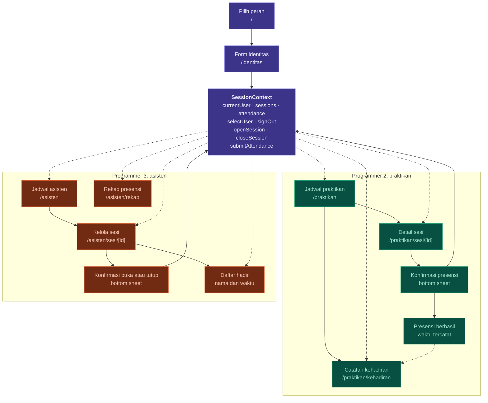

# Rancangan Pembagian Tugas Tiga Programmer

Aplikasi demo presensi kegiatan praktikum untuk dua sudut pandang: **praktikan** dan **asisten**. Tiga programmer berbagi satu state lewat `SessionContext`. Data dummy tinggal di memori. Tidak ada database dan tidak ada sinkronisasi.

Sasaran sprint: satu siklus penuh dapat diperagakan tanpa memuat ulang aplikasi.

1. Asisten melihat jadwal, membuka sesi, memantau daftar hadir, dan menutup sesi.
2. Praktikan melihat jadwal dan detail sesi, melakukan presensi saat sesi dibuka, dan melihat catatan kehadiran sendiri.
3. Status sesi terlihat sama di kedua peran karena semua layar membaca satu provider.

---

## 1. Lingkup dan Batasan

**Masuk lingkup**

- Pemilihan peran dan identitas di dalam aplikasi.
- Jadwal dan detail sesi untuk kedua peran.
- Buka dan tutup sesi oleh asisten.
- Presensi oleh praktikan, dengan waktu tercatat.
- Daftar hadir untuk asisten dan catatan kehadiran untuk praktikan.
- Rekap per sesi.
- Data dummy, state kosong, dan umpan balik tindakan.

**Di luar lingkup**

- Tambah, ubah, atau hapus sesi.
- Backend, API, autentikasi nyata, dan penyimpanan permanen.
- Sinkronisasi antar perangkat dan notifikasi push.

**Keputusan lingkup**

- User story tidak meminta pembuatan sesi. Semua sesi berasal dari `src/data/dummy.ts`.
- Perubahan data hanya berasal dari tiga aksi: buka sesi, tutup sesi, dan presensi.
- Sesi berjalan dari `pending` ke `open`, lalu ke `closed`. Tidak ada transisi lain.
- Data kembali ke kondisi awal saat aplikasi dimuat ulang.

---

## 2. Aktor dan Use Case

| Kode | Use case | Aktor | Pemilik |
|---|---|---|---|
| UC-01 | Pilih peran (praktikan atau asisten) | praktikan, asisten | Programmer 1 |
| UC-02 | Pilih identitas lewat form | praktikan, asisten | Programmer 1 |
| UC-03 | Ganti peran tanpa memuat ulang aplikasi | praktikan, asisten | Programmer 1 |
| UC-04 | Lihat jadwal sesi | praktikan, asisten | Programmer 2 (praktikan)<br>Programmer 3 (asisten) |
| UC-05 | Lihat detail sesi: nama praktikum, kelas, waktu, ruang, status | praktikan, asisten | Programmer 2 (praktikan)<br>Programmer 3 (asisten) |
| UC-06 | Buka sesi | asisten | Programmer 3 |
| UC-07 | Pantau daftar hadir | asisten | Programmer 3 |
| UC-08 | Tutup sesi | asisten | Programmer 3 |
| UC-09 | Lakukan presensi | praktikan | Programmer 2 |
| UC-10 | Lihat catatan kehadiran sendiri | praktikan | Programmer 2 |
| UC-11 | Lihat rekap presensi | asisten | Programmer 3 |

---

## 3. Aturan yang Mengikat

| Kode | Aturan | Ditegakkan di |
|---|---|---|
| R-01 | Presensi hanya diterima saat status sesi `open` | `submitAttendance` |
| R-02 | Satu praktikan hanya punya satu catatan per sesi | `submitAttendance` |
| R-03 | Presensi hanya untuk praktikan yang ada di `participantIds` sesi | `submitAttendance` |
| R-04 | Hanya pengguna berperan praktikan yang dapat presensi | `submitAttendance` |
| R-05 | Buka sesi hanya dari `pending`; tutup sesi hanya dari `open` | reducer |
| R-06 | Hanya pengguna berperan asisten yang dapat membuka atau menutup sesi | `openSession`, `closeSession` |
| R-07 | Ganti peran tidak menghapus `sessions` dan `attendance` | provider |
| R-08 | Muat ulang aplikasi mengembalikan data dummy | provider |
| R-09 | Tutup sesi tidak menghapus catatan; presensi tidak dapat dibatalkan | reducer |
| R-10 | Tidak ada tambah, ubah, atau hapus sesi | lingkup sprint |

Semua aturan R-01 sampai R-09 ditegakkan di context, bukan hanya dengan menonaktifkan tombol. Tombol nonaktif adalah tampilan dari aturan, bukan penggantinya. R-10 adalah batas lingkup sprint, bukan aturan yang dijalankan kode.

---

## 4. Tabel Pembagian Tugas

| Aspek | Programmer 1<br>*Fondasi, state bersama, pemilihan peran* | Programmer 2<br>*Sisi praktikan* | Programmer 3<br>*Sisi asisten* |
|---|---|---|---|
| **Use cases** | UC-01<br>UC-02<br>UC-03<br>Aturan R-01 sampai R-09 | UC-04<br>UC-05<br>UC-09<br>UC-10 | UC-04<br>UC-05<br>UC-06<br>UC-07<br>UC-08<br>UC-11 |
| **Layar dan rute** | `/` Pilih peran<br>`/identitas` Form identitas<br>`_layout.tsx` root | `/praktikan` Jadwal<br>`/praktikan/sesi/[id]` Detail sesi<br>`/praktikan/kehadiran` Catatan kehadiran | `/asisten` Jadwal<br>`/asisten/sesi/[id]` Kelola sesi<br>`/asisten/rekap` Rekap presensi |
| **State dan logika** | `SessionContext` dan reducer<br>`selectUser`, `signOut`, `openSession`, `closeSession`, `submitAttendance`<br>Guard R-01 sampai R-06<br>`RoleGuard`<br>Selector turunan | Menghubungkan layar ke context<br>Menurunkan catatan milik user saat ini<br>Menentukan tombol presensi aktif atau nonaktif | Menghubungkan buka dan tutup ke context<br>Memfilter daftar hadir per sesi<br>Menghitung rekap per sesi |
| **Interaksi** | Form identitas<br>`Toast` umpan balik<br>`ConfirmSheet` reusable<br>Aksi ganti peran di header | `ConfirmSheet` konfirmasi presensi<br>Umpan balik sukses berisi waktu<br>Daftar catatan kehadiran | `ConfirmSheet` konfirmasi buka dan tutup<br>Daftar hadir berisi nama, NIM, dan waktu<br>Form filter rekap |
| **State yang ditangani** | Belum ada identitas dipilih<br>Pencarian identitas kosong | Sesi belum dibuka, dibuka, ditutup<br>Sudah presensi<br>Bukan peserta<br>Jadwal kosong<br>Catatan kehadiran kosong | Tombol bergantung status sesi<br>Daftar hadir kosong atau terisi<br>Rekap kosong dan filter kosong |
| **Komponen bersama** | Membangun `SessionCard`, `StatusBadge`, `EmptyState`, `ConfirmSheet`, `Toast`, `FormField`, `RoleGuard`, `RoleSwitchButton`, theme, dan `lib/format` | Memakai komponen dan theme dari Programmer 1 | Memakai komponen dan theme dari Programmer 1 |
| **Folder milik** | `src/app/_layout.tsx`<br>`src/app/index.tsx`<br>`src/app/identitas.tsx`<br>`src/context/`<br>`src/components/`<br>`src/theme/`<br>`src/data/`<br>`src/lib/` | `src/app/praktikan/`<br>`src/screens/praktikan/` | `src/app/asisten/`<br>`src/screens/asisten/` |
| **Deliverable** | Kontrak context, skeleton, dan komponen bersama, di-push paling awal<br>**Final:** uji ganti peran dan demo run | Alur praktikan lengkap di atas context bersama<br>**Final:** uji siklus dari sisi praktikan | Alur asisten lengkap di atas context bersama<br>**Final:** uji siklus dari sisi asisten |

---

## 5. Detail per Programmer

### 5.1 Programmer 1 — Fondasi, state bersama, pemilihan peran

**Use case:** UC-01, UC-02, UC-03. Menegakkan R-01 sampai R-09 untuk semua sisi.

**Rute dan layar**

| Rute | Berkas | Isi |
|---|---|---|
| `/` | `src/app/index.tsx` | Dua kartu peran. Pilihan membuka `/identitas?role=praktikan` atau `/identitas?role=asisten`. |
| `/identitas` | `src/app/identitas.tsx` | Form identitas: daftar pengguna sesuai peran, kolom pencarian nama atau NIM, tombol Masuk yang nonaktif sampai pengguna dipilih. |
| root | `src/app/_layout.tsx` | `SessionProvider`, font, splash screen, `Stack`. |

**State dan logika**

- Satu `SessionProvider` di root. Semua rute berada di bawahnya.
- `selectUser(userId)` mengisi `currentUser`, lalu mengarahkan ke beranda peran.
- `signOut()` mengosongkan `currentUser`, lalu kembali ke `/`. Data sesi dan presensi tidak dihapus.
- `RoleGuard(role)` membungkus layout peran. Bila `currentUser` kosong atau perannya tidak cocok, pengguna diarahkan ke `/`.
- Selector turunan disediakan di context agar aturan tampilan tidak ditulis ulang per layar.
- Format tanggal dan waktu memakai `src/lib/format.ts`. Zona waktu WIB dan label Bahasa Indonesia.

**Interaksi**

- Form identitas dengan pilihan pengguna dan tombol Masuk.
- `ConfirmSheet` untuk semua konfirmasi di kedua sisi.
- `Toast` atau banner untuk umpan balik singkat.
- `RoleSwitchButton` di header. Tombol ini muncul di kedua sisi dan memanggil `signOut`.

**State kosong**

- Belum ada pengguna dipilih: tombol Masuk nonaktif, teks bantu tampil.
- Pencarian tidak menemukan pengguna: `EmptyState` di dalam form.
- Belum ada `currentUser` saat membuka rute peran: diarahkan ke `/`.

**Data dummy**

- Satu asisten, misalnya Nadia.
- Tujuh praktikan: enam peserta C2 dan C3, satu praktikan tanpa sesi untuk state catatan kehadiran kosong.
- Setiap praktikan punya NIM di `nim`; `id` internal dipakai untuk relasi `participantIds` dan `closedBy`.
- Empat sesi: dua sesi tertutup pekan lalu, C3 hari ini berstatus `open` dengan empat catatan hadir dari praktikan lain, dan C2 hari ini berstatus `pending` untuk alur buka dan tutup sesi.
- Tanggal sesi dihitung relatif terhadap tanggal berjalan agar demo tidak bergantung tanggal tetap.

**Deliverable**

- Kontrak context dan data dummy, disepakati sebelum P2 dan P3 mulai.
- Skeleton dan provider yang sudah berjalan, di-push lebih dulu.
- Komponen bersama dan theme.
- Final: uji ganti peran dan demo run.

### 5.2 Programmer 2 — Sisi praktikan

**Use case:** UC-04, UC-05, UC-09, UC-10.

**Rute dan layar**

| Rute | Berkas | Isi |
|---|---|---|
| `/praktikan` | `src/app/praktikan/(tabs)/index.tsx` | Jadwal praktikan. Tab Jadwal. |
| `/praktikan/sesi/[id]` | `src/app/praktikan/sesi/[id].tsx` | Detail sesi dan aksi presensi. |
| `/praktikan/kehadiran` | `src/app/praktikan/(tabs)/kehadiran.tsx` | Catatan kehadiran sendiri. Tab Kehadiran. |
| layout | `src/app/praktikan/_layout.tsx`<br>`src/app/praktikan/(tabs)/_layout.tsx` | Stack dan `RoleGuard('praktikan')`; tab Jadwal dan Kehadiran. |

**Isi detail sesi**

Nama praktikum (gabungan nama mata kuliah dan kode), topik, kelas, tanggal, waktu, ruang, dan status sesi. Status selalu berupa teks, bukan hanya warna.

**Aksi presensi**

| Kondisi sesi | Tombol | Keterangan |
|---|---|---|
| `pending` | nonaktif | Sesi belum dibuka |
| `open`, peserta, belum presensi | aktif | Presensi sekarang, membuka `ConfirmSheet` |
| `open`, sudah presensi | nonaktif | Sudah presensi pukul HH.mm |
| `open`, bukan peserta | nonaktif | Kamu tidak terdaftar di sesi ini |
| `closed`, tidak ada catatan | nonaktif | Sesi sudah ditutup |
| `closed`, ada catatan | nonaktif | Hadir pukul HH.mm |

**Umpan balik**

- Sukses: `ConfirmSheet` atau banner "Presensi berhasil" dengan waktu tercatat. Tombol langsung berubah tanpa muat ulang.
- Gagal karena `duplicate` atau `not-open`: notice di layar, bukan hanya toast. Tampilan tombol ikut diperbarui.
- Waktu ditampilkan dalam WIB dengan format `HH.mm`.

**Catatan kehadiran**

- Daftar sesi yang diikuti pengguna, urut tanggal terbaru.
- Tiap baris menampilkan status: Hadir dan waktu, Belum presensi, atau Tidak hadir.
- Hanya menampilkan catatan milik `currentUser`.

**State yang ditangani**

- Jadwal kosong.
- Sesi tidak ditemukan.
- Sesi belum dibuka, dibuka, dan ditutup.
- Sudah presensi dan belum presensi.
- Bukan peserta sesi.
- Catatan kehadiran kosong.

**Dependensi:** context, komponen, theme, dan format dari Programmer 1. Tidak mengubah folder Programmer 3.

**Deliverable**

- Alur praktikan lengkap di atas shared context.
- Final: uji siklus dari sisi praktikan.

### 5.3 Programmer 3 — Sisi asisten

**Use case:** UC-04, UC-05, UC-06, UC-07, UC-08, UC-11.

**Rute dan layar**

| Rute | Berkas | Isi |
|---|---|---|
| `/asisten` | `src/app/asisten/(tabs)/index.tsx` | Jadwal asisten. Tab Jadwal. |
| `/asisten/sesi/[id]` | `src/app/asisten/sesi/[id].tsx` | Kelola sesi. |
| `/asisten/rekap` | `src/app/asisten/(tabs)/rekap.tsx` | Rekap presensi. Tab Rekap. |
| layout | `src/app/asisten/_layout.tsx`<br>`src/app/asisten/(tabs)/_layout.tsx` | Stack dan `RoleGuard('asisten')`; tab Jadwal dan Rekap. |

**Pekerjaan migrasi dari kode yang sudah ada**

- Pindahkan rute `/`, `/rekap`, dan `/sesi/[id]` ke bawah `/asisten`. Hapus grup `(tabs)` lama setelah pemindahan.
- Ganti pemakaian `useAssistantSessions` di layar asisten dengan `useSession` dari context bersama.
- Jangan mengubah `src/app/_layout.tsx`. Penggantian `AssistantPreviewProvider` di root dilakukan Programmer 1.
- Cabut rute `/tambah-sesi`, tombol Tambah sesi, `add-session-screen`, `session-form`, dan aksi `addSession`.
- Tampilkan NIM praktikan dari `user.nim` pada daftar hadir.
- Pertahankan tampilan yang sudah ada: kartu jadwal, bottom sheet, navigasi bawah, dan layar rekap.

**Jadwal asisten**

Jadwal asisten menampilkan seluruh sesi pada data dummy. Tidak ada filter berdasarkan praktikum yang diampu.

**Kelola sesi**

| Status | Tombol utama | Isi layar |
|---|---|---|
| `pending` | Buka sesi | Detail sesi, daftar hadir kosong, keterangan sesi belum dibuka |
| `open` | Tutup sesi | Detail sesi, hitungan hadir/total, daftar hadir berisi nama, NIM, dan waktu |
| `closed` | tidak ada | Detail sesi, keterangan ditutup pukul HH.mm oleh nama, daftar hadir final |

Setiap aksi buka atau tutup melewati `ConfirmSheet`. Daftar hadir diperbarui dari context yang sama dengan sisi praktikan. Setelah praktikan presensi, asisten melihat baris baru tanpa memuat ulang. Bila aksi mengembalikan `ok: false`, tampilkan notice dan tutup sheet tanpa mengubah status.

**Rekap presensi**

Rekap menampilkan ringkasan per sesi. Daftar peserta lengkap dan waktu presensi ada di layar Kelola Sesi, bukan di rekap.

| Aturan | Nilai |
|---|---|
| Nilai awal | Rentang bulan berjalan, dari tanggal 1 sampai akhir bulan. Pilihan sesi "Semua sesi". |
| Semua tanggal | Rentang kosong (`null`) tidak memfilter tanggal. |
| Pilihan sesi | Hanya sesi `closed`. Opsi "Semua sesi" memakai string kosong. |
| Batas tanggal | Inklusif pada kedua ujung. Sesi dipakai bila `date >= start` dan `date <= end`. |
| Gabungan filter | Pilihan sesi dan rentang tanggal berlaku bersamaan. Sesi di luar rentang tidak tampil meski dipilih. |
| Data yang masuk | Hanya sesi `closed`. |
| Urutan | Tanggal terbaru lebih dulu. |
| Persentase | `Math.round(hadir / peserta * 100)`. Contoh 1/6 menjadi 17. Bila peserta 0, persentase tidak ditampilkan. |
| Hasil kosong | `EmptyState`. |

Tiap baris menampilkan sesi, jumlah hadir, jumlah peserta, dan persentase.

**State yang ditangani**

- Tiga status sesi dengan tombol yang sesuai.
- Aksi buka atau tutup ditolak context: notice tampil dan status tidak berubah.
- Daftar hadir kosong dan terisi.
- Rekap kosong dan filter kosong.
- Sesi tidak ditemukan.

**Dependensi:** context, komponen, theme, dan format dari Programmer 1.

**Deliverable**

- Alur asisten lengkap di atas shared context.
- Final: uji siklus dari sisi asisten.

---

## 6. Kontrak SessionContext

Tipe data dan aksi disepakati sebelum layar dibangun. P1 menyimpan kontrak ini di `src/context/session-context.tsx`. Context diekspos lewat hook `useSession()` yang mengembalikan state dan aksi.

```ts
export type Role = 'praktikan' | 'asisten';
export type SessionStatus = 'pending' | 'open' | 'closed';

export type User = {
  id: string;           // id internal untuk relasi participantIds dan closedBy
  name: string;
  nim?: string;         // wajib untuk praktikan; ditampilkan di daftar hadir
  role: Role;
  className?: string;   // khusus praktikan
};

export type Session = {
  id: string;
  code: string;         // kode praktikum, mis. C2
  course: string;       // nama mata kuliah
  topic: string;
  className: string;
  date: string;         // YYYY-MM-DD
  startTime: string;    // HH:mm
  endTime: string;
  room: string;
  status: SessionStatus;
  participantIds: string[];   // berisi User.id
  openedAt?: string;
  closedAt?: string;
  closedBy?: string;     // userId asisten yang menutup sesi
};

export type Attendance = {
  sessionId: string;
  userId: string;       // User.id
  recordedAt: string;   // ISO 8601
};

export type AttendanceResult =
  | { ok: true; recordedAt: string }
  | { ok: false; reason: 'not-open' | 'duplicate' | 'not-participant' | 'not-praktikan' };

export type SessionActionResult =
  | { ok: true }
  | { ok: false; reason: 'not-found' | 'not-asisten' | 'invalid-status' };
```

`course` adalah nama mata kuliah. `code` adalah kode praktikum. Nama praktikum yang tampil adalah gabungan keduanya, mis. `Basis Data C2`.

`nim` wajib diisi untuk praktikan. `id` tetap dipakai untuk relasi dan bukan pengganti NIM. Nama penutup sesi diambil lewat `userById(closedBy)?.name` bila `closedBy` terisi; bila pengguna tidak ditemukan, tampilkan `Asisten`.

**Aksi**

| Aksi | Masukan | Perilaku | Penjaga |
|---|---|---|---|
| `selectUser` | `userId` | Mengisi `currentUser`, lalu mengarahkan ke beranda peran | id harus ada |
| `signOut` | - | Mengosongkan `currentUser`, lalu ke `/` | - |
| `openSession` | `sessionId` | `pending` menjadi `open`, mengisi `openedAt`; mengembalikan `SessionActionResult` | R-05, R-06 |
| `closeSession` | `sessionId` | `open` menjadi `closed`, mengisi `closedAt` dan `closedBy` dari `currentUser.id`; mengembalikan `SessionActionResult` | R-05, R-06 |
| `submitAttendance` | `sessionId` | Menambah `Attendance` dan mengembalikan waktu | R-01 sampai R-04 |

`openSession` dan `closeSession` mengembalikan `ok: false` bila id tidak ditemukan, pengguna bukan asisten, atau status tidak sesuai. UI tidak mengubah status secara optimistis: setelah `ConfirmSheet`, panggil aksi, lalu tampilkan notice bila hasil `ok: false` dan biarkan state menjadi sumber tampilan.

**Selector**

| Selector | Hasil |
|---|---|
| `sessionById(id)` | `Session` atau `undefined` |
| `attendanceForSession(id)` | Daftar `{ user, recordedAt }`, urut waktu |
| `attendanceForUser(userId)` | Daftar `{ session, state, recordedAt? }`, urut tanggal terbaru |
| `attendanceState(session, userId)` | `hadir`, `belum`, atau `tidak-hadir` |
| `userById(id)` | `User` atau `undefined`; dipakai untuk nama penutup sesi |
| `presentCount(sessionId)` | Jumlah catatan hadir pada sesi |

`attendanceState` ditentukan dari data, bukan dari state terpisah: `hadir` bila ada catatan, `belum` bila tidak ada dan sesi belum ditutup, `tidak-hadir` bila tidak ada dan sesi sudah ditutup. Label tampilan: Hadir, Belum presensi, Tidak hadir.

---

## 7. Alur Aplikasi

Panah **solid** berarti menulis ke state. Panah **putus-putus** berarti membaca dari state.



Ganti peran tidak digambar. Tombol ganti peran memanggil `signOut`, lalu kembali ke `/`. Data sesi dan presensi tetap.

---

## 8. Peta Interaksi dengan SessionContext

| Layar | Pemilik | Interaksi dengan state |
|---|---|---|
| Pilih peran | Programmer 1 | Membaca daftar peran; menulis parameter peran ke rute identitas |
| Form identitas | Programmer 1 | **Menulis** `currentUser` lewat `selectUser` |
| Ganti peran | Programmer 1 | **Menulis** `currentUser` lewat `signOut`, lalu ke `/` |
| Jadwal praktikan | Programmer 2 | Membaca `sessions` dan `currentUser` |
| Detail sesi praktikan | Programmer 2 | Membaca `sessions` dan `attendance`; **menulis** lewat `submitAttendance` |
| Catatan kehadiran | Programmer 2 | Membaca `attendance` milik `currentUser` |
| Jadwal asisten | Programmer 3 | Membaca `sessions` |
| Kelola sesi | Programmer 3 | Membaca `sessions` dan `attendance`; **menulis** lewat `openSession` dan `closeSession` |
| Rekap presensi | Programmer 3 | Membaca `sessions` dan `attendance` untuk sesi tertutup |
| Umpan balik dan toast | Programmer 1 | Menampilkan hasil aksi, bukan menyimpan data |

---

## 9. Struktur Folder dan Kepemilikan

```text
src/
├── app/
│   ├── _layout.tsx                     # Programmer 1: provider dan Stack
│   ├── index.tsx                       # Programmer 1: pilih peran
│   ├── identitas.tsx                   # Programmer 1: form identitas
│   ├── praktikan/
│   │   ├── _layout.tsx                 # Programmer 2: Stack dan RoleGuard
│   │   ├── (tabs)/
│   │   │   ├── _layout.tsx             # Programmer 2: tab Jadwal dan Kehadiran
│   │   │   ├── index.tsx               # Programmer 2: jadwal praktikan
│   │   │   └── kehadiran.tsx           # Programmer 2: catatan kehadiran
│   │   └── sesi/[id].tsx               # Programmer 2: detail sesi dan presensi
│   └── asisten/
│       ├── _layout.tsx                 # Programmer 3: Stack dan RoleGuard
│       ├── (tabs)/
│       │   ├── _layout.tsx             # Programmer 3: tab Jadwal dan Rekap
│       │   ├── index.tsx               # Programmer 3: jadwal asisten
│       │   └── rekap.tsx               # Programmer 3: rekap presensi
│       └── sesi/[id].tsx               # Programmer 3: kelola sesi
├── components/                         # Programmer 1: komponen bersama
├── context/                            # Programmer 1: SessionContext
├── data/                               # Programmer 1: dummy.ts
├── lib/                                # Programmer 1: format tanggal dan waktu
├── theme/                              # Programmer 1: token warna dan tipografi
└── screens/
    ├── praktikan/                      # Programmer 2
    └── asisten/                        # Programmer 3: kode yang sudah ada
```

Grup `(tabs)` tidak menambah segmen URL. Detail sesi berada di luar grup agar bar bawah tidak tampil.

Setiap programmer hanya mengubah folder miliknya. Programmer 1 memiliki `_layout.tsx` root. Programmer 2 dan 3 hanya membuat layout di dalam folder rutenya.

Pengecualian migrasi: Programmer 3 memindahkan dan menghapus rute lama di `src/app/(tabs)/`, `src/app/sesi/`, dan `src/app/tambah-sesi.tsx`.

---

## 10. Kondisi Repo dan Pekerjaan Migrasi

Kondisi kode saat dokumen ini direvisi:

- Rute yang aktif adalah `/`, `/rekap`, `/sesi/[id]`, dan `/tambah-sesi`. Semuanya untuk sisi asisten.
- `src/screens/asisten/` sudah berisi tampilan asisten: jadwal, kelola sesi, rekap, form tambah sesi, bottom sheet, dan navigasi bawah.
- Sumber data masih `AssistantPreviewProvider` di `src/app/_layout.tsx`. Adapter ini bukan `SessionContext` dan belum punya `submitAttendance`.
- Belum ada layar praktikan, pemilihan peran, form identitas, dan aturan presensi.
- Tombol Tambah sesi masih muncul di `schedule-screen.tsx` dan mengarah ke `/tambah-sesi`.

Pekerjaan yang mengikuti kondisi tersebut:

- Programmer 1 mengganti `AssistantPreviewProvider` dengan `SessionContext`.
- Programmer 3 mempertahankan tampilan asisten, memindahkan rutenya ke `/asisten`, mengganti pemakaian data di layar asisten dengan `useSession`, dan mencabut tambah sesi.
- Programmer 2 membangun seluruh layar praktikan.
- Komponen lokal asisten dipetakan ke komponen bersama Programmer 1 secara bertahap.

---

## 11. Kebutuhan User Story dan Wujudnya

| Kebutuhan | Pemilik | Wujud di aplikasi |
|---|---|---|
| Jadwal dan detail sesi: nama praktikum, kelas, waktu, status sesi | P1, P2, P3 | `SessionCard` dan `StatusBadge`; detail menampilkan semua field; status berupa teks |
| Asisten dapat membuka dan menutup sesi; status terlihat pada semua pengguna | P1, P3 | Aksi buka dan tutup di context; satu provider; ganti peran menunjukkan status yang sama |
| Praktikan dapat presensi saat sesi dibuka; waktu tercatat; umpan balik berhasil | P1, P2 | `submitAttendance`; `ConfirmSheet`; feedback "Presensi berhasil" berisi waktu |
| Praktikan yang sama tidak dapat presensi lebih dari sekali pada sesi yang sama | P1, P2 | Guard `duplicate`; tombol nonaktif setelah presensi; tidak ada catatan kedua |
| Asisten melihat peserta yang presensi beserta waktu; praktikan melihat catatan sendiri | P2, P3 | Daftar hadir di Kelola Sesi; tab Catatan kehadiran; rekap ringkasan per sesi |
| Form untuk masukan atau pilihan pengguna; modal atau bottom sheet untuk konfirmasi dan informasi; data dummy | P1, P2, P3 | Form identitas; form filter rekap; semua konfirmasi memakai `ConfirmSheet`; data di `src/data/dummy.ts` |
| Pemilihan peran dan identitas di dalam aplikasi | P1 | Rute `/` dan `/identitas`; tombol ganti peran |
| Flexbox | P1, P2, P3 | Susunan memakai `flex`, `gap`, `alignItems`; tidak ada posisi absolut untuk susunan utama |
| Navigasi antar halaman | P1, P2, P3 | Expo Router; tab di dalam peran, stack untuk detail |
| State agar tampilan merespons tindakan | P1, P2, P3 | Status sesi, tombol nonaktif, feedback aksi, filter rekap |
| Daftar kosong, sesi belum dibuka, data terisi | P2, P3 | Daftar di bagian 14 |
| Data tidak perlu sinkron | P1 | State di memori; data kembali saat aplikasi dimuat ulang |

---

## 12. Urutan Kerja

1. **Kontrak.** Programmer 1 menyiapkan tipe, aksi, selector, dan data dummy. Programmer 2 dan 3 meninjau kontrak. Perubahan kontrak disepakati sebelum layar dibangun.
2. **Pembebasan rute.** Programmer 3 memindahkan rute asisten ke `/asisten` dan menghapus grup `(tabs)` lama. Langkah ini tidak menunggu context dan harus selesai sebelum Programmer 1 membuat rute `/` baru, agar tidak ada dua rute untuk `/`.
3. **Fondasi.** Programmer 1 membangun provider, rute `/` dan `/identitas`, komponen bersama, theme, dan `lib/format`. Hasil di-push lebih dulu.
4. **Paralel.** Programmer 2 membangun layar praktikan. Programmer 3 menyambungkan layar asisten ke context dan mencabut tambah sesi.
5. **Integrasi.** Programmer 1 memeriksa semua layar memakai satu provider. Tim menjalankan skenario demo dan memeriksa state kosong.
6. **Demo.** Jalankan skenario bagian 13 di web dan emulator Android.

---

## 13. Skenario Demo Siklus Penuh

Persiapan: data dummy berisi C2 hari ini berstatus `pending`, C3 hari ini berstatus `open` dengan empat catatan hadir dari praktikan lain, dua sesi tertutup pekan lalu, enam praktikan peserta C2 dan C3, serta satu praktikan tanpa sesi.

| No | Aksi | Hasil yang harus terlihat |
|---|---|---|
| 1 | Pilih peran Asisten, pilih Nadia, tekan Masuk | Jadwal asisten tampil. C2 berstatus Belum dibuka. C3 berstatus Dibuka dengan 4 dari 6 hadir. |
| 2 | Buka detail C2, tekan Buka sesi, konfirmasi di sheet | Status menjadi Dibuka. Tombol berubah menjadi Tutup sesi. Daftar hadir 0 dari 6. |
| 3 | Ganti peran, pilih Praktikan, pilih Aditya | Jadwal praktikan menampilkan C2 dan C3 berstatus Dibuka. Status sama dengan sisi asisten. |
| 4 | Buka detail C2, tekan Presensi sekarang, konfirmasi | Feedback "Presensi berhasil" berisi waktu. Tombol nonaktif. Status menjadi Hadir pukul HH.mm. |
| 5 | Kembali ke jadwal, buka detail C2 lagi | Tombol presensi tetap nonaktif. Tidak ada catatan ganda. |
| 6 | Buka tab Catatan kehadiran | Baris C2 berstatus Hadir beserta waktu. Baris C3 berstatus Belum presensi. |
| 7 | Ganti peran ke Asisten Nadia, buka detail C2 | Daftar hadir terisi 1 dari 6: nama, NIM, dan waktu presensi Aditya. |
| 8 | Tekan Tutup sesi, konfirmasi | Status menjadi Ditutup. Tombol aksi hilang. Keterangan ditutup pukul HH.mm oleh Nadia. Daftar hadir tetap. |
| 9 | Ganti peran ke Praktikan Bunga, buka detail C2 | Tombol presensi nonaktif dengan alasan sesi sudah ditutup. Catatan Bunga berstatus Tidak hadir. |
| 10 | Ganti peran ke Praktikan Gilang, buka tab Catatan kehadiran | Empty state tampil karena Gilang belum terdaftar di sesi mana pun. |
| 11 | Ganti peran ke Asisten, buka Rekap, pilih rentang tanggal tanpa sesi | Empty state tampil. Ubah filter ke rentang yang memuat C2: baris C2 menampilkan 1 dari 6 hadir dan 17 persen. |

---

## 14. State Kosong dan Kondisi Tepi

| Layar | Kondisi | Tampilan |
|---|---|---|
| Form identitas | Belum ada pengguna dipilih | Tombol Masuk nonaktif dan teks bantu |
| Form identitas | Pencarian tanpa hasil | Empty state di dalam form |
| Jadwal praktikan | Tidak ada sesi | Empty state dengan penjelasan |
| Detail sesi | Sesi tidak ditemukan | Empty state dan tombol kembali |
| Detail sesi | Sesi belum dibuka | Tombol presensi nonaktif, alasan tampil |
| Detail sesi | Sesi sudah ditutup | Tombol presensi nonaktif, alasan dan waktu tutup tampil |
| Detail sesi | Sudah presensi | Tombol nonaktif, waktu presensi tampil |
| Detail sesi | Bukan peserta | Tombol nonaktif, alasan tampil |
| Catatan kehadiran | Tidak ada catatan | Empty state dengan penjelasan |
| Jadwal asisten | Daftar kosong atau filter kosong | Empty state |
| Kelola sesi | Daftar hadir kosong | Teks "Belum ada presensi" dan hitungan 0 dari total |
| Kelola sesi | Daftar hadir terisi | Nama, NIM, waktu, dan hitungan hadir dari total |
| Rekap | Tidak ada sesi tertutup pada filter | Empty state |

---

## 15. Kriteria Selesai

- UC-01 sampai UC-11 dapat ditunjukkan dalam satu sesi tanpa memuat ulang aplikasi.
- Status sesi sama setelah ganti peran.
- Presensi ditolak saat sesi belum dibuka atau sudah ditutup.
- Presensi ganda tidak menambah catatan; tombol nonaktif.
- Waktu presensi tampil pada feedback, daftar hadir, dan catatan kehadiran.
- Rekap menampilkan ringkasan yang konsisten dengan daftar hadir.
- Setiap daftar punya empty state.
- Tidak ada rute atau tombol tambah sesi.
- `npx tsc --noEmit` dan `npx expo lint` lulus.
- Demo berjalan di web dan emulator Android.

---

## 16. Legenda

| Warna | Keterangan |
|---|---|
| Ungu | Programmer 1: shared |
| Hijau | Programmer 2: praktikan |
| Oranye | Programmer 3: asisten |

Solid arrow: menulis ke state. Dashed arrow: membaca dari state.
