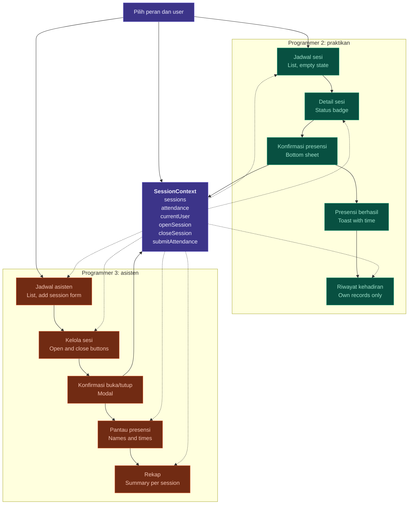

# Rancangan Pembagian Tugas Tiga Programmer

Aplikasi presensi sesi dengan dua sisi pengguna: **Praktikan** dan **Asisten**. Semua layar berbagi satu state lewat `SessionContext`.

| Programmer | Peran | Fokus |
|---|---|---|
| Programmer 1 | Foundation and shared state | Fondasi, context, komponen bersama |
| Programmer 2 | Praktikan side | Alur presensi dari sisi praktikan |
| Programmer 3 | Asisten side | Alur pengelolaan sesi dari sisi asisten |

---

## 1. Tabel Pembagian Tugas

| Aspek | Programmer 1<br>*Foundation and shared state* | Programmer 2<br>*Praktikan side* | Programmer 3<br>*Asisten side* |
|---|---|---|---|
| **Use cases** | UC-01 Pilih peran dan identitas<br>UC-12 Ganti peran<br>Rules behind UC-04, UC-07, UC-09 | UC-02 Lihat jadwal<br>UC-03 Lihat detail sesi<br>UC-04 Melakukan presensi<br>UC-05 Lihat catatan kehadiran | UC-06 Lihat jadwal<br>UC-07 Buka sesi<br>UC-08 Pantau presensi<br>UC-09 Tutup sesi<br>UC-10 Lihat rekap<br>UC-11 Tambah sesi |
| **Screens** | Role select<br>User select (form)<br>App shell and navigators | Jadwal list<br>Detail sesi<br>Riwayat kehadiran | Jadwal asisten<br>Kelola sesi (with live attendance)<br>Rekap<br>Tambah sesi (form) |
| **Logic and state** | SessionContext and reducer<br>`openSession`, `closeSession`, `addSession`, `submitAttendance`<br>Block duplicate presensi, block when not open, record time<br>login, logout | Connect screens to context<br>Check if current user already attended<br>Filter riwayat by current user | Connect open, close, add to context<br>Filter attendance by session<br>Count totals for rekap |
| **Interactions** | Role and user form<br>Toast feedback component<br>Reusable modal and bottom sheet | Bottom sheet to confirm presensi<br>Success feedback showing recorded time | Modal to confirm open or close<br>Add-session form with validation |
| **States to handle** | No user selected<br>Empty data | Session belum, buka, tutup<br>Already attended<br>Empty jadwal, empty riwayat | Buttons that depend on status<br>Attendance list empty or filled<br>Empty jadwal, empty rekap |
| **Shared parts** | Builds: `SessionCard`, `StatusBadge`, `EmptyState`, `ConfirmModal`, `BottomSheet`, `Toast`, theme file<br>Builds: `data/dummy.js` | Uses components, context, and theme from Programmer 1 | Uses components, context, and theme from Programmer 1 |
| **Folders owned** | `navigation/`<br>`context/`<br>`data/`<br>`theme/`<br>`components/`<br>`screens/auth/` | `screens/praktikan/` | `screens/asisten/` |
| **Deliverable** | Skeleton and working context pushed first, so others can connect<br>**Final:** role-switch testing and demo run | Full praktikan flow running on shared context<br>**Final:** test cycle from praktikan view | Full asisten flow running on shared context<br>**Final:** test cycle from asisten view |

---

## 2. Detail per Programmer

### Programmer 1 — Foundation and shared state

**Use cases**
- UC-01 Pilih peran dan identitas
- UC-12 Ganti peran
- Aturan (rules) di balik UC-04, UC-07, dan UC-09

**Screens**
- Role select
- User select (form)
- App shell and navigators

**Logic and state**
- `SessionContext` dan reducer
- Action: `openSession`, `closeSession`, `addSession`, `submitAttendance`
- Blokir presensi ganda
- Blokir presensi saat sesi tidak dibuka
- Catat waktu presensi
- Login dan logout

**Interactions**
- Form peran dan user
- Komponen toast feedback
- Modal dan bottom sheet yang reusable

**States to handle**
- Belum ada user yang dipilih
- Data kosong

**Shared parts (dibangun oleh Programmer 1)**
- `SessionCard`
- `StatusBadge`
- `EmptyState`
- `ConfirmModal`
- `BottomSheet`
- `Toast`
- File theme
- `data/dummy.js`

**Deliverable**
- Skeleton dan context yang sudah berjalan, di-push **paling awal** agar programmer lain bisa langsung terhubung.
- Final: pengujian pergantian peran dan demo run.

### Programmer 2 — Praktikan side

**Use cases**
- UC-02 Lihat jadwal
- UC-03 Lihat detail sesi
- UC-04 Melakukan presensi
- UC-05 Lihat catatan kehadiran

**Screens**
- Jadwal list
- Detail sesi
- Riwayat kehadiran

**Logic and state**
- Menghubungkan layar ke context
- Mengecek apakah user saat ini sudah presensi
- Memfilter riwayat berdasarkan user saat ini

**Interactions**
- Bottom sheet untuk konfirmasi presensi
- Feedback sukses yang menampilkan waktu tercatat

**States to handle**
- Sesi belum dibuka, dibuka, ditutup
- Sudah presensi
- Jadwal kosong, riwayat kosong

**Dependensi:** komponen, context, dan theme dari Programmer 1.

**Deliverable**
- Alur praktikan lengkap berjalan di atas shared context.
- Final: test cycle dari sisi praktikan.

### Programmer 3 — Asisten side

**Use cases**
- UC-06 Lihat jadwal
- UC-07 Buka sesi
- UC-08 Pantau presensi
- UC-09 Tutup sesi
- UC-10 Lihat rekap
- UC-11 Tambah sesi

**Screens**
- Jadwal asisten
- Kelola sesi (dengan live attendance)
- Rekap
- Tambah sesi (form)

**Logic and state**
- Menghubungkan aksi buka, tutup, dan tambah ke context
- Memfilter data presensi per sesi
- Menghitung total untuk rekap

**Interactions**
- Modal konfirmasi buka atau tutup sesi
- Form tambah sesi dengan validasi

**States to handle**
- Tombol yang bergantung pada status sesi
- Daftar presensi kosong atau terisi
- Jadwal kosong, rekap kosong

**Dependensi:** komponen, context, dan theme dari Programmer 1.

**Deliverable**
- Alur asisten lengkap berjalan di atas shared context.
- Final: test cycle dari sisi asisten.

---

## 3. Alur Aplikasi dan SessionContext

Panah **solid** berarti menulis ke state. Panah **putus-putus** berarti membaca dari state.



### Peta interaksi dengan SessionContext

| Layar | Pemilik | Interaksi dengan state |
|---|---|---|
| Pilih peran dan user | Programmer 1 | Mengatur `currentUser`, mengarahkan ke sisi praktikan atau asisten |
| Jadwal sesi | Programmer 2 | Membaca `sessions` |
| Detail sesi | Programmer 2 | Membaca `sessions` dan `attendance` |
| Konfirmasi presensi | Programmer 2 | **Menulis** lewat `submitAttendance` |
| Presensi berhasil | Programmer 2 | Menampilkan toast dengan waktu tercatat |
| Riwayat kehadiran | Programmer 2 | Membaca `attendance` milik user saat ini |
| Jadwal asisten | Programmer 3 | Membaca `sessions`, form tambah sesi memakai `addSession` |
| Kelola sesi | Programmer 3 | Membaca `sessions` dan `attendance` |
| Konfirmasi buka/tutup | Programmer 3 | **Menulis** lewat `openSession` / `closeSession` |
| Pantau presensi | Programmer 3 | Membaca `attendance` (nama dan waktu) |
| Rekap | Programmer 3 | Membaca `attendance`, ringkasan per sesi |

---

## 4. Struktur Folder dan Kepemilikan

```text
src/
├── navigation/        # Programmer 1
├── context/           # Programmer 1
├── data/              # Programmer 1  (dummy.js)
├── theme/             # Programmer 1
├── components/        # Programmer 1  (SessionCard, StatusBadge, EmptyState,
│                      #                ConfirmModal, BottomSheet, Toast)
└── screens/
    ├── auth/          # Programmer 1
    ├── praktikan/     # Programmer 2
    └── asisten/       # Programmer 3
```

> Setiap programmer hanya mengubah folder miliknya sendiri untuk meminimalkan konflik merge.

---

## 5. Urutan Kerja

1. **Programmer 1** membuat skeleton, `SessionContext`, komponen bersama, theme, dan `data/dummy.js`, lalu **push lebih dulu**.
2. **Programmer 2** dan **Programmer 3** mengambil hasil push tersebut, lalu mengerjakan layar masing-masing secara paralel di atas context yang sama.
3. Tahap akhir, masing-masing menguji alur penuh:
   - Programmer 1: pengujian pergantian peran dan demo run.
   - Programmer 2: test cycle dari sisi praktikan.
   - Programmer 3: test cycle dari sisi asisten.

---

## 6. Legenda

| Warna | Keterangan |
|---|---|
| Ungu | Programmer 1: shared |
| Hijau | Programmer 2: praktikan |
| Oranye | Programmer 3: asisten |

Solid arrow: writes to state. Dashed arrow: reads from state.
